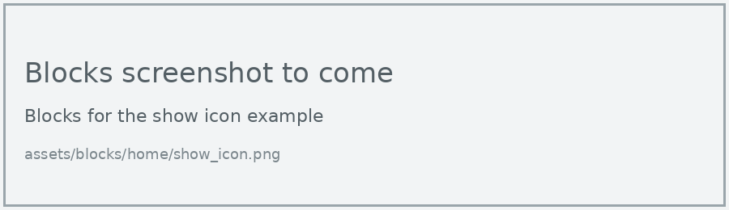

# Griffins' Knowledge Repository

Build and programming tutorials for the RoboCup Junior challenges, plus lessons for the other robots we use in class.

## How to use this site

The tabs along the top split the site into sections:

- **OnStage**, **Rescue Line**, **Rescue Maze** and **Soccer** hold tutorials for each RoboCup Junior challenge. Each tutorial teaches one part of completing that challenge.
- **Tips** holds short notes on techniques we can use in any challenge.
- **Other Robots** holds lessons for the PU Robot, the XGO Robot Dog and the WuKong Manipulator, which we program in MakeCode.
- **Reference** holds the Glossary, which lists every technical term on the site.

The lessons for each robot build on each other, so work through them in order. Before starting any robot in Other Robots, work through [Using MakeCode](other-robots/using-makecode.md).

## Callouts

Coloured boxes called **callouts** highlight different kinds of information. Each type of callout has its own colour and icon, so we can tell at a glance what it's for.

!!! learn "Learning intentions"
    This callout is at the top of every lesson page. It lists what we will learn on that page.

!!! terms "Terminology"
    This callout comes straight after the learning intentions. It lists the new technical terms on the page, with a short definition of each. Every term is also on the [Glossary](reference/glossary.md) page.

!!! primm "PRIMM"
    This callout comes after each example program. It asks us to **predict** what the code will do, **run** it, and **investigate** how it works. Sometimes it asks us to **modify** the code.

!!! note "Code explanation"
    This callout comes after each PRIMM callout and gives a line-by-line explanation of the example program. On the lesson pages it starts closed, so we can make our own prediction first. Click its title to open it.

!!! tip "Tip"
    This callout gives extra information, such as definitions, background facts, comparisons and hints.

!!! warning "Warning"
    This callout warns us about mistakes that are easy to make, or things that will stop our program or robot working.

## Blocks and Python tabs

The robots in Other Robots can be programmed with Blocks or with Python. Each example has a tab for each, and we choose the one we're using:

=== "Blocks"

    { .blocks }

=== "Python"

    ```python linenums="1"
    --8<-- "examples/home/show_icon/main.py"
    ```

When we choose a tab, every other example on the site switches to the same tab, so we only need to choose once.

## Code blocks

Python code is shown in code blocks like the one in the Python tab above. Code blocks have:

- **line numbers**, which match the line numbers in the Code explanation
- a **copy** button in the top-right corner, which copies the code so we can paste it into MakeCode's Python view

## PRIMM

Each example follows the PRIMM steps:

1. **Predict**: read the code and predict what it will do.
2. **Run**: download the program to the robot and see if our prediction was right.
3. **Investigate**: work out what each line of code does.
4. **Modify**: change the code to make it do something different.
5. **Make**: write our own program that uses the same ideas.

The PRIMM callout after each example takes us through the first three steps. The Exercises at the end of each lesson cover modify and make.
