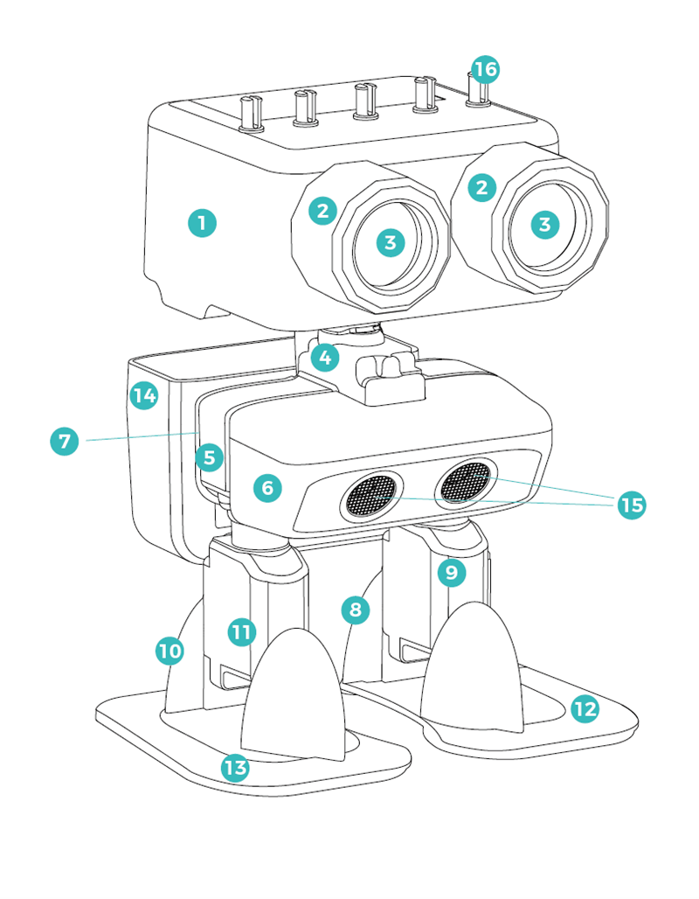
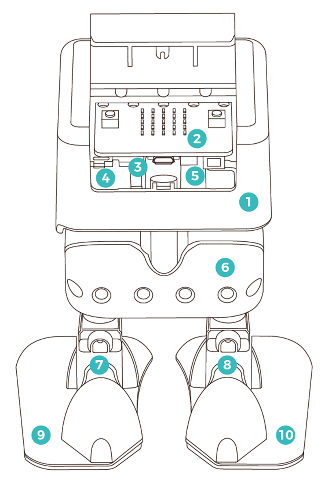

# Lesson 1: Meet the PU Robot

!!! learn "In this lesson we will learn"
    - the names of the PU Robot's main parts and what each one does
    - how to switch the PU Robot on, off and charge it
    - how to take the micro:bit out of the robot's head and put it back
    - how to set up a MakeCode project for the PU Robot
    - what the blocks in the robot PU category do

!!! terms "Terminology"
    - **servo motor** – a motor that can be controlled to turn to an exact angle or spin at a set speed.
    - **degrees of freedom** – the number of separate ways a robot can move. Each servo motor adds one, so the PU Robot has six.
    - **calibration** – when the robot moves its joints to a set starting position after switching on, so it knows where each joint is.
    - **factory program** – the program the robot comes with from the maker, which lets it work with the remote controller.

The PU Robot walks on two legs. Each leg has two **servo motors**, and two more servo motors move its head. The micro:bit in its head tells each servo motor what angle to turn to.

## What we need

- a PU Robot, charged
- a micro:bit V2 (a micro:bit V1 shows the error number 927 and won't work)
- a micro USB data cable
- a small screwdriver to open the robot's head cover
- a computer with Chrome or Edge

## Parts of the robot

Altogether the robot has six servo motors, and each one moves one joint, so the robot has six **degrees of freedom**. Our arms and legs work the same way, with joints that bend and turn, but we have many more degrees of freedom than the robot.

<figure markdown="span">
  { width="420" }
  <figcaption>The outside of the PU Robot. Image: <a href="https://wiki.elecfreaks.com/en/microbit/robot/pu-robot-kit/pu-robot-kit-case-01">ELECFREAKS</a>.</figcaption>
</figure>

| No. | Part | What it does |
| --- | --- | --- |
| 1 | head shell | holds the circuit board, battery and head servo motor, and has holes for building block pins |
| 2 | lamp holder brackets (2) | hold the lamp heads on the head shell |
| 3 | lamp heads (2) | light up in different colours |
| 4 | shoulder bracket | holds the neck servo motor and joins the neck to the chest |
| 5 | chest bracket | holds the leg servo motors and joins the shoulders to the legs |
| 6 | front cover | holds the ultrasonic sensor on the chest |
| 7 | rear cover | keeps the wires tidy, and has pin holes for the backpack and other building blocks |
| 8 | left leg bracket | holds the left foot servo motor |
| 9 | left leg cover | protects the left foot servo motor and joins the leg to the foot |
| 10 | right leg bracket | holds the right foot servo motor |
| 11 | right leg cover | protects the right foot servo motor and joins the leg to the foot |
| 12 | left foot | turned by the left foot servo motor |
| 13 | right foot | turned by the right foot servo motor |
| 14 | backpack | clips onto the rear cover and can carry small things |
| 15 | ultrasonic sensor | measures how far away things are |
| 16 | building block pin adapters (5) | join building block parts to the top of the head |

Inside the head we find the parts that control the robot.

<figure markdown="span">
  { width="420" }
  <figcaption>Inside the head, with the cover off. Image: <a href="https://wiki.elecfreaks.com/en/microbit/robot/pu-robot-kit/pu-robot-kit-case-01">ELECFREAKS</a>.</figcaption>
</figure>

| No. | Part | What it does |
| --- | --- | --- |
| 1 | head shell | holds everything inside the head |
| 2 | micro:bit | the robot's brain, which runs the program |
| 3 | head servo motor | tilts the head up and down |
| 4 | head servo bracket | holds the head servo motor in place |
| 5 | neck bracket | joins the neck and head servo motors to the head shell |
| 6 | rear cover | keeps the wires tidy |
| 7 | left leg bracket | holds the left foot servo motor |
| 8 | right leg bracket | holds the right foot servo motor |
| 9 | left foot | turned by the left foot servo motor |
| 10 | right foot | turned by the right foot servo motor |

## Power and charging

- The black power button is on the robot's chin. Press it once to switch on, and press it twice to switch off.
- After switching on, the robot takes about 2 seconds to do its **calibration**. Wait until it stands still before we touch it.
- To charge the robot, plug a USB cable into the charging port on its chin. Charging takes about 20 to 30 minutes and gives about 20 minutes of use.

!!! warning "Before we start"
    - Downloading our own program replaces the robot's **factory program**. The remote controller then stops working until our teacher puts the factory program back, so we use the remote in [Lesson 2](lesson_02.md) before downloading anything.
    - Never twist the robot's joints by hand while it's switched on. This damages the servo motors.
    - Test the robot on the floor or a low, clear surface. It walks, jumps and can fall off a desk.

## Take out the micro:bit

The micro:bit sits inside the robot's head, so we take it out to connect it to the computer.

1. Switch the robot off by pressing the power button on its chin twice.
    - Why: moving the joints while the robot is on damages the servo motors.
2. Gently turn the robot's body by 90°.
    - Why: this lets us reach the screws that hold the head cover on.
3. Undo the screws and put them somewhere safe, such as a small container.
4. Open the head cover.
5. Look at which way the micro:bit faces, then lift it out.
    - Result: we're holding the micro:bit and we know which way it goes back in.

## Set up a MakeCode project

Follow [Using MakeCode](../using-makecode.md) to create a new project and add the PU Robot extension (search for `pu robot`). A new **robot PU** category appears in the list of block categories. It has these groups:

| Group | What it does |
| --- | --- |
| Setup | the walking speed range and servo trim |
| Actions | built-in modes (greet, dance, explore and more), walking and servo angles |
| Sensors | ultrasonic distance, body roll and pitch, and music tempo |
| Actuators | the coloured lights and eyes |
| Controller | code for a second micro:bit used as a remote control |
| Remote Control | code for the robot to receive radio messages from the remote control |

## Put the micro:bit back

After we download a program, we put the micro:bit back in the robot.

1. Unplug the USB cable.
2. Place the micro:bit back in the head, facing the same way as before.
3. Close the head cover, put the screws back in and turn the body back.
4. Press the power button on the robot's chin once.
    - Result: the robot does its calibration (about 2 seconds), then runs our program.

!!! tip "Do we need to take the micro:bit out every time?"
    Yes. The USB port on the micro:bit is covered while it's inside the head, so we take it out each time we download a new program. Keeping the screws in a container stops them getting lost.

## Exercises

### Exercise 1

Without looking at the tables, can you point to the ultrasonic sensor, the head servo motor and the lamp heads? Check each one with a partner.

### Exercise 2

Can you switch the robot on, wait for its calibration, then switch it off again? Describe what the robot does during calibration.

### Exercise 3

Can you take the micro:bit out of the head and put it back in, facing the right way? Check with a partner before closing the cover.
