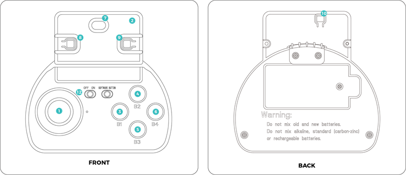

# Lesson 2: Remote Control Show

!!! learn "In this lesson we will learn"
    - how servo motors let the robot move a bit like a person
    - how to drive the robot and start its actions with the remote controller

!!! terms "Terminology"
    - **joystick** – a stick that we push in different directions to control something, which gives a number for how far it's pushed.
    - **autonomous** – able to work by itself, without a person controlling each move.

Before we write our own programs, let's see what the robot can already do. In this lesson we drive it with the remote controller and put on an imitation show.

## What we need

- a PU Robot, charged and still running its factory program
- the remote controller, with a micro:bit V2 inside it running the remote's factory program, and batteries fitted
- a clear space on the floor

!!! warning "Do this lesson before downloading our own program"
    The remote controller only works with the factory program. Once we download our own program to the robot, the remote stops working until our teacher puts the factory program back.

## The remote controller

The remote controller holds a second micro:bit, which sends commands to the robot by radio. We drive with the **joystick** and start actions with buttons B1 to B4. B1 makes the robot **autonomous**: it walks and explores by itself until we take control again.

<figure markdown="span">
  
  <figcaption>The front and back of the remote controller. Image: <a href="https://wiki.elecfreaks.com/en/microbit/robot/pu-robot-kit/pu-robot-kit-case-01">ELECFREAKS</a>.</figcaption>
</figure>

| No. | Control | What it does |
| --- | --- | --- |
| 1 | joystick | push forwards or backwards to walk (the further we push, the faster it goes), tilt left or right to turn (the further we tilt, the sharper the turn), tilt a long way left or right to step sideways, and press it down to rest |
| 2 | tilting the remote | while we use the joystick, tilt the whole remote forwards or backwards to nod the head, or left or right to turn the head |
| 3 | B1 | starts autonomous mode, where the robot walks and explores by itself |
| 4 | B2 | jumps |
| 5 | B3 | dances to music, with the lights changing colour on the beat |
| 6 | B4 | kicks a ball |
| 7 | micro:bit logo | touch it and the robot talks or sings, depending on what it has been doing |
| 8 | micro:bit button A | changes the radio channel up by one and shows it on the display |
| 9 | micro:bit button B | changes the radio channel down by one and shows it on the display |
| 10 | micro:bit reset button | restarts the remote and sets the channel back to 6 |
| 11 | buttons A and B together | shows the real channel number, which is the number on the display plus 160 |
| 12 | power switch | switches the remote on and off |

!!! tip "Wait for each jump and kick to finish"
    Pressing B2 or B4 again before the robot finishes the last jump or kick can make it fall over. Wait until it stands still before pressing again.

!!! warning "Each pair needs its own channel"
    If several robots and remotes in the room are on the same channel, one remote can control more than one robot. Our teacher will tell us which channel to use.

## Drive the robot

1. Put the robot on the floor and press the power button on its chin once.
    - Why: the robot needs to be on a flat surface for its calibration.
    - Result: the robot moves its joints and then stands still.
2. Switch the remote on with its power switch.
    - Result: the remote's micro:bit display shows the channel number.
3. Set the channel our teacher gave us, using buttons A and B on the remote's micro:bit.
    - Why: this stops our remote controlling another pair's robot.
4. Push the joystick gently forwards, then let go.
    - Result: the robot walks forward slowly, then stops.
5. Try each of B1 to B4, waiting for each action to finish.
    - Result: the robot explores by itself, jumps, dances and kicks.

## Imitation show

Robots like the PU Robot are designed by copying how people and animals move. Let's turn that around and see how well the robot can copy us.

1. One person does a simple move, such as walking forward three steps, nodding, looking left and right, or kicking.
2. Their partner uses the remote to make the robot copy the move.
3. Swap roles, and try a move that combines two actions, such as walking then kicking.

As we watch, think about which of the robot's servo motors move for each action, and what the robot can't copy because it doesn't have the joints.

## Exercises

### Exercise 1

Can you drive the robot across the room, turn it around, and drive it back to where it started?

### Exercise 2

Choose one move the robot copied well and one it couldn't copy. For each one, explain why, using the words servo motor and degrees of freedom.

### Exercise 3

Can you plan a 30-second show that uses walking, turning, a head movement and at least two of B1 to B4? Write the steps down in order, then perform it for the class.
