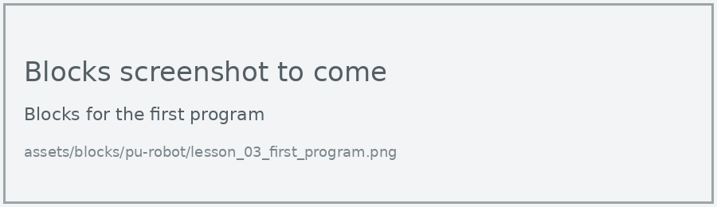
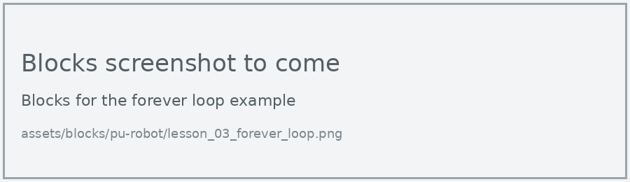

# Lesson 3: First Program

!!! learn "In this lesson we will learn"
    - how to use PRIMM to learn from example programs
    - how code in **on start** runs once, in order
    - how to make the PU Robot show a face and walk
    - how a **forever** loop repeats code

!!! terms "Terminology"
    - **PRIMM** – a five-step way of learning to code: Predict, Run, Investigate, Modify and Make.
    - **on start** – the block whose code runs once, as soon as the micro:bit is switched on.
    - **sequence** – code running one line after the other, from the top of the program to the bottom.
    - **millisecond** – one thousandth of a second, so 1000 milliseconds make 1 second.
    - **forever loop** – a loop that repeats the code inside it again and again for as long as the micro:bit is switched on.
    - **function** – a named block of code that we can run again and again whenever we need it.

Now that we can get a program onto the robot, let's write our first one. It checks that everything works: the robot shows a smiley face, then walks forward.

## Learning with PRIMM

Every example on this site follows the **PRIMM** steps. Before we run an example, we **predict** what it will do. Then we **run** it to check, and **investigate** how each line works. The Exercises at the end of each lesson ask us to **modify** the code and **make** our own programs. The [home page](../../index.md#primm) explains each step.

## On start

Code in the **on start** block runs once, as soon as the micro:bit is switched on. It runs as a **sequence**: the first block, then the next, all the way to the bottom.

=== "Blocks"

    { .blocks }

    Blocks used: **set walk speed range** (robot PU > Setup), **show icon** (Basic), **walk forward for 3 steps at speed 5** (robot PU > Actions).

=== "Python"

    ```python linenums="1"
    --8<-- "examples/other/pu_robot/lesson_03/first_program/main.py"
    ```

Download the program and put the micro:bit back in the robot. Place the robot on the floor with clear space in front of it, because it walks as soon as its calibration is finished. Then switch it on.

!!! primm "PRIMM"
    1. **Predict** what you think the robot will do. Be specific.
    2. **Run** the program.
    3. Time to **investigate** the code. What does each line do?

??? note "Code explanation"
    - **line 1** → sets the fastest forward and backward walking speeds to level 2.
    - **line 2** → shows a happy face on the micro:bit's display.
    - **line 3** → makes the robot walk forward 3 steps at speed 5.

!!! tip "Why set the walk speed range?"
    The walk speed range sets how fast the robot is allowed to walk. Setting it at the start of every program means the robot always walks at a speed we know, instead of whatever was used last.

## Forever loop

The **forever** block repeats the code inside it for as long as the micro:bit is on. When the last block inside it finishes, it goes back to the first one.

=== "Blocks"

    { .blocks }

    Blocks used: **forever**, **show icon** and **pause (ms)** (Basic).

=== "Python"

    ```python linenums="1"
    --8<-- "examples/other/pu_robot/lesson_03/forever_loop/main.py"
    ```

In Python, the forever block becomes a **function** called `on_forever`. The last line tells the micro:bit to run that function over and over.

!!! primm "PRIMM"
    1. **Predict** what you think will appear on the display. Be specific.
    2. **Run** the program.
    3. Time to **investigate** the code. What does each line do?

??? note "Code explanation"
    - **line 1** → defines a function called `on_forever` that holds the code to repeat.
    - **line 2** → shows a happy face on the display.
    - **line 3** → waits for 1000 milliseconds (1 second).
    - **line 4** → shows a heart on the display.
    - **line 5** → waits for another second.
    - **line 6** → tells the micro:bit to run `on_forever` again and again.

!!! warning "Indent the code inside a function"
    In Python, the lines inside `on_forever` must start with 4 spaces. That's how Python knows they belong to the function. If a line isn't indented, it's not part of the loop.

## Exercises

!!! primm "PRIMM"
    Time to **modify** the code and see what happens.

Each exercise has starter code. Copy it into MakeCode's Python view, or build the same program in Blocks, then change it.

### Exercise 1

Can you make the robot show a heart, walk forward 5 steps, then show a happy face?

Starter code:

```python linenums="1"
--8<-- "examples/other/pu_robot/lesson_03/ex1_heart_walk/main.py"
```

### Exercise 2

Can you make the display show a countdown of 3, 2, 1 before the robot walks forward? Use the **show number** block (Basic).

Starter code:

```python linenums="1"
--8<-- "examples/other/pu_robot/lesson_03/ex2_countdown/main.py"
```

### Exercise 3

Can you make a forever loop that shows a happy face, then a sad face, then a surprised face, with half a second between each one?

Starter code:

```python linenums="1"
--8<-- "examples/other/pu_robot/lesson_03/ex3_faces/main.py"
```
