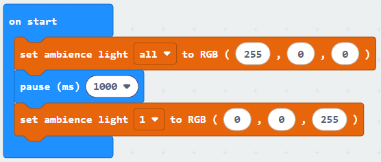
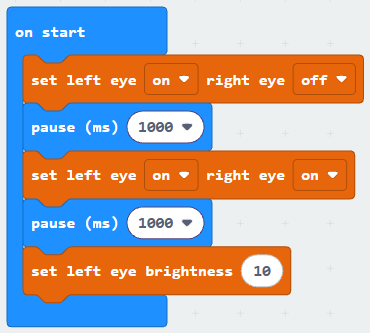
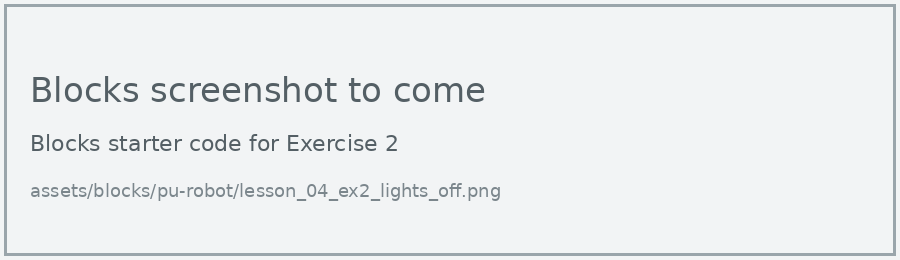
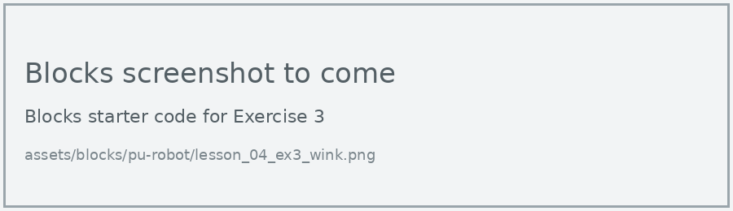
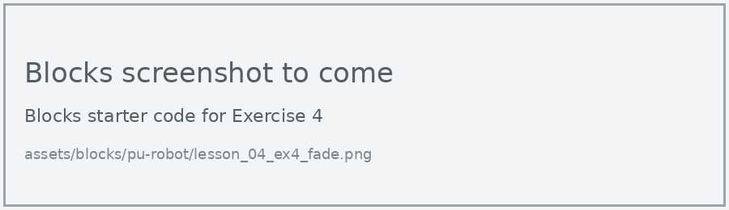

# Lesson 4: Lights and Eyes

!!! learn "In this lesson we will learn"
    - how to set the colour of the robot's ambience lights
    - how to turn the robot's eyes on and off and change their brightness
    - how to repeat code a set number of times with a repeat loop

!!! terms "Terminology"
    - **LED** – a light-emitting diode, which is a small electronic light; the micro:bit display is a 5 × 5 grid of them.
    - **RGB** – a way of describing a colour by how much red, green and blue light it contains.
    - **brightness** – how strongly a light shines, from `0` (off) to `100` (fully on).
    - **repeat loop** – a loop that runs its code a set number of times, written as a `for` loop in Python.
    - **indentation** – spaces at the start of a line (four in Python) that show which code belongs to a loop or other block.

The PU Robot has four coloured ambience lights and two eyes. Each light is an **LED**. Lights are a great way for the robot to show us what it's doing, so we'll use them a lot in later lessons.

## Ambience lights

We set each light's colour with three **RGB** numbers: how much red, green and blue to mix, each from 0 to 255. For example, `(255, 0, 0)` is full red and `(255, 255, 0)` is yellow. We can set one light (1 to 4) or all of them at once.

=== "Blocks"

    { .blocks }

    Blocks used: **set ambience light to RGB** (robot PU > Actuators), **pause (ms)** (Basic).

=== "Python"

    ```python linenums="1"
    --8<-- "examples/other/pu_robot/lesson_04/ambience_light/main.py"
    ```

!!! primm "PRIMM"
    1. **Predict** which lights will change, and to what colour. Be specific.
    2. **Run** the program.
    3. Time to **investigate** the code. What does each line do?

??? note "Code explanation"
    - **line 1** → sets all four ambience lights to red (255 red, 0 green, 0 blue).
    - **line 2** → waits for 1 second.
    - **line 3** → sets light 1 to blue, while the other three stay red.

!!! tip "Mixing colours"
    | Colour | Red | Green | Blue |
    | --- | --- | --- | --- |
    | red | 255 | 0 | 0 |
    | green | 0 | 255 | 0 |
    | blue | 0 | 0 | 255 |
    | yellow | 255 | 255 | 0 |
    | purple | 255 | 0 | 255 |
    | white | 255 | 255 | 255 |
    | off | 0 | 0 | 0 |

## Eyes

Each eye can be on or off, and we can change its **brightness** from 0 to 100.

=== "Blocks"

    { .blocks }

    Blocks used: **set left eye right eye** and **set left eye brightness** (robot PU > Actuators), **pause (ms)** (Basic).

=== "Python"

    ```python linenums="1"
    --8<-- "examples/other/pu_robot/lesson_04/eyes/main.py"
    ```

!!! primm "PRIMM"
    1. **Predict** what the robot's eyes will do. Be specific.
    2. **Run** the program.
    3. Time to **investigate** the code. What does each line do?

??? note "Code explanation"
    - **line 1** → turns the left eye on and the right eye off, like a wink.
    - **line 2** → waits for 1 second.
    - **line 3** → turns both eyes on.
    - **line 4** → waits for 1 second.
    - **line 5** → dims the left eye to brightness 10.

## Repeat loop

To flash the lights five times, we could copy the same blocks five times. That's a lot of blocks, and if we want to change the colour we have to change it five times. A **repeat loop** runs the code inside it a set number of times instead.

=== "Blocks"

    { .blocks }

    Blocks used: **repeat 5 times** (Loops), **set ambience light to RGB** (robot PU > Actuators), **pause (ms)** (Basic).

=== "Python"

    ```python linenums="1"
    --8<-- "examples/other/pu_robot/lesson_04/repeat_flash/main.py"
    ```

!!! primm "PRIMM"
    1. **Predict** what the lights will do, and how many times. Be specific.
    2. **Run** the program.
    3. Time to **investigate** the code. What does each line do?

??? note "Code explanation"
    - **line 1** → starts a loop that runs the indented code 5 times.
    - **line 2** → sets all the lights to red.
    - **line 3** → waits for half a second.
    - **line 4** → sets all the lights to blue.
    - **line 5** → waits for half a second, then the loop goes back to line 2 until it has run 5 times.

In Python, the repeat block becomes `for index in range(5):`. The **indentation** of lines 2 to 5 shows that they're inside the loop.

## Exercises

!!! primm "PRIMM"
    Time to **modify** the code and see what happens.

Each exercise has starter code in Blocks and Python. Build the blocks in MakeCode, or copy the Python into MakeCode's Python view, then change it.

### Exercise 1

Can you make a traffic light sequence on all four lights? It should:

1. show green for 3 seconds
2. show amber (255, 120, 0) for 1 second
3. show red for 3 seconds

Starter code:

=== "Blocks"

    { .blocks }

=== "Python"

    ```python linenums="1"
    --8<-- "examples/other/pu_robot/lesson_04/ex1_traffic_light/main.py"
    ```

### Exercise 2

Can you make each of the four lights a different colour, then turn them off one at a time, one per second?

Starter code:

=== "Blocks"

    { .blocks }

=== "Python"

    ```python linenums="1"
    --8<-- "examples/other/pu_robot/lesson_04/ex2_lights_off/main.py"
    ```

### Exercise 3

Can you make the robot wink 3 times with its left eye, using a repeat loop?

Starter code:

=== "Blocks"

    { .blocks }

=== "Python"

    ```python linenums="1"
    --8<-- "examples/other/pu_robot/lesson_04/ex3_wink/main.py"
    ```

### Exercise 4

Can you make the left eye slowly get brighter, from 0 to 100, using a repeat loop? Hint: in a repeat loop, `index` counts up 0, 1, 2 and so on, so `index * 10` counts up in tens.

Starter code:

=== "Blocks"

    { .blocks }

=== "Python"

    ```python linenums="1"
    --8<-- "examples/other/pu_robot/lesson_04/ex4_fade/main.py"
    ```
