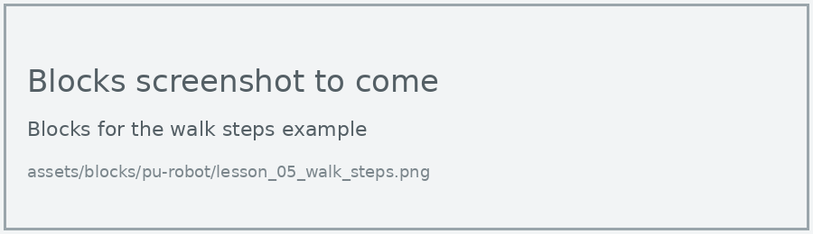
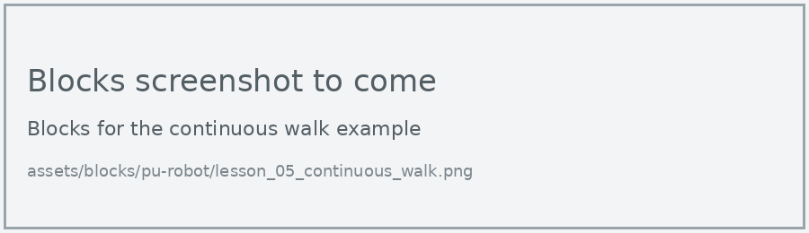

# Lesson 5: Walking

!!! learn "In this lesson we will learn"
    - how to walk a set number of steps in any direction
    - how to make the robot keep walking until we tell it to stop
    - how the walk speed range changes continuous walking

In Lesson 2, the robot walked forward 3 steps. The walk block can also walk backward, step sideways and turn. There's also a second way to walk: set a direction and let the robot keep going until we stop it.

## Walk a set number of steps

The **walk** block takes three things: the direction, the number of steps and the speed (1 to 10). The robot finishes all its steps before the program moves on to the next block.

=== "Blocks"

    { .blocks }

    Blocks used: **walk for steps at speed** (robot PU > Actions), **pause (ms)** (Basic).

=== "Python"

    ```python linenums="1"
    --8<-- "examples/other/pu_robot/lesson_05/walk_steps/main.py"
    ```

!!! primm "PRIMM"
    1. **Predict** where the robot will end up. Be specific.
    2. **Run** the program.
    3. Time to **investigate** the code. What does each line do?

??? note "Code explanation"
    - **line 1** → walks the robot forward 5 steps at speed 5.
    - **line 2** → waits for 1 second.
    - **line 3** → turns the robot right on the spot for 4 steps at speed 5.

The directions are `FORWARD`, `BACKWARD`, `SIDE_LEFT`, `SIDE_RIGHT`, `LEFT_TURN` and `RIGHT_TURN`.

## Keep walking

The **set robot move direction** block starts the robot walking and lets the program carry on straight away. The robot keeps walking until we use **stop action**. Its speed comes from the walk speed range we set in Lesson 2.

=== "Blocks"

    { .blocks }

    Blocks used: **set walk speed range** (robot PU > Setup), **set robot move direction** and **stop action** (robot PU > Actions), **pause (ms)** (Basic).

=== "Python"

    ```python linenums="1"
    --8<-- "examples/other/pu_robot/lesson_05/continuous_walk/main.py"
    ```

!!! primm "PRIMM"
    1. **Predict** how long the robot will walk for.
    2. **Run** the program.
    3. Time to **investigate** the code. What does each line do?

??? note "Code explanation"
    - **line 1** → sets the fastest forward and backward walking speeds to level 2.
    - **line 2** → starts the robot walking forward.
    - **line 3** → waits 3 seconds while the robot keeps walking.
    - **line 4** → stops the robot.

!!! tip "Which walking block should we use?"
    - Use **walk for steps** when we know how far we want to go. The program waits until the steps are done.
    - Use **set robot move direction** when we want the robot to keep going while the program does something else, such as checking a sensor. We'll need this in Lesson 7.

## Exercises

!!! primm "PRIMM"
    Time to **modify** the code and see what happens.

Each exercise has starter code. Copy it into MakeCode's Python view, or build the same program in Blocks, then change it.

### Exercise 1

How does the speed setting change how far the robot walks? It should:

1. walk forward 5 steps at speed 2, then measure the distance from a tape start line in centimetres
2. repeat at speeds 5 and 8, running each speed 3 times
3. record the results in a table

What's the relationship between speed and distance travelled?

Starter code:

```python linenums="1"
--8<-- "examples/other/pu_robot/lesson_05/ex1_speed_test/main.py"
```

### Exercise 2

Does the robot move the same distance when it steps side left as when it steps side right? Test each way 3 times and compare.

Starter code:

```python linenums="1"
--8<-- "examples/other/pu_robot/lesson_05/ex2_side_steps/main.py"
```

### Exercise 3

Can you make the robot walk in a square and finish close to where it started? Hint: use a repeat loop, and test how many turning steps make a quarter turn.

Starter code:

```python linenums="1"
--8<-- "examples/other/pu_robot/lesson_05/ex3_square/main.py"
```

### Exercise 4

Can you change the walk speed range so the robot walks faster forward than backward? Test it with **set robot move direction**. The forward level goes from 0 to 4, and the backward level from 0 to 3.

Starter code:

```python linenums="1"
--8<-- "examples/other/pu_robot/lesson_05/ex4_speed_range/main.py"
```
