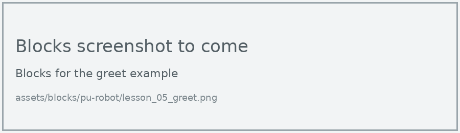
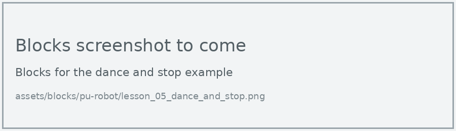
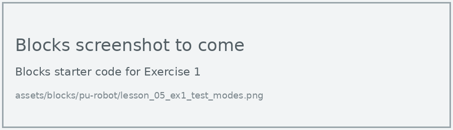
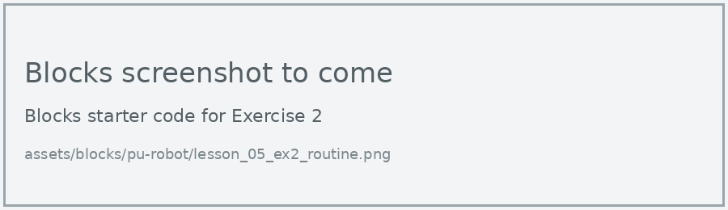
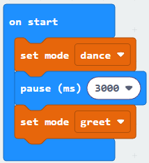

# Lesson 5: Built-in Modes

!!! learn "In this lesson we will learn"
    - what the PU Robot's six built-in modes do
    - how to start a mode with the **set mode** block
    - how to stop a mode with the **stop action** block

The PU Robot has six built-in modes: greet, rest, explore, jump, dance and kick. Each one is a whole routine that ELECFREAKS has already programmed, so one block makes the robot do something quite complicated.

## Set mode

=== "Blocks"

    { .blocks }

    Blocks used: **set mode** (robot PU > Actions).

=== "Python"

    ```python linenums="1"
    --8<-- "examples/other/pu_robot/lesson_05_greet.py"
    ```

!!! primm "PRIMM"
    1. **Predict** what you think the robot will do when it greets us. Be specific.
    2. **Run** the program.
    3. Time to **investigate** the code. What does each line do?

??? note "Code explanation"
    === "Blocks"

        - **on start** → runs the blocks inside once, when the program starts.
            - **set mode greet** → starts the robot's greet mode.

    === "Python"

        - **line 1** → starts the robot's greet mode.

In Python, each mode is an option of `robotPu.Action`, written in capitals: `GREET`, `REST`, `EXPLORE`, `JUMP`, `DANCE` and `KICK`.

## Stop action

Some modes keep going until we tell the robot to stop. Dance keeps dancing, for example. The **stop action** block ends the mode and puts the robot back to standing still.

=== "Blocks"

    { .blocks }

    Blocks used: **set mode** and **stop action** (robot PU > Actions), **pause (ms)** (Basic).

=== "Python"

    ```python linenums="1"
    --8<-- "examples/other/pu_robot/lesson_05_dance_and_stop.py"
    ```

Dance reacts to sound, so play some music nearby before running this program.

!!! primm "PRIMM"
    1. **Predict** how long the robot will dance, and what it will do afterwards.
    2. **Run** the program.
    3. Time to **investigate** the code. What does each line do?

??? note "Code explanation"
    === "Blocks"

        - **on start** → runs the blocks inside once, when the program starts.
            - **set mode dance** → starts the robot's dance mode.
            - **pause (ms) 10000** → waits 10 seconds while the robot dances.
            - **stop action** → stops the dance.

    === "Python"

        - **line 1** → starts the robot's dance mode.
        - **line 2** → waits 10 seconds while the robot dances.
        - **line 3** → stops the dance.

!!! warning "Give the robot space"
    Explore and jump move the robot around. Test them on the floor, with clear space around the robot.

## Exercises

!!! primm "PRIMM"
    Time to **modify** the code and see what happens.

Each exercise has starter code in Blocks and Python. Build the blocks in MakeCode, or copy the Python into MakeCode's Python view, then change it.

### Exercise 1

Can you test all six modes, one at a time, by changing the mode in the starter code? Record what each mode does in a table with the columns Mode, What the robot did and How it stopped.

Starter code:

=== "Blocks"

    { .blocks }

=== "Python"

    ```python linenums="1"
    --8<-- "examples/other/pu_robot/lesson_05_ex1_test_modes.py"
    ```

### Exercise 2

Can you make a routine that greets us, dances for 5 seconds, stops, then kicks?

Starter code:

=== "Blocks"

    { .blocks }

=== "Python"

    ```python linenums="1"
    --8<-- "examples/other/pu_robot/lesson_05_ex2_routine.py"
    ```

### Exercise 3

What happens if we use **set mode** to start a new mode while another mode is still running? Why do you think this happens?

Starter code:

=== "Blocks"

    { .blocks }

=== "Python"

    ```python linenums="1"
    --8<-- "examples/other/pu_robot/lesson_05_ex3_change_mode.py"
    ```
