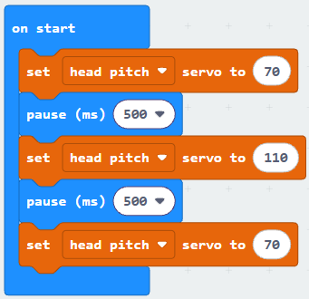
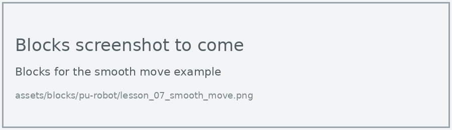
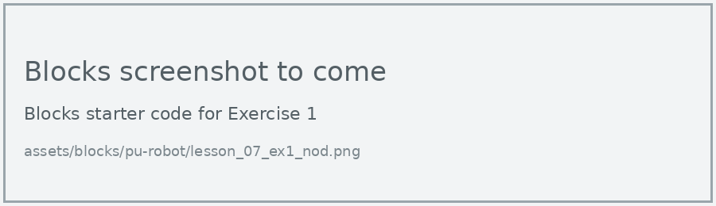
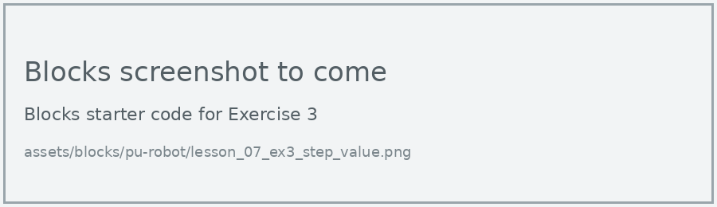
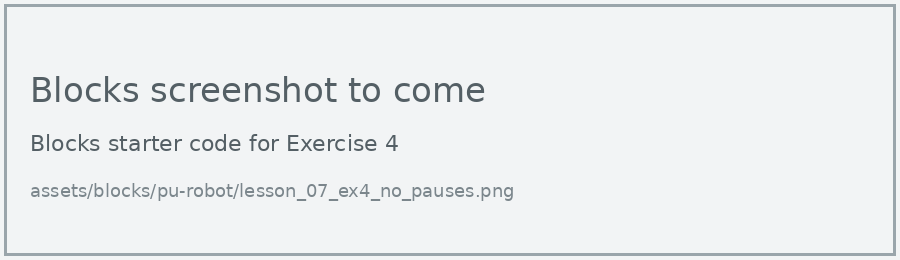

# Lesson 7: Moving Joints

!!! learn "In this lesson we will learn"
    - how to turn one servo motor to an exact angle
    - how to move a servo motor smoothly
    - how to make the robot nod and shake its head

!!! terms "Terminology"
    - **degree** – the unit for measuring angles, where a full turn is 360 degrees and a quarter turn is 90 degrees.
    - **running in the background** – carrying on by itself once started while the rest of the program keeps running.

So far, the robot's built-in blocks have moved all its servo motors for us. Now let's move one joint at a time. The robot has six joints we can move: left foot, left leg, right foot, right leg, head offset (turning the head side to side) and head pitch (tilting the head up and down).

## Set a servo angle

Each servo motor turns to an angle from 0 to 180 **degrees**. For every joint, 90 is the centre position.

=== "Blocks"

    { .blocks }

    Blocks used: **set servo to** (robot PU > Actions), **pause (ms)** (Basic).

=== "Python"

    ```python linenums="1"
    --8<-- "examples/other/pu_robot/lesson_07/set_servo/main.py"
    ```

!!! primm "PRIMM"
    1. **Predict** what the robot's head will do. Be specific.
    2. **Run** the program.
    3. Time to **investigate** the code. What does each line do?

??? note "Code explanation"
    - **line 1** → tilts the head to 70 degrees.
    - **line 2** → waits for half a second.
    - **line 3** → tilts the head the other way, to 110 degrees.
    - **line 4** → waits for half a second.
    - **line 5** → moves the head back to the centre, 90 degrees.

!!! warning "Stay between 60 and 120"
    The servo motors can turn from 0 to 180 degrees, but the robot's body gets in the way at the ends. Keep angles between 60 and 120 to protect the servo motors.

## Smooth movement

**Set servo** jumps straight to the new angle. **Smooth move** turns the servo a few degrees at a time, so the movement looks more natural. The step value (1 to 20) sets how many degrees it moves each time: small steps are slow and smooth, big steps are quick.

Smooth move is **running in the background**. It starts the servo moving and the program carries straight on, so we add a pause to give the head time to get there.

=== "Blocks"

    { .blocks }

    Blocks used: **smooth move servo to with step** (robot PU > Actions), **pause (ms)** (Basic).

=== "Python"

    ```python linenums="1"
    --8<-- "examples/other/pu_robot/lesson_07/smooth_move/main.py"
    ```

!!! primm "PRIMM"
    1. **Predict** how this movement will look different from the first example.
    2. **Run** the program.
    3. Time to **investigate** the code. What does each line do?

??? note "Code explanation"
    - **line 1** → starts turning the head to 60 degrees, 2 degrees at a time.
    - **line 2** → waits 2 seconds while the head turns.
    - **line 3** → starts turning the head the other way, to 120 degrees.
    - **line 4** → waits 2 seconds while the head turns.
    - **line 5** → turns the head back to the centre, 90 degrees.

## Exercises

!!! primm "PRIMM"
    Time to **modify** the code and see what happens.

Each exercise has starter code in Blocks and Python. Build the blocks in MakeCode, or copy the Python into MakeCode's Python view, then change it.

### Exercise 1

Can you make the robot nod "yes" 3 times using a repeat loop?

Starter code:

=== "Blocks"

    { .blocks }

=== "Python"

    ```python linenums="1"
    --8<-- "examples/other/pu_robot/lesson_07/ex1_nod/main.py"
    ```

### Exercise 2

Can you make the robot shake its head "no" by moving the head offset joint?

Starter code:

=== "Blocks"

    { .blocks }

=== "Python"

    ```python linenums="1"
    --8<-- "examples/other/pu_robot/lesson_07/ex2_shake/main.py"
    ```

### Exercise 3

What difference does the step value make in smooth move? Try steps of 1, 5 and 20, and describe how each one looks.

Starter code:

=== "Blocks"

    { .blocks }

=== "Python"

    ```python linenums="1"
    --8<-- "examples/other/pu_robot/lesson_07/ex3_step_value/main.py"
    ```

### Exercise 4

What happens if we take the pauses out of the smooth move example? Why do you think this happens?

Starter code:

=== "Blocks"

    { .blocks }

=== "Python"

    ```python linenums="1"
    --8<-- "examples/other/pu_robot/lesson_07/ex4_no_pauses/main.py"
    ```
