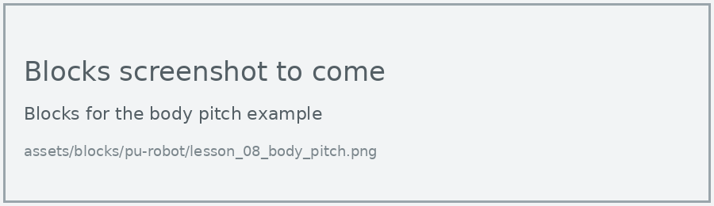
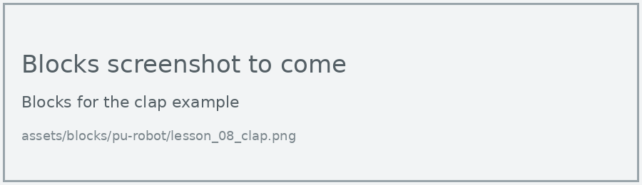
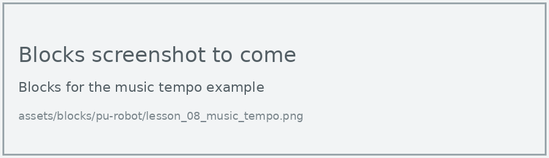

# Lesson 8: Balance and Sound

!!! learn "In this lesson we will learn"
    - how to read how far the robot's body is tilted
    - how to start an action with a clap, using an event
    - how to read the tempo of music playing nearby

!!! terms "Terminology"
    - **roll** – turning around the x-axis, like a plane dipping one wing.
    - **event** – something that happens which the program needs to respond to, such as a loud sound.
    - **event handler** – the code that responds to a particular event, such as making the robot jump when it hears a clap.
    - **microphone** – an input device that detects sound and measures how loud it is.
    - **tempo** – the speed of a tune, measured in beats per minute.

The PU Robot can feel how its body is tilted, so it knows if it's leaning or has fallen over. The micro:bit V2 inside it also has a **microphone**, so the robot can hear us too.

## Body tilt

The robot measures two kinds of tilt. **Body pitch** is tilting forwards and backwards. **Body roll** is tilting from side to side.

=== "Blocks"

    { .blocks }

    Blocks used: **forever**, **show number** and **pause (ms)** (Basic), **body pitch** (robot PU > Sensors).

=== "Python"

    ```python linenums="1"
    --8<-- "examples/other/pu_robot/lesson_08/body_pitch/main.py"
    ```

Switch the robot on, then gently tilt the whole robot forwards and backwards. Don't bend its joints.

!!! primm "PRIMM"
    1. **Predict** what numbers will appear as you tilt the robot forwards, then backwards.
    2. **Run** the program.
    3. Time to **investigate** the code. What does each line do?

??? note "Code explanation"
    - **line 1** → defines the function that the forever loop repeats.
    - **line 2** → reads the body pitch and shows it on the display.
    - **line 3** → waits half a second, so the number is easier to read.
    - **line 4** → tells the micro:bit to run `on_forever` again and again.

## React to a clap

A clap is an **event**. Instead of checking for it in a forever loop, we give MakeCode an **event handler**: code that runs by itself whenever the event happens. In Blocks, it's the **on loud sound** block. In Python, it's a function plus a line that connects it to the event.

=== "Blocks"

    { .blocks }

    Blocks used: **on loud sound** (Input), **set mode** (robot PU > Actions).

=== "Python"

    ```python linenums="1"
    --8<-- "examples/other/pu_robot/lesson_08/clap/main.py"
    ```

!!! primm "PRIMM"
    1. **Predict** what will happen when you clap near the robot.
    2. **Run** the program.
    3. Time to **investigate** the code. What does each line do?

??? note "Code explanation"
    - **line 1** → defines a function called `on_sound_loud`, which will run when there's a loud sound.
    - **line 2** → starts the robot's jump mode.
    - **line 3** → connects `on_sound_loud` to the loud sound event.

!!! warning "Test the clap first"
    The head cover can muffle sound, and the robot's own servo motors make noise. Test how loud a clap needs to be, and check that the robot moving doesn't set off the event by itself.

## Music tempo

The robot can listen to music and work out its **tempo** in beats per minute (BPM). This is how the dance mode keeps time.

=== "Blocks"

    { .blocks }

    Blocks used: **forever**, **show number** and **pause (ms)** (Basic), **music tempo** (robot PU > Sensors).

=== "Python"

    ```python linenums="1"
    --8<-- "examples/other/pu_robot/lesson_08/music_tempo/main.py"
    ```

!!! primm "PRIMM"
    1. **Predict** what the display will show with no music, and with music playing.
    2. **Run** the program, then play a song with a steady beat nearby.
    3. Time to **investigate** the code. What does each line do?

??? note "Code explanation"
    - **line 1** → defines the function that the forever loop repeats.
    - **line 2** → reads the music tempo and shows it on the display.
    - **line 3** → waits 1 second before reading it again.
    - **line 4** → tells the micro:bit to run `on_forever` again and again.

## Exercises

!!! primm "PRIMM"
    Time to **modify** the code and see what happens.

Each exercise has starter code. Copy it into MakeCode's Python view, or build the same program in Blocks, then change it.

### Exercise 1

What range of values does body roll give? Change the example to show body roll, tilt the robot gently from side to side, and record the lowest and highest numbers.

Starter code:

```python linenums="1"
--8<-- "examples/other/pu_robot/lesson_08/ex1_body_roll/main.py"
```

### Exercise 2

Can you make the lights turn red when the robot is tilted too far forwards or backwards, and green when it's level? Use your numbers from the first example to choose how far is too far.

Starter code:

```python linenums="1"
--8<-- "examples/other/pu_robot/lesson_08/ex2_tilt_alarm/main.py"
```

### Exercise 3

Can you make the robot greet you when you wave your hand, and jump when you clap?

Starter code:

```python linenums="1"
--8<-- "examples/other/pu_robot/lesson_08/ex3_wave_and_clap/main.py"
```

### Exercise 4

How accurate is the music tempo? Play three songs whose BPM you can look up online, and compare the robot's tempo with the real one.

Starter code:

```python linenums="1"
--8<-- "examples/other/pu_robot/lesson_08/ex4_tempo_test/main.py"
```
