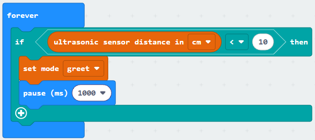
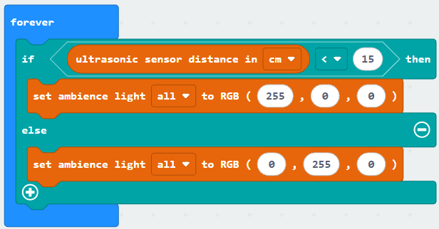
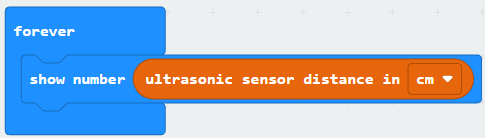
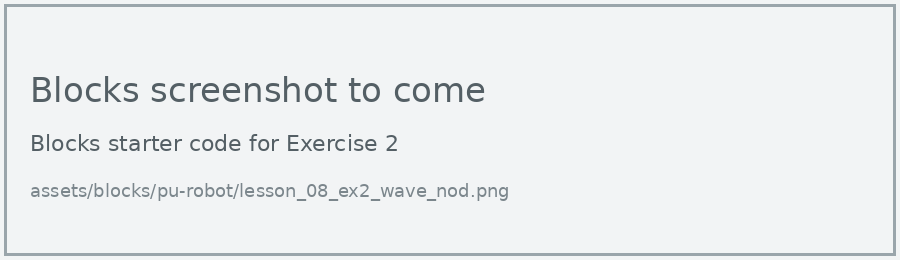
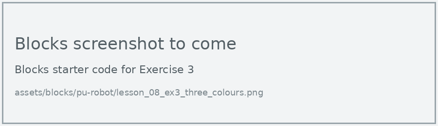
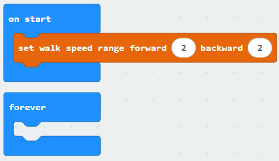

# Lesson 8: Ultrasonic Sensor

!!! learn "In this lesson we will learn"
    - how the ultrasonic sensor measures distance
    - how to use an **if** statement to react to a hand wave
    - how to use **if … else** to choose between two actions

!!! terms "Terminology"
    - **ultrasound** – sound that is too high-pitched for people to hear.
    - **ultrasonic sensor** – a sensor that measures distance by sending out ultrasound and timing how long its echo takes to come back.
    - **condition** – a check that gives back either `True` or `False`.
    - **comparison operator** – a symbol such as `==`, `!=`, `>` or `<` that compares two values and gives back `True` or `False`.
    - **if statement** – code that makes a decision by running its indented block only when its condition is `True`.
    - **else** – the part of an `if` statement that runs when none of the conditions are `True`.

The robot's "eyes" are really an **ultrasonic sensor**. One side sends out a burst of **ultrasound**, and the other side listens for the echo. The longer the echo takes to come back, the further away the object is.

Since we can't press the micro:bit buttons inside the head, the ultrasonic sensor gives us a way to start actions: we wave our hand in front of the robot.

## Read the distance

=== "Blocks"

    { .blocks }

    Blocks used: **forever**, **show number** (Basic), **ultrasonic sensor distance in cm** (robot PU > Sensors).

=== "Python"

    ```python linenums="1"
    --8<-- "examples/other/pu_robot/lesson_08_show_distance.py"
    ```

!!! primm "PRIMM"
    1. **Predict** what the display will show as you move your hand towards the robot.
    2. **Run** the program.
    3. Time to **investigate** the code. What does each line do?

??? note "Code explanation"
    === "Blocks"

        - **forever** → runs the blocks inside again and again.
            - **show number ultrasonic sensor distance in cm** → measures the distance to the nearest object in centimetres and shows it on the display.

    === "Python"

        - **line 1** → defines the function that the forever loop repeats.
        - **line 2** → measures the distance to the nearest object in centimetres and shows it on the display.
        - **line 3** → tells the micro:bit to run `on_forever` again and again.

## React to a hand wave

An **if statement** checks a **condition**. If the condition is `True`, the code inside the if runs. If it's `False`, that code is skipped. Here the condition uses the `<` **comparison operator** to check whether the distance is less than 10 cm.

=== "Blocks"

    { .blocks }

    Blocks used: **forever**, **pause (ms)** (Basic), **if then** and **0 < 0** (Logic), **ultrasonic sensor distance in cm** (robot PU > Sensors), **set mode** (robot PU > Actions).

=== "Python"

    ```python linenums="1"
    --8<-- "examples/other/pu_robot/lesson_08_hand_wave.py"
    ```

!!! primm "PRIMM"
    1. **Predict** what will happen when you hold your hand about 5 cm in front of the robot's eyes.
    2. **Run** the program.
    3. Time to **investigate** the code. What does each line do?

??? note "Code explanation"
    === "Blocks"

        - **forever** → runs the blocks inside again and again.
            - **if ultrasonic sensor distance in cm < 10 then** → checks whether something is closer than 10 cm…
                - **set mode greet** → …and if it is, starts the greet mode.
                - **pause (ms) 1000** → waits 1 second, so one wave doesn't start the greeting several times.

    === "Python"

        - **line 1** → defines the function that the forever loop repeats.
        - **line 2** → checks whether something is closer than 10 cm…
        - **line 3** → …and if it is, starts the greet mode.
        - **line 4** → waits 1 second, so one wave doesn't start the greeting several times.
        - **line 5** → tells the micro:bit to run `on_forever` again and again.

!!! tip "Why the pause?"
    The forever loop checks the distance many times each second. Without the pause, one wave of our hand would be seen several times and start the greeting again and again.

## If … else

Adding **else** gives the if statement a second path. When the condition is `False`, the code under else runs instead.

=== "Blocks"

    { .blocks }

    Blocks used: **forever** (Basic), **if then else** and **0 < 0** (Logic), **ultrasonic sensor distance in cm** (robot PU > Sensors), **set ambience light to RGB** (robot PU > Actuators).

=== "Python"

    ```python linenums="1"
    --8<-- "examples/other/pu_robot/lesson_08_obstacle_alarm.py"
    ```

!!! primm "PRIMM"
    1. **Predict** what colour the lights will be when nothing is near, and when your hand is close.
    2. **Run** the program.
    3. Time to **investigate** the code. What does each line do?

??? note "Code explanation"
    === "Blocks"

        - **forever** → runs the blocks inside again and again.
            - **if ultrasonic sensor distance in cm < 15 then** → checks whether something is closer than 15 cm…
                - **set ambience light all to RGB (255, 0, 0)** → …and if it is, turns all the lights red.
            - **else** → otherwise…
                - **set ambience light all to RGB (0, 255, 0)** → …turns all the lights green.

    === "Python"

        - **line 1** → defines the function that the forever loop repeats.
        - **line 2** → checks whether something is closer than 15 cm…
        - **line 3** → …and if it is, turns all the lights red.
        - **line 4** → otherwise…
        - **line 5** → …turns all the lights green.
        - **line 6** → tells the micro:bit to run `on_forever` again and again.

## Exercises

!!! primm "PRIMM"
    Time to **modify** the code and see what happens.

Each exercise has starter code in Blocks and Python. Build the blocks in MakeCode, or copy the Python into MakeCode's Python view, then change it.

### Exercise 1

How accurate is the ultrasonic sensor? Hold a book at 10, 20 and 30 cm from the robot (measure with a ruler) and record what the display shows each time.

Starter code:

=== "Blocks"

    { .blocks }

=== "Python"

    ```python linenums="1"
    --8<-- "examples/other/pu_robot/lesson_08_ex1_accuracy.py"
    ```

### Exercise 2

Can you make the robot nod its head when you wave your hand in front of it?

Starter code:

=== "Blocks"

    { .blocks }

=== "Python"

    ```python linenums="1"
    --8<-- "examples/other/pu_robot/lesson_08_ex2_wave_nod.py"
    ```

### Exercise 3

Can you make the lights show three colours: red when something is closer than 10 cm, amber between 10 and 20 cm, and green when it's further away? Hint: an if block can have more than one condition. Select the plus sign on the if block to add an **else if**.

Starter code:

=== "Blocks"

    { .blocks }

=== "Python"

    ```python linenums="1"
    --8<-- "examples/other/pu_robot/lesson_08_ex3_three_colours.py"
    ```

### Exercise 4

Can you make the robot walk forward until something is closer than 15 cm, then stop? Hint: start the robot walking with **set robot move direction** before the forever loop.

Starter code:

=== "Blocks"

    { .blocks }

=== "Python"

    ```python linenums="1"
    --8<-- "examples/other/pu_robot/lesson_08_ex4_stop_at_wall.py"
    ```
