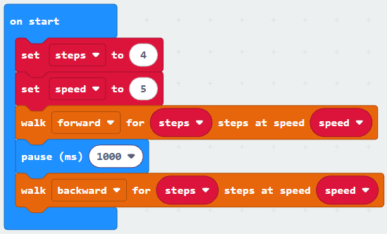
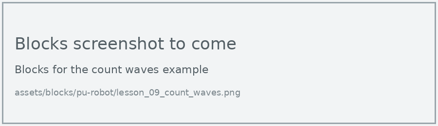
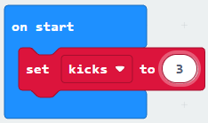
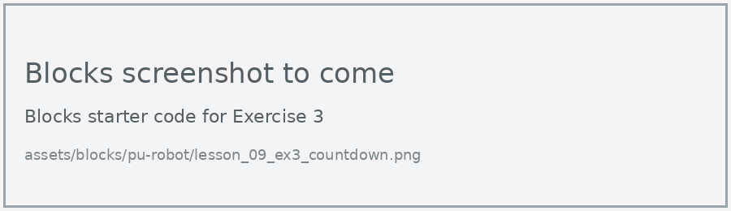

# Lesson 9: Variables

!!! learn "In this lesson we will learn"
    - how to store a value in a variable and use it in our program
    - how one variable can change a setting everywhere it's used
    - how to change a variable while the program runs, such as counting hand waves

!!! terms "Terminology"
    - **variable** – a named place, like a labelled box, that stores a value our program can use and change.
    - **global variable** – a variable that can be used anywhere in the program and keeps its value for as long as the program runs.

So far, we've typed numbers straight into our blocks: 4 steps, speed 5, a pause of 1000. If we want to change how far the robot walks, we have to find and change every one of those numbers. A **variable** lets us store a number once, give it a name, and use the name wherever we need the number.

## Variables for settings

Here the number of steps and the speed are stored in two variables, then both walk blocks use them.

=== "Blocks"

    { .blocks }

    Blocks used: **set steps to** and **set speed to** (Variables, after **Make a Variable**), **walk for steps at speed** (robot PU > Actions), **pause (ms)** (Basic).

=== "Python"

    ```python linenums="1"
    --8<-- "examples/other/pu_robot/lesson_09_walk_settings.py"
    ```

!!! primm "PRIMM"
    1. **Predict** where the robot will end up. Be specific.
    2. **Run** the program.
    3. Time to **investigate** the code. What does each line do?

??? note "Code explanation"
    === "Blocks"

        - **on start** → runs the blocks inside once, when the program starts.
            - **set steps to 4** → creates a variable called `steps` and stores 4 in it.
            - **set speed to 5** → creates a variable called `speed` and stores 5 in it.
            - **walk forward for steps steps at speed speed** → walks the robot forward, using the values in `steps` and `speed`.
            - **pause (ms) 1000** → waits for 1 second.
            - **walk backward for steps steps at speed speed** → walks the robot backward, using the same two variables.

    === "Python"

        - **line 1** → creates a variable called `steps` and stores 4 in it.
        - **line 2** → creates a variable called `speed` and stores 5 in it.
        - **line 3** → walks the robot forward, using the values in `steps` and `speed`.
        - **line 4** → waits for 1 second.
        - **line 5** → walks the robot backward, using the same two variables.

!!! tip "Change one place, change the whole program"
    To make the robot walk further both ways, we only change line 1. Every block that uses `steps` gets the new value.

## Counting with a variable

A variable can also change while the program runs. Here `waves` starts at 0, and each time we wave our hand in front of the robot, it goes up by 1.

=== "Blocks"

    { .blocks }

    Blocks used: **forever**, **show number** and **pause (ms)** (Basic), **if then** and **0 < 0** (Logic), **ultrasonic sensor distance in cm** (robot PU > Sensors), **set waves to** and **change waves by** (Variables).

=== "Python"

    ```python linenums="1"
    --8<-- "examples/other/pu_robot/lesson_09_count_waves.py"
    ```

!!! primm "PRIMM"
    1. **Predict** what the display will show after you wave your hand three times.
    2. **Run** the program.
    3. Time to **investigate** the code. What does each line do?

??? note "Code explanation"
    === "Blocks"

        - **on start** → runs the blocks inside once, when the program starts.
            - **set waves to 0** → creates the `waves` variable and sets it to 0 when the program starts.
        - **forever** → runs the blocks inside again and again.
            - **if ultrasonic sensor distance in cm < 10 then** → checks whether something is closer than 10 cm…
                - **change waves by 1** → …and if it is, adds 1 to `waves`.
                - **show number waves** → shows the number of waves on the display.
                - **pause (ms) 1000** → waits 1 second, so one wave is only counted once.

    === "Python"

        - **line 1** → defines the function that the forever loop repeats.
        - **line 2** → tells Python to use the `waves` variable from the main program, not a new one.
        - **line 3** → checks whether something is closer than 10 cm…
        - **line 4** → …and if it is, adds 1 to `waves`.
        - **line 5** → shows the number of waves on the display.
        - **line 6** → waits 1 second, so one wave is only counted once.
        - **line 7** → tells the micro:bit to run `on_forever` again and again.
        - **line 9** → creates the `waves` variable and sets it to 0 when the program starts.

!!! tip "What does global do?"
    `waves` is created in the main program (line 9), so it's a **global variable**. Inside a function, Python needs the line `global waves` before it can change it. In Blocks, MakeCode adds this for us.

## Exercises

!!! primm "PRIMM"
    Time to **modify** the code and see what happens.

Each exercise has starter code in Blocks and Python. Build the blocks in MakeCode, or copy the Python into MakeCode's Python view, then change it.

### Exercise 1

Can you make the robot kick the number of times stored in a variable called `kicks`, with a 3-second pause after each kick? Hint: put the variable in a repeat loop.

Starter code:

=== "Blocks"

    { .blocks }

=== "Python"

    ```python linenums="1"
    --8<-- "examples/other/pu_robot/lesson_09_ex1_kicks.py"
    ```

### Exercise 2

Can you add a third variable called `rest` for the length of the pause, and use it in the walk settings program?

Starter code:

=== "Blocks"

    { .blocks }

=== "Python"

    ```python linenums="1"
    --8<-- "examples/other/pu_robot/lesson_09_ex2_settings.py"
    ```

### Exercise 3

Can you change the wave counter so it counts down from 5, and the robot greets us when it reaches 0?

Starter code:

=== "Blocks"

    { .blocks }

=== "Python"

    ```python linenums="1"
    --8<-- "examples/other/pu_robot/lesson_09_ex3_countdown.py"
    ```
