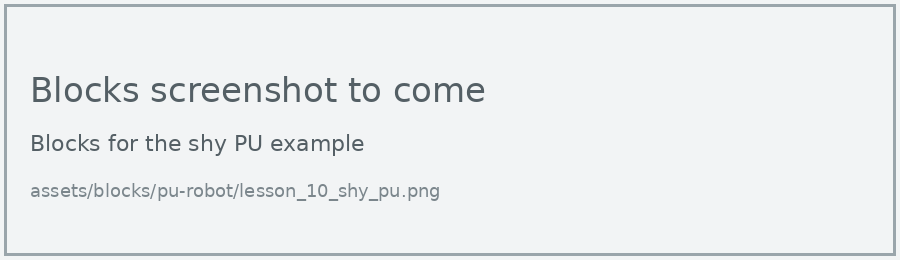

# Lesson 10: Shy PU

!!! learn "In this lesson we will learn"
    - how to use **elif** to choose between more than two actions
    - how thresholds split a sensor reading into zones
    - how to give the robot a personality from its sensor readings

!!! terms "Terminology"
    - **elif** – short for else if, a part of an `if` statement that checks another condition when the conditions before it were `False`.
    - **threshold** – a set value that a reading must reach before the program counts it, such as the distance that counts as too close.

In Lesson 8, the robot had two choices: red if something was close, green if not. Let's give it a shy personality instead, with three ways to behave depending on how close we are:

| Distance | Mood | What the robot does |
| --- | --- | --- |
| more than 30 cm | brave | green lights, walks forward |
| 10 to 30 cm | nervous | amber lights, shakes its head |
| less than 10 cm | scared | red lights, steps backward |

The numbers 30 and 10 are **thresholds**. They split the distance into three zones.

## If, elif, else

To choose between three actions, we add **elif** between the if and the else. Python checks each condition in order and runs the first one that's `True`. If none are `True`, it runs the else.

=== "Blocks"

    { .blocks }

    Blocks used: **forever** and **pause (ms)** (Basic), **set distance to** and **distance** (Variables), **ultrasonic sensor distance in cm** (robot PU > Sensors), **if then else if then else** and **0 > 0** (Logic), **set ambience light to RGB** (robot PU > Actuators), **walk for steps at speed** and **set servo to** (robot PU > Actions).

=== "Python"

    ```python linenums="1"
    --8<-- "examples/other/pu_robot/lesson_10/shy_pu/main.py"
    ```

Place the robot on the floor with clear space in front, then slowly walk towards it.

!!! primm "PRIMM"
    1. **Predict** what the robot will do as you get closer and closer.
    2. **Run** the program.
    3. Time to **investigate** the code. What does each line do?

??? note "Code explanation"
    - **line 1** → defines the function that the forever loop repeats.
    - **line 2** → tells Python to use the `distance` variable from the main program.
    - **line 3** → measures the distance once and stores it in `distance`.
    - **line 4** → checks whether we're further than 30 cm away…
    - **line 5** → …and if we are, turns the lights green…
    - **line 6** → …and walks forward 1 step.
    - **line 7** → otherwise, checks whether we're further than 10 cm away…
    - **line 8** → …and if we are, turns the lights amber…
    - **line 9** → …and turns the head to one side.
    - **line 10** → waits 300 milliseconds.
    - **line 11** → turns the head to the other side.
    - **line 12** → waits 300 milliseconds.
    - **line 13** → turns the head back to the centre.
    - **line 14** → otherwise (closer than 10 cm)…
    - **line 15** → …turns the lights red…
    - **line 16** → …and steps backward 2 steps.
    - **line 17** → tells the micro:bit to run `on_forever` again and again.
    - **line 19** → creates the `distance` variable and sets it to 0 when the program starts.

!!! tip "Why store the distance in a variable?"
    If we read the sensor in each condition, the robot would measure three times, and each reading could be slightly different. Measuring once and storing the result means every condition checks the same number.

!!! warning "The order of the conditions matters"
    Python stops at the first condition that's `True`. If we checked `distance > 10` first, a distance of 50 would match it, and the robot would never reach the brave zone.

## Exercises

!!! primm "PRIMM"
    Time to **modify** the code and see what happens.

Each exercise has starter code. Copy it into MakeCode's Python view, or build the same program in Blocks, then change it.

### Exercise 1

Can you change the thresholds to make the robot braver (it only gets nervous when we're much closer)? Test your new thresholds with a ruler.

Starter code:

```python linenums="1"
--8<-- "examples/other/pu_robot/lesson_10/ex1_zones/main.py"
```

### Exercise 2

Can you make the robot's eyes show its mood too: both on when brave, one on when nervous, and both off when scared?

Starter code:

```python linenums="1"
--8<-- "examples/other/pu_robot/lesson_10/ex2_eyes/main.py"
```

### Exercise 3

Can you add a fourth zone, closer than 5 cm, where the robot covers its eyes by turning them off and tilting its head down?

Starter code:

```python linenums="1"
--8<-- "examples/other/pu_robot/lesson_10/ex3_four_zones/main.py"
```
