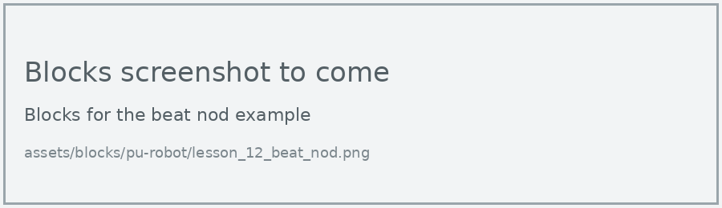
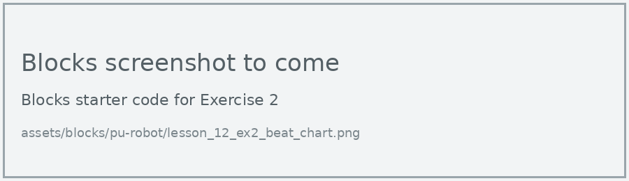
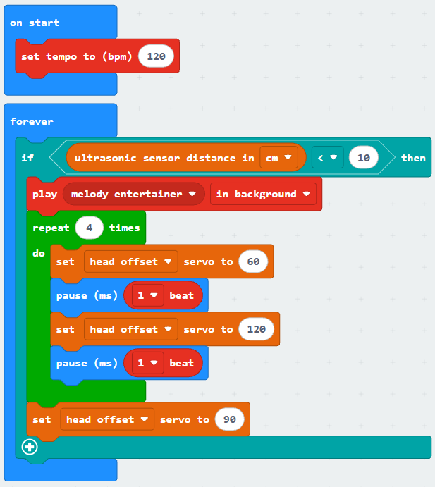

# Lesson 12: Dance to the Beat

!!! learn "In this lesson we will learn"
    - how the tempo sets the length of each beat
    - how to time the robot's moves to the beat
    - how to play music in the background while the robot dances

!!! terms "Terminology"
    - **beat** – one of the regular pulses in a piece of music that we would tap our foot to.

In Lesson 11, the robot listened to music and worked out its tempo. Now the robot gets to make the music and dance to it. The trick is timing: every move needs to last exactly one **beat**.

## Moves on the beat

At a tempo of 120 beats per minute, there are 2 beats every second, so each beat lasts 500 milliseconds. Instead of working this out ourselves, the **beat** block gives us the length of a beat (or half a beat) at the current tempo.

=== "Blocks"

    { .blocks }

    Blocks used: **set tempo to (bpm)** and **1 beat** (Music), **repeat** (Loops), **set servo to** (robot PU > Actions), **pause (ms)** (Basic).

=== "Python"

    ```python linenums="1"
    --8<-- "examples/other/pu_robot/lesson_12_beat_nod.py"
    ```

!!! primm "PRIMM"
    1. **Predict** how many times the robot will nod, and how long the whole program will take.
    2. **Run** the program. Tap your foot along with the nods.
    3. Time to **investigate** the code. What does each line do?

??? note "Code explanation"
    === "Blocks"

        - **on start** → runs the blocks inside once, when the program starts.
            - **set tempo to (bpm) 120** → sets the tempo to 120 beats per minute.
            - **repeat 8 times** → starts a loop that runs 8 times.
                - **set head pitch servo to 70** → tilts the head to 70 degrees.
                - **pause (ms) 1/2 beat** → waits for half a beat.
                - **set head pitch servo to 110** → tilts the head the other way, to 110 degrees.
                - **pause (ms) 1/2 beat** → waits for half a beat, so each nod takes exactly one beat.
            - **set head pitch servo to 90** → moves the head back to the centre when the loop finishes.

    === "Python"

        - **line 1** → sets the tempo to 120 beats per minute.
        - **line 2** → starts a loop that runs 8 times.
        - **line 3** → tilts the head to 70 degrees.
        - **line 4** → waits for half a beat.
        - **line 5** → tilts the head the other way, to 110 degrees.
        - **line 6** → waits for half a beat, so each nod takes exactly one beat.
        - **line 7** → moves the head back to the centre when the loop finishes.

!!! tip "Why use the beat block instead of a number?"
    If we change the tempo on line 1, every pause changes with it. With numbers typed into each pause, we'd have to work out and change every one.

## Dance to music

The **play** block can play a melody in the background. The music starts, and the program carries straight on to the dance moves, so both happen at once. This dance starts when we wave our hand in front of the robot.

=== "Blocks"

    { .blocks }

    Blocks used: **forever** and **pause (ms)** (Basic), **if then** and **0 < 0** (Logic), **ultrasonic sensor distance in cm** (robot PU > Sensors), **play melody in background**, **1 beat** and **set tempo to (bpm)** (Music), **repeat** (Loops), **set servo to** (robot PU > Actions).

=== "Python"

    ```python linenums="1"
    --8<-- "examples/other/pu_robot/lesson_12_dance_with_music.py"
    ```

!!! primm "PRIMM"
    1. **Predict** what will happen when you wave your hand in front of the robot.
    2. **Run** the program.
    3. Time to **investigate** the code. What does each line do?

??? note "Code explanation"
    === "Blocks"

        - **on start** → runs the blocks inside once, when the program starts.
            - **set tempo to (bpm) 120** → sets the tempo to 120 beats per minute when the program starts.
        - **forever** → runs the blocks inside again and again.
            - **if ultrasonic sensor distance in cm < 10 then** → checks whether something is closer than 10 cm…
                - **play melody entertainer in background** → …and if it is, starts playing The Entertainer in the background.
                - **repeat 4 times** → starts a loop that runs 4 times.
                    - **set head offset servo to 60** → turns the head to one side.
                    - **pause (ms) 1 beat** → waits for one beat.
                    - **set head offset servo to 120** → turns the head to the other side.
                    - **pause (ms) 1 beat** → waits for one beat.
                - **set head offset servo to 90** → turns the head back to the centre when the loop finishes.

    === "Python"

        - **line 1** → defines the function that the forever loop repeats.
        - **line 2** → checks whether something is closer than 10 cm…
        - **line 3** → …and if it is, starts playing The Entertainer in the background.
        - **line 4** → starts a loop that runs 4 times.
        - **line 5** → turns the head to one side.
        - **line 6** → waits for one beat.
        - **line 7** → turns the head to the other side.
        - **line 8** → waits for one beat.
        - **line 9** → turns the head back to the centre when the loop finishes.
        - **line 10** → tells the micro:bit to run `on_forever` again and again.
        - **line 12** → sets the tempo to 120 beats per minute when the program starts.

!!! tip "Plan the dance first"
    Before coding a longer dance, draw a beat chart: a row of boxes, one per beat, with the move for each beat written in its box. Then each box becomes a move and a one-beat pause in our code.

## Exercises

!!! primm "PRIMM"
    Time to **modify** the code and see what happens.

Each exercise has starter code in Blocks and Python. Build the blocks in MakeCode, or copy the Python into MakeCode's Python view, then change it.

### Exercise 1

What happens to the dance if we change the tempo to 60, then to 180? Why does one change make the moves faster or slower?

Starter code:

=== "Blocks"

    { .blocks }

=== "Python"

    ```python linenums="1"
    --8<-- "examples/other/pu_robot/lesson_12_ex1_tempo.py"
    ```

### Exercise 2

Can you draw a beat chart for 8 beats of moves (nod, shake, wink and so on), then program it?

Starter code:

=== "Blocks"

    { .blocks }

=== "Python"

    ```python linenums="1"
    --8<-- "examples/other/pu_robot/lesson_12_ex2_beat_chart.py"
    ```

### Exercise 3

Can you make a dance with at least three different moves and changing light colours, timed to a melody of your choice?

Starter code:

=== "Blocks"

    { .blocks }

=== "Python"

    ```python linenums="1"
    --8<-- "examples/other/pu_robot/lesson_12_ex3_my_dance.py"
    ```
