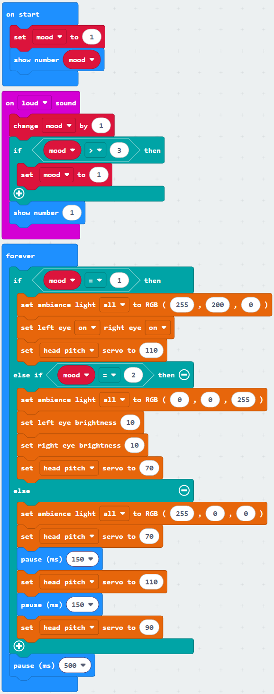
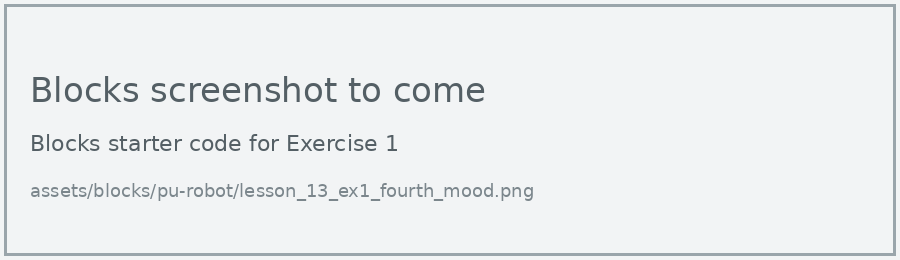
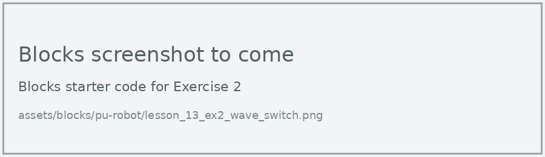
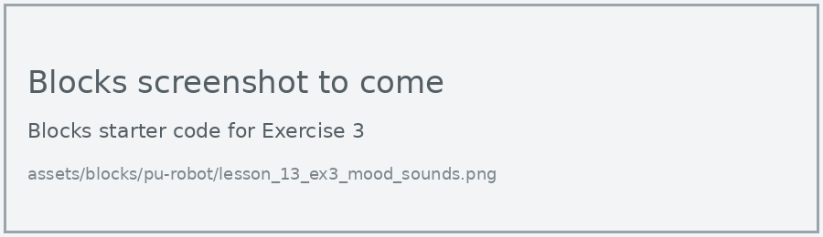

# Lesson 13: Moods

!!! learn "In this lesson we will learn"
    - how a variable can store the state a program is in
    - how a state machine chooses behaviour from the current state
    - how an event can switch the robot from one mood to the next

!!! terms "Terminology"
    - **state** – the situation a program is in at a particular moment, such as which mood the robot is in.
    - **state machine** – a way of thinking about a program as always being in one state, with rules that decide the next state when an event happens.

Let's give the robot moods. It will always be in one of three moods: happy, sleepy or grumpy. Each mood has its own lights, eyes and head movement. Clapping switches the robot to the next mood.

This kind of program is called a **state machine**. The robot is always in one **state** (its mood), the state decides what it does, and an event (a clap) moves it to the next state.

| Mood | Number | Lights | What the robot does |
| --- | --- | --- | --- |
| happy | 1 | yellow | eyes on, head tilted up |
| sleepy | 2 | blue | eyes dimmed, head tilted down |
| grumpy | 3 | red | eyes on, shakes its head |

## A mood state machine

=== "Blocks"

    { .blocks }

    Blocks used: **on loud sound** (Input), **set mood to**, **change mood by** and **mood** (Variables), **if then**, **if then else if then else**, **0 > 0** and **0 = 0** (Logic), **forever**, **show number** and **pause (ms)** (Basic), **set ambience light to RGB**, **set left eye right eye** and **set eye brightness** (robot PU > Actuators), **set servo to** (robot PU > Actions).

=== "Python"

    ```python linenums="1"
    --8<-- "examples/other/pu_robot/lesson_13_moods.py"
    ```

!!! primm "PRIMM"
    1. **Predict** what the robot will do when it starts, and after each clap.
    2. **Run** the program. Clap four times, waiting a few seconds between claps.
    3. Time to **investigate** the code. What does each line do?

??? note "Code explanation"
    - **line 1** → defines a function called `on_sound_loud`, which will run when there's a loud sound.
    - **line 2** → tells Python to use the `mood` variable from the main program.
    - **line 3** → moves to the next mood by adding 1.
    - **line 4** → checks whether the mood has gone past 3…
    - **line 5** → …and if it has, goes back to mood 1.
    - **line 6** → shows the new mood number on the display.
    - **line 7** → connects `on_sound_loud` to the loud sound event.
    - **line 9** → defines the function that the forever loop repeats.
    - **line 10** → checks whether the robot is happy (mood 1)…
    - **line 11** → …and if it is, turns the lights yellow…
    - **line 12** → …turns both eyes on…
    - **line 13** → …and tilts the head to 110 degrees.
    - **line 14** → otherwise, checks whether the robot is sleepy (mood 2)…
    - **line 15** → …and if it is, turns the lights blue…
    - **lines 16–17** → …dims both eyes to brightness 10…
    - **line 18** → …and tilts the head to 70 degrees.
    - **line 19** → otherwise (mood 3, grumpy)…
    - **line 20** → …turns the lights red…
    - **line 21** → …turns the head to one side.
    - **line 22** → waits 150 milliseconds.
    - **line 23** → turns the head to the other side.
    - **line 24** → waits 150 milliseconds.
    - **line 25** → turns the head back to the centre.
    - **line 26** → waits half a second before checking the mood again.
    - **line 27** → tells the micro:bit to run `on_forever` again and again.
    - **line 29** → creates the `mood` variable and starts the robot happy.
    - **line 30** → shows the starting mood number.

!!! tip "Two jobs, two parts"
    The event handler (lines 1 to 7) only changes the state. The forever loop (lines 9 to 27) only acts on the state. Keeping these jobs separate makes it easy to add more moods later.

!!! warning "Test the clap first"
    Remember from Lesson 11: the head cover can muffle sound, and the servo motors make noise. If the grumpy head shake keeps switching the mood by itself, make the clap louder or move the head more slowly.

## Exercises

!!! primm "PRIMM"
    Time to **modify** the code and see what happens.

Each exercise has starter code in Blocks and Python. Build the blocks in MakeCode, or copy the Python into MakeCode's Python view, then change it.

### Exercise 1

Can you add a fourth mood, surprised, with its own lights, eyes and head movement?

Starter code:

=== "Blocks"

    { .blocks }

=== "Python"

    ```python linenums="1"
    --8<-- "examples/other/pu_robot/lesson_13_ex1_fourth_mood.py"
    ```

### Exercise 2

Can you switch moods with a hand wave instead of a clap? Hint: check the distance in the forever loop, and remember to pause after a wave.

Starter code:

=== "Blocks"

    { .blocks }

=== "Python"

    ```python linenums="1"
    --8<-- "examples/other/pu_robot/lesson_13_ex2_wave_switch.py"
    ```

### Exercise 3

Can you play a different sound each time the robot changes mood? Hint: look in the Music category for **play sound** or **play melody**.

Starter code:

=== "Blocks"

    { .blocks }

=== "Python"

    ```python linenums="1"
    --8<-- "examples/other/pu_robot/lesson_13_ex3_mood_sounds.py"
    ```
