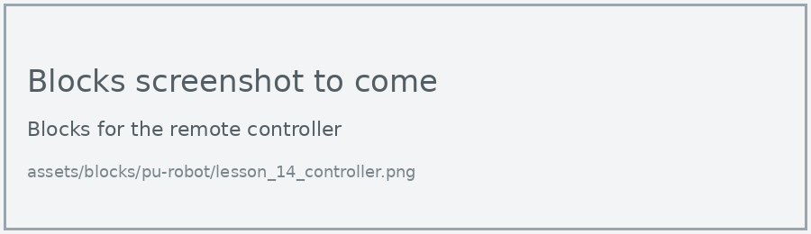
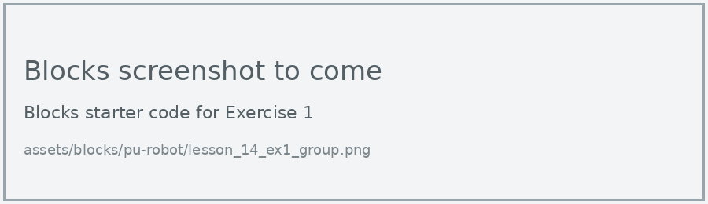
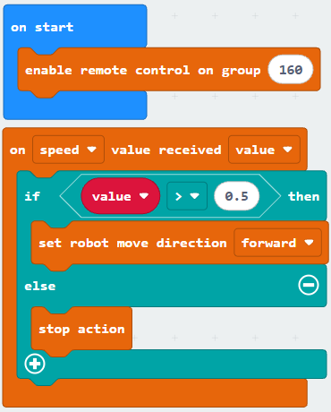
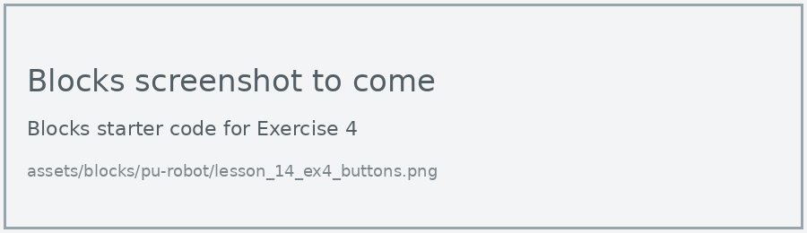

# Lesson 14: Radio Remote

!!! learn "In this lesson we will learn"
    - how two micro:bits send messages to each other by radio
    - how to program a second micro:bit as a joystick remote control
    - how to make the robot respond to messages from the remote

!!! terms "Terminology"
    - **radio** – a way of sending and receiving messages without wires, using invisible radio waves.
    - **radio group** – a number from 0 to 255 that sets which micro:bits can hear each other's radio messages.

In Lesson 2 we drove the robot using the remote controller's factory program. Now we program the remote ourselves. The two micro:bits talk to each other by **radio**. In this lesson we write two programs: one for the remote and one for the robot.

## What we need

- the PU Robot
- the remote controller shell, with a second micro:bit V2 inside it

!!! warning "Each pair needs its own radio group"
    A radio remote needs two micro:bits: the one in the robot and a second micro:bit as the remote. They only hear each other when both programs use the same **radio group**.

    Every micro:bit in the room that is on the same radio group hears every message sent on it, whatever robot it belongs to. With more than one robot running in the class, two pairs on the same group means one remote controls both robots. Before we download, we check with the other pairs and choose a group number from 0 to 255 that nobody else is using. Then we change 160 to that number in both programs.

## The remote

The remote reads how far the joystick is pushed forwards or backwards, and sends that number to the robot. The number goes from -1 to 1, with 0 in the middle.

=== "Blocks"

    { .blocks }

    Blocks used: **set controller radio group**, **send value** and **read joystick value** (robot PU > Controller), **forever** and **pause (ms)** (Basic).

=== "Python"

    ```python linenums="1"
    --8<-- "examples/other/pu_robot/lesson_14_controller.py"
    ```

??? note "Code explanation"
    === "Blocks"

        - **on start** → runs the blocks inside once, when the program starts.
            - **set controller radio group 160** → sets the remote's radio group to 160 and shows the number on the display.
        - **forever** → runs the blocks inside again and again.
            - **send speed value read joystick value speed** → reads how far the joystick is pushed forwards or backwards and sends that number to the robot as a speed value.
            - **pause (ms) 50** → waits 50 milliseconds, so the remote sends about 20 messages a second.

    === "Python"

        - **line 1** → sets the remote's radio group to 160 and shows the number on the display.
        - **line 3** → defines the function that the forever loop repeats.
        - **line 4** → reads how far the joystick is pushed forwards or backwards and sends that number to the robot as a speed value.
        - **line 5** → waits 50 milliseconds, so the remote sends about 20 messages a second.
        - **line 6** → tells the micro:bit to run `on_forever` again and again.

## The robot

The robot listens for speed values. Each time one arrives, an event handler decides what to do with it.

=== "Blocks"

    { .blocks }

    Blocks used: **enable remote control on group** and **on value received** (robot PU > Remote Control), **if then else** and **0 > 0** (Logic), **set robot move direction** and **stop action** (robot PU > Actions).

=== "Python"

    ```python linenums="1"
    --8<-- "examples/other/pu_robot/lesson_14_robot.py"
    ```

Download each program to its own micro:bit. Put one in the robot and one in the remote, then switch both on.

!!! primm "PRIMM"
    1. **Predict** what the robot will do when you push the joystick forwards, and when you let go.
    2. **Run** both programs.
    3. Time to **investigate** the code. What does each line do?

??? note "Code explanation"
    === "Blocks"

        - **on start** → runs the blocks inside once, when the program starts.
            - **enable remote control on group 160** → turns on remote control and sets the robot's radio group to 160.
        - **on speed value received value** → runs the blocks inside when the robot receives a speed from the controller, and stores it in `value`.
            - **if value > 0.5 then** → checks whether the joystick is pushed more than halfway forwards…
                - **set robot move direction forward** → …and if it is, starts the robot walking forward.
            - **else** → otherwise…
                - **stop action** → …stops the robot.

    === "Python"

        - **line 1** → turns on remote control and sets the robot's radio group to 160.
        - **line 3** → defines a function called `on_speed_received`, which gets the speed value in `value`.
        - **line 4** → checks whether the joystick is pushed more than halfway forwards…
        - **line 5** → …and if it is, starts the robot walking forward.
        - **line 6** → otherwise…
        - **line 7** → …stops the robot.
        - **line 8** → connects `on_speed_received` to the event of a speed value arriving.

!!! tip "Putting the factory program back"
    Once we download our own program, the remote's buttons no longer do what the PU Robot's instructions say. Our teacher can put the factory program back on both micro:bits.

## Exercises

!!! primm "PRIMM"
    Time to **modify** the code and see what happens.

Each exercise has starter code in Blocks and Python. Build the blocks in MakeCode, or copy the Python into MakeCode's Python view, then change it.

### Exercise 1

Can you change 160 to your pair's radio group in both programs, and test that your remote only controls your robot?

Starter code:

=== "Blocks"

    { .blocks }

=== "Python"

    ```python linenums="1"
    --8<-- "examples/other/pu_robot/lesson_14_ex1_group.py"
    ```

### Exercise 2

What happens if you pull the joystick backwards? If the robot walks forward when you pull back, the joystick values are the other way around. Can you fix it?

Starter code:

=== "Blocks"

    { .blocks }

=== "Python"

    ```python linenums="1"
    --8<-- "examples/other/pu_robot/lesson_14_ex2_reverse.py"
    ```

### Exercise 3

Can you add walking backward, and turning left and right? It should:

- walk backward when the joystick is pulled more than halfway back
- send the joystick's turn value from the remote as well
- turn left or right when the turn value is past halfway

Starter code:

=== "Blocks"

    { .blocks }

=== "Python"

    ```python linenums="1"
    --8<-- "examples/other/pu_robot/lesson_14_ex3_full_control.py"
    ```

### Exercise 4

Can you use the remote's B1 to B4 buttons to start modes such as dance and kick? Hint: on the remote, use **initialize controller buttons** and **B1 pressed** (robot PU > Controller), and send a button value. On the robot, use **on button value received**.

Starter code:

=== "Blocks"

    { .blocks }

=== "Python"

    ```python linenums="1"
    --8<-- "examples/other/pu_robot/lesson_14_ex4_buttons.py"
    ```
