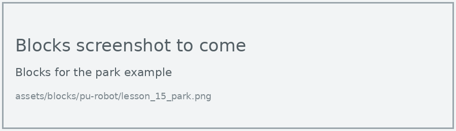
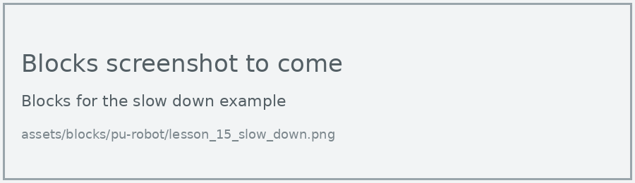
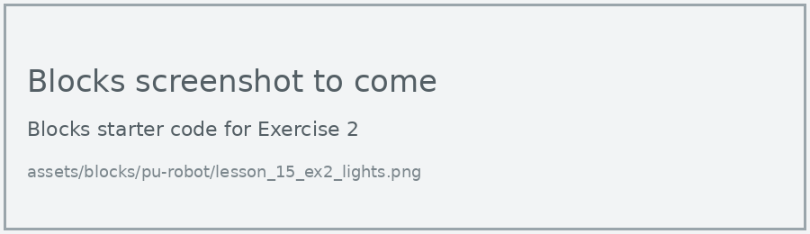
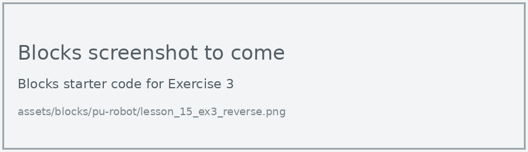

# Lesson 15: Parking Challenge

!!! learn "On this page we will learn"
    - how to plan a program with an input, process, output table
    - how to use variables for values we will tune
    - how to improve a program by testing it, changing one value and testing again

!!! terms "Terminology"
    - **IPO table** – an Input, Process, Output table that maps out what a system takes in, what it decides and what it does.
    - **tuning** – adjusting a value such as a distance or a speed, testing it, and adjusting it again until the program works well.

The challenge: program the robot to walk towards a wall and stop as close to it as possible, without touching it. The closest robot in the class wins.

## What we need

- the PU Robot
- a wall, or a heavy book standing on its end
- a ruler or tape measure
- Lesson 8 (ultrasonic sensor), Lesson 9 (variables) and Lesson 10 (elif)

## Plan

| Input | Process | Output |
| --- | --- | --- |
| distance to the wall (ultrasonic sensor) | Is the wall further away than the stopping distance? | yes: walk forward 1 step |
| | | no: stop and show a tick |

## Build it

### Step 1: walk until close

The stopping distance is stored in a variable, `stop_distance`, because it's the number we'll tune. The robot walks one step at a time, checking the distance before each step.

=== "Blocks"

    { .blocks }

    Blocks used: **forever** and **show icon** (Basic), **if then else** and **0 > 0** (Logic), **ultrasonic sensor distance in cm** (robot PU > Sensors), **walk for steps at speed** (robot PU > Actions), **set stop_distance to** and **stop_distance** (Variables).

=== "Python"

    ```python linenums="1"
    --8<-- "examples/other/pu_robot/lesson_15/park/main.py"
    ```

Place the robot about 1 metre from the wall, facing it, then switch it on.

!!! primm "PRIMM"
    1. **Predict** how far from the wall the robot will stop.
    2. **Run** the program, then measure the gap between the robot and the wall.
    3. Time to **investigate** the code. What does each line do?

??? note "Code explanation"
    - **line 1** → defines the function that the forever loop repeats.
    - **line 2** → checks whether the wall is further away than `stop_distance`…
    - **line 3** → …and if it is, walks forward 1 step at speed 4.
    - **line 4** → otherwise…
    - **line 5** → …shows a tick, because the robot has parked.
    - **line 6** → tells the micro:bit to run `on_forever` again and again.
    - **line 8** → creates the `stop_distance` variable and sets it to 15 cm.

### Step 2: slow down near the wall

A fast robot can overshoot, because it measures, then takes a whole step. Real cars slow down as they park, so let's do the same: walk fast when the wall is far away, and slowly when it's close.

=== "Blocks"

    { .blocks }

    Blocks used: **forever** and **show icon** (Basic), **if then else if then else** and **0 > 0** (Logic), **ultrasonic sensor distance in cm** (robot PU > Sensors), **walk for steps at speed** (robot PU > Actions), **set distance to**, **set slow_distance to**, **set stop_distance to** and their variable blocks (Variables).

=== "Python"

    ```python linenums="1"
    --8<-- "examples/other/pu_robot/lesson_15/slow_down/main.py"
    ```

!!! primm "PRIMM"
    1. **Predict** whether this version will stop closer to the wall than step 1.
    2. **Run** the program and measure the gap.
    3. Time to **investigate** the code. What does each line do?

??? note "Code explanation"
    - **line 1** → defines the function that the forever loop repeats.
    - **line 2** → tells Python to use the `distance` variable from the main program.
    - **line 3** → measures the distance once and stores it in `distance`.
    - **line 4** → checks whether the wall is further away than `slow_distance`…
    - **line 5** → …and if it is, walks forward 1 step at speed 6.
    - **line 6** → otherwise, checks whether the wall is further away than `stop_distance`…
    - **line 7** → …and if it is, walks forward 1 step at speed 2.
    - **line 8** → otherwise…
    - **line 9** → …shows a tick, because the robot has parked.
    - **line 10** → tells the micro:bit to run `on_forever` again and again.
    - **line 12** → creates the `distance` variable and sets it to 0.
    - **line 13** → sets the distance where the robot starts to slow down to 30 cm.
    - **line 14** → sets the stopping distance to 8 cm.

## Test it

Run each version 3 times from the same starting spot, and record the gap each time.

| Version | Stop distance | Run 1 | Run 2 | Run 3 | Touched the wall? |
| --- | --- | --- | --- | --- | --- |
| step 1 | 15 cm | | | | |
| step 2 | 8 cm | | | | |

!!! tip "Change one value at a time"
    When **tuning**, change only one variable between tests. If we change two at once and the result gets better, we can't tell which change helped.

## Extend it

!!! primm "PRIMM"
    Time to **modify** the code and see what happens.

Each challenge has starter code in Blocks and Python. Build the blocks in MakeCode, or copy the Python into MakeCode's Python view, then change it.

### Exercise 1

Can you tune `slow_distance`, `stop_distance` and the two speeds to stop as close to the wall as possible without touching it? Record each change and its result.

Starter code:

=== "Blocks"

    { .blocks }

=== "Python"

    ```python linenums="1"
    --8<-- "examples/other/pu_robot/lesson_15/ex1_tune/main.py"
    ```

### Exercise 2

Can you make the lights show how close the robot is: green when far, amber when slowing down, and red when parked?

Starter code:

=== "Blocks"

    { .blocks }

=== "Python"

    ```python linenums="1"
    --8<-- "examples/other/pu_robot/lesson_15/ex2_lights/main.py"
    ```

### Exercise 3

Can you make the robot back away if it ends up too close (less than 4 cm), then park again?

Starter code:

=== "Blocks"

    { .blocks }

=== "Python"

    ```python linenums="1"
    --8<-- "examples/other/pu_robot/lesson_15/ex3_reverse/main.py"
    ```
