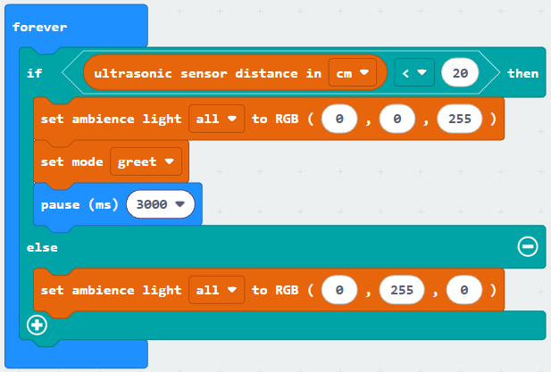
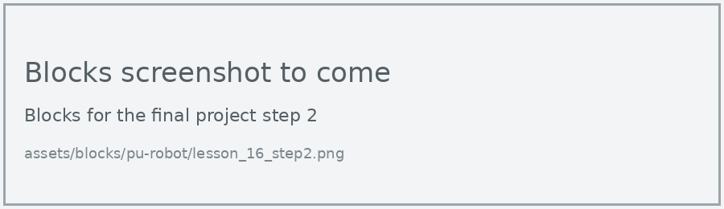

# Lesson 16: Final Project

!!! learn "On this page we will learn"
    - how to write requirements for our own robot program
    - how to plan, build and test a program in small stages
    - how to evaluate whether our program meets its requirements

!!! terms "Terminology"
    - **requirement** – something specific that a system needs to do, such as greeting someone who comes within 20 cm.
    - **testing table** – a table that lists each test with its expected result and actual result, so we can spot any differences.
    - **evaluation** – checking that a program does what it was meant to do by comparing each requirement against our test results.

Now it's our turn to design a robot program from scratch. In groups, we'll design a robot behaviour that uses at least four of the things we've learnt: movement, lights, sound, variables, if statements, loops, sensors and moods.

First, let's work through a small example together: a greeter robot for the classroom door. The same four steps will work for any project.

## 1. Define the problem

We start by writing down exactly what the program needs to do. Each **requirement** gets an ID, so we can check it off later.

| ID | Requirement |
| --- | --- |
| R1 | When nobody is near, the robot waits with green lights. |
| R2 | When someone comes within 20 cm, the lights turn blue and the robot greets them. |
| R3 | The robot counts every visitor and shows the total on the display. |

!!! tip "Write requirements we can test"
    "The robot is friendly" is hard to test. "The robot greets anyone within 20 cm" is easy: we stand at 20 cm and see what happens.

## 2. Design the solution

| Input | Process | Output |
| --- | --- | --- |
| distance (ultrasonic sensor) | Is someone closer than 20 cm? | yes: blue lights, greet, add 1 to visitors, show visitors |
| | | no: green lights |

We'll build it in two stages: first R1 and R2, then R3.

## 3. Build in small stages

### Stage 1: wait and greet (R1, R2)

=== "Blocks"

    { .blocks }

    Blocks used: **forever** and **pause (ms)** (Basic), **if then else** and **0 < 0** (Logic), **ultrasonic sensor distance in cm** (robot PU > Sensors), **set ambience light to RGB** (robot PU > Actuators), **set mode** (robot PU > Actions).

=== "Python"

    ```python linenums="1"
    --8<-- "examples/other/pu_robot/lesson_16_step1.py"
    ```

!!! primm "PRIMM"
    1. **Predict** what the robot will do when you walk up to it.
    2. **Run** the program.
    3. Time to **investigate** the code. What does each line do?

??? note "Code explanation"
    - **line 1** → defines the function that the forever loop repeats.
    - **line 2** → checks whether someone is closer than 20 cm…
    - **line 3** → …and if they are, turns the lights blue (R2)…
    - **line 4** → …greets them (R2)…
    - **line 5** → …and waits 3 seconds, so one visitor is only greeted once.
    - **line 6** → otherwise…
    - **line 7** → …turns the lights green while the robot waits (R1).
    - **line 8** → tells the micro:bit to run `on_forever` again and again.

### Stage 2: count the visitors (R3)

Now we add a variable, `visitors`, that goes up by 1 for each greeting.

=== "Blocks"

    { .blocks }

    Blocks used: the stage 1 blocks, plus **set visitors to** and **change visitors by** (Variables) and **show number** (Basic).

=== "Python"

    ```python linenums="1"
    --8<-- "examples/other/pu_robot/lesson_16_step2.py"
    ```

!!! primm "PRIMM"
    1. **Predict** what the display will show after three visitors.
    2. **Run** the program.
    3. Time to **investigate** the code. What does each new line do?

??? note "Code explanation"
    - **line 1** → defines the function that the forever loop repeats.
    - **line 2** → tells Python to use the `visitors` variable from the main program.
    - **line 3** → checks whether someone is closer than 20 cm…
    - **line 4** → …and if they are, turns the lights blue…
    - **line 5** → …greets them…
    - **line 6** → …adds 1 to the number of visitors (R3)…
    - **line 7** → …shows the total on the display (R3)…
    - **line 8** → …and waits 3 seconds.
    - **line 9** → otherwise…
    - **line 10** → …turns the lights green.
    - **line 11** → tells the micro:bit to run `on_forever` again and again.
    - **line 13** → creates the `visitors` variable and sets it to 0 when the program starts.

## 4. Test and evaluate

A **testing table** checks every path through the program.

| Test | Expected result | Actual result |
| --- | --- | --- |
| nobody near | green lights, nothing on the display | |
| walk up to 15 cm | blue lights, greeting, display shows 1 | |
| step back, then walk up again | display shows 2 | |
| stand at 25 cm | green lights, no greeting | |

Then the **evaluation** compares each requirement with the results.

| ID | Requirement | Met? | Evidence |
| --- | --- | --- | --- |
| R1 | waits with green lights | | |
| R2 | greets anyone within 20 cm | | |
| R3 | counts and shows visitors | | |

Possible improvements: a different greeting for every tenth visitor, or a clap that resets the count.

## Your turn

Work through these steps for your own robot behaviour:

1. Choose an idea and write at least 4 requirements, each with an ID.
2. Fill in an IPO table for your program.
3. List which lessons' skills you'll use (you need at least four).
4. Build it in stages, testing after each stage.
5. Write a testing table that covers every path through your program.
6. Evaluate each requirement with evidence from your tests, and list two improvements.
7. Present your robot to the class.

!!! tip "Project ideas"
    - a guard robot that gets suspicious when someone comes near
    - a dance performance with music, lights and moods
    - a robot pet that gets sleepy if nobody plays with it
    - a parking robot that celebrates when it parks perfectly
