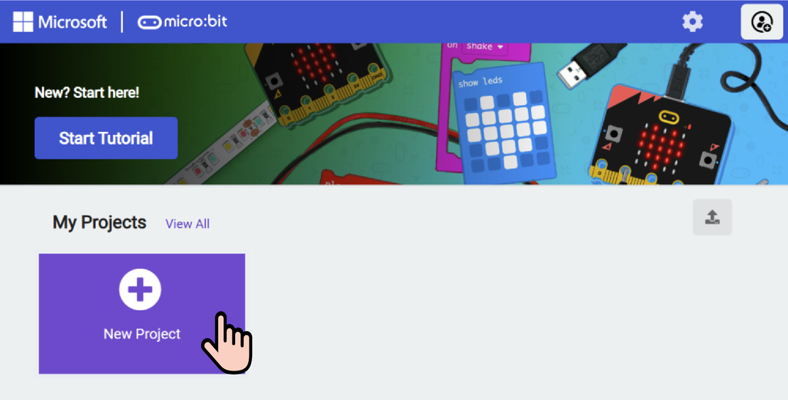
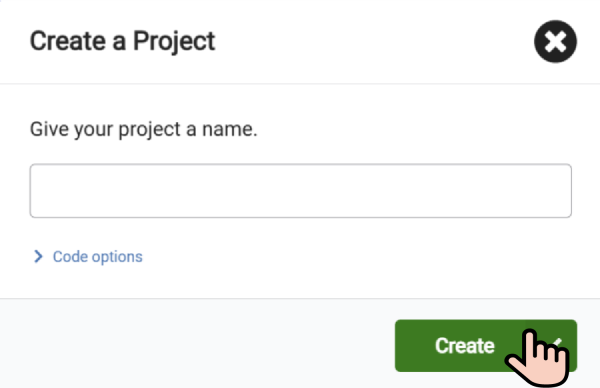
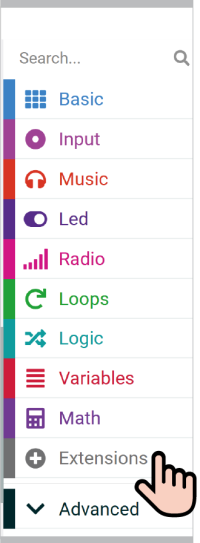
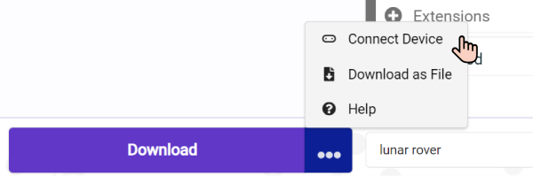
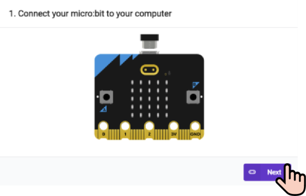
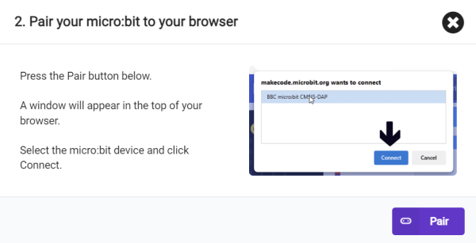

# Using MakeCode

!!! learn "On this page we will learn"
    - how to create a new MakeCode project
    - how to add a robot's extension
    - how to switch between Blocks and Python
    - how to download our program to the micro:bit

!!! terms "Terminology"
    - **micro:bit** – a small, pocket-sized educational computer with buttons, a display and sensors that we can program.
    - **MakeCode** – a free online editor from Microsoft that lets us program the micro:bit using Blocks or Python.
    - **block** – a piece of code shaped like a jigsaw piece that we drag and snap together with other blocks to build a program.
    - **extension** – an add-on that gives MakeCode extra blocks and commands for controlling a particular piece of hardware.
    - **download** – to copy our program from MakeCode onto the micro:bit so it can run there.
    - **.hex file** – the file MakeCode creates when we download, which holds our program in a form the micro:bit can run.
    - **WebUSB** – a way for the web browser to talk straight to the micro:bit through the USB cable, so MakeCode can send programs without us copying files.

Every robot in Other Robots is programmed the same way, so this page covers the steps they all share. Each robot's lessons link back here instead of repeating them.

## What we need

- a computer with the Chrome or Edge web browser
- a micro USB **data** cable (some cables only charge, and they won't work)
- the robot, with its micro:bit

## Create a project

1. Go to [makecode.microbit.org](https://makecode.microbit.org) and select **New Project**.
    - Why: each program we write lives in its own project, which MakeCode saves in the browser.
    - Result: a box opens asking for a project name.

    <figure markdown="span">
      { width="560" }
      <figcaption>Select New Project under My Projects. Image: ELECFREAKS.</figcaption>
    </figure>

2. Type a name that says what the program does, for example `PU first program`, and select **Create**.
    - Result: the editor opens with an **on start** block and a **forever** block already in place.

    <figure markdown="span">
      { width="400" }
      <figcaption>Name the project, then select Create. Image: ELECFREAKS.</figcaption>
    </figure>

!!! tip "Where our projects are saved"
    MakeCode saves our projects in the web browser on the computer we're using. To find a project again, go back to the MakeCode home page and look under **My Projects**. If we use a different computer, our projects won't be there.

## Add a robot's extension

MakeCode only has the standard micro:bit blocks to start with. Each robot needs its own extension, which adds the blocks that control it.

1. In the list of block categories, select **Extensions**. If we can't see it, select **Advanced** first.
    - Result: the Extensions page opens with a search box.

    <figure markdown="span">
      { width="160" }
      <figcaption>Extensions is near the bottom of the block categories. Image: ELECFREAKS.</figcaption>
    </figure>

2. Type the robot's search word in the search box and press ++enter++.

    | Robot | Search for | Category that appears |
    | --- | --- | --- |
    | PU Robot | `pu robot` | robot PU |
    | XGO Robot Dog | `xgo` | xgo |
    | WuKong Manipulator | `wukong` | wuKong |

3. Select the robot's extension.
    - Why: the extension gives us the blocks and Python commands for that robot.
    - Result: we're taken back to the editor, and a new category with the robot's name appears in the list of block categories.

!!! warning "Add the extension to every new project"
    The extension belongs to the project, not to MakeCode. Every time we start a new project, we need to add the extension again.

!!! tip "If the search finds nothing"
    Paste the extension's address into the search box instead:

    - PU Robot: `https://github.com/elecfreaks/pxt-PU-Robot`
    - XGO Robot Dog: `https://github.com/elecfreaks/pxt-xgo`
    - WuKong Manipulator: `https://github.com/elecfreaks/pxt-wukong`

## Switch between Blocks and Python

MakeCode stores one program and can show it as either Blocks or Python, so we can swap views at any time.

1. At the top of the editor, find the **Blocks** button and the language drop-down next to it. Select the drop-down and choose **Python**.
    - Result: our blocks now appear as Python code.
2. Select **Blocks** to switch back.
    - Result: our Python code appears as blocks again.

The drop-down also has **JavaScript**. We don't use it on this site, so we can ignore it.

When MakeCode changes blocks into Python:

- blocks inside **on start** become plain lines of code at the bottom of the program
- blocks inside **forever**, or inside an event such as **on button A pressed**, become a function that starts with `def`, plus a line that connects that function to the loop or event
- the robot's commands start with the extension's name, for example `robotPu.`, `xgo.` or `wuKong.`
- options picked from a drop-down are written in capital letters, for example `IconNames.HAPPY`

!!! tip "Not sure how to write something in Python?"
    Build it in Blocks first, then switch to Python to see the code. If our Python has a mistake (a red underline), MakeCode can't switch back to Blocks until we fix it.

!!! warning "If MakeCode's Python looks different"
    The Python on this site was written from each extension's code, but not every line has been tested in MakeCode yet. If MakeCode shows a slightly different name for a command or an option, trust MakeCode's version.

## Download our program

There are two ways to get our program onto the micro:bit. Connecting with WebUSB is faster once it's set up, and dragging a .hex file works on any computer.

### Option A: connect with WebUSB

1. Plug the micro:bit into the computer with the USB cable.
    - Result: a drive called **MICROBIT** appears on the computer.
2. In MakeCode, select the three dots next to the **Download** button, then **Connect Device**.

    <figure markdown="span">
      { width="400" }
      <figcaption>Connect Device is in the menu next to Download. Image: ELECFREAKS.</figcaption>
    </figure>

3. Follow the prompts, select **BBC micro:bit CMSIS-DAP**, then select **Connect**.
    - Why: this lets MakeCode send programs straight to the micro:bit.
    - Result: MakeCode says the micro:bit is connected.

    <figure markdown="span">
      { width="400" }
      <figcaption>First, check the micro:bit is plugged in and select Next. Image: ELECFREAKS.</figcaption>
    </figure>

    <figure markdown="span">
      { width="400" }
      <figcaption>Then select Pair and choose the micro:bit in the pop-up. Image: ELECFREAKS.</figcaption>
    </figure>

4. Select **Download**.
    - Result: the yellow light on the back of the micro:bit flashes, then our program starts.

We only need to connect once each lesson. After that, **Download** sends the program straight away.

### Option B: drag and drop a .hex file

1. Select **Download** in MakeCode.
    - Result: a file ending in `.hex` is saved to the computer's Downloads folder.
2. Open File Explorer and find the `.hex` file.
3. Drag the file onto the **MICROBIT** drive.
    - Result: the yellow light on the back of the micro:bit flashes. The drive disappears and comes back, which is normal. Our program then starts.

!!! tip "No MICROBIT drive?"
    Try a different USB cable or USB port. A cable that only charges can't carry data, so the computer never sees the micro:bit.
