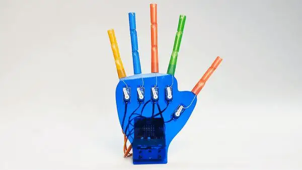

# WuKong Manipulator

The ELECFREAKS WuKong Manipulator is a robotic hand that we build ourselves from straws, thread and five servo motors. Each servo motor pulls a thread that curls one straw finger. A micro:bit plugs into the WuKong board, which powers the servo motors from its own battery.

<figure markdown="span">
  { width="480" }
  <figcaption>The finished hand. Image: <a href="https://wiki.elecfreaks.com/en/microbit/interesting-case/straw-manipulator/How-to-use-the-microbit-to-control-the-straw-manipulator/">ELECFREAKS</a>.</figcaption>
</figure>

Work through the lessons in order. Lessons 1 to 3 build the hand, and the rest program it.

| Lesson | What we do |
| --- | --- |
| [Lesson 1: Build the Frame](lesson_01.md) | mount the servo motors and board, and plug in the cables |
| [Lesson 2: Zero the Servos](lesson_02.md) | set every servo motor to its starting position |
| [Lesson 3: Finish the Hand](lesson_03.md) | fit the servo arms and threads |
| [Lesson 4: Finger Range](lesson_04.md) | find how far each finger can curl, using a variable |
| [Lesson 5: Count to Five](lesson_05.md) | move fingers one at a time, in order |
| [Lesson 6: Hand Gestures](lesson_06.md) | package hand shapes as functions |
| [Lesson 7: Rock, Paper, Scissors](lesson_07.md) | play a game using random numbers and decisions |
| [Lesson 8: Smooth Movement](lesson_08.md) | curl a finger slowly with a while loop |
| [Lesson 9: Tilt Control](lesson_09.md) | control the fingers by tilting the micro:bit |
| [Lesson 10: Grip Challenge](lesson_10.md) | improve the hand so it can hold an object |
| [Lesson 11: Radio Remote](lesson_11.md) | control the hand from a second micro:bit |

!!! tip "Which port is each finger?"
    The examples use the ports from the ELECFREAKS instructions: thumb S0, index finger S1, middle finger S3, ring finger S5 and little finger S7. In Lesson 1 we record which port each of our fingers uses. If ours are different, change the ports in each example to match.
