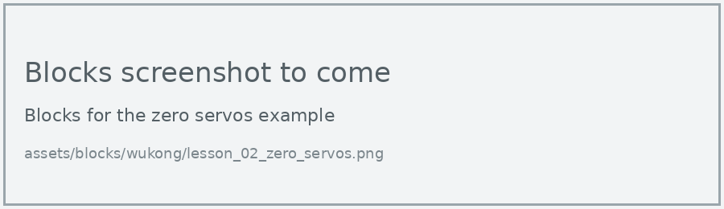
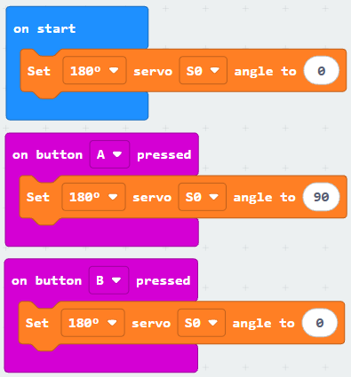
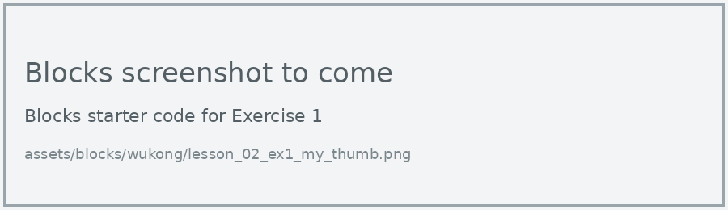
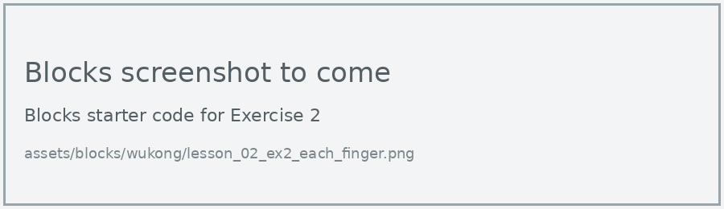

# Lesson 2: Zero the Servos

!!! learn "In this lesson we will learn"
    - how to set up a MakeCode project for the WuKong board
    - how to set a servo motor's angle
    - why we zero the servo motors before fitting the arms

!!! terms "Terminology"
    - **zero** – to set a servo motor to 0 degrees, its starting position, before attaching anything to it.

In this kit, 0 degrees means a straight finger and 180 degrees means a fully curled finger. For that to be true, every servo motor must be at 0 degrees when we fit its arm in Lesson 3. So before we finish the hand, we **zero** every servo motor.

## Set up a MakeCode project

Follow [Using MakeCode](../using-makecode.md) to create a new project and add the WuKong extension (search for `wukong`). A new **wuKong** category appears in the list of block categories.

The block we use most is **Set 180° servo S0 angle to 0**. Always leave the servo type on 180°, because that's the type of servo motor in this kit. The wuKong category also has blocks for motors and the board's lights.

The micro:bit stays in the WuKong board while we download. Plug the USB cable into the micro:bit itself.

## Zero every servo motor

=== "Blocks"

    { .blocks }

    Blocks used: **Set servo angle to** (wuKong), **show icon** (Basic).

=== "Python"

    ```python linenums="1"
    --8<-- "examples/other/wukong/lesson_02/zero_servos/main.py"
    ```

!!! primm "PRIMM"
    1. **Predict** what the servo motors will do when the board switches on.
    2. **Run** the program: download it, then switch the WuKong board on.
    3. Time to **investigate** the code. What does each line do?

??? note "Code explanation"
    - **lines 1–8** → set the servo motors on all 8 ports, S0 to S7, to 0 degrees.
    - **line 9** → shows a happy face, so we know the program has finished.

!!! tip "Why zero all 8 ports?"
    Setting all 8 ports means every servo motor is zeroed, whichever ports we plugged our fingers into.

## Test one servo motor

The arms aren't fitted yet, so it's hard to see a servo motor turn. To check, push a white arm onto the thumb servo motor's spindle without its screw, and take it off again before Lesson 3.

=== "Blocks"

    { .blocks }

    Blocks used: **on button pressed** (Input), **Set servo angle to** (wuKong).

=== "Python"

    ```python linenums="1"
    --8<-- "examples/other/wukong/lesson_02/test_thumb/main.py"
    ```

!!! primm "PRIMM"
    1. **Predict** how far the arm will turn when you press A, and when you press B.
    2. **Run** the program.
    3. Time to **investigate** the code. What does each line do?

??? note "Code explanation"
    - **line 1** → defines a function called `on_button_pressed_a`, which will run when button A is pressed.
    - **line 2** → turns the thumb servo motor to 90 degrees, a quarter turn.
    - **line 3** → connects `on_button_pressed_a` to button A.
    - **line 5** → defines a function called `on_button_pressed_b`, which will run when button B is pressed.
    - **line 6** → turns the thumb servo motor back to 0 degrees.
    - **line 7** → connects `on_button_pressed_b` to button B.
    - **line 9** → sets the thumb servo motor to 0 degrees when the program starts.

!!! warning "Finish at 0 degrees"
    When the test works, press B, then switch the board off. From now on, don't turn the servo spindles by hand, so they stay at 0 degrees until we fit the arms.

## Exercises

!!! primm "PRIMM"
    Time to **modify** the code and see what happens.

Each exercise has starter code in Blocks and Python. Build the blocks in MakeCode, or copy the Python into MakeCode's Python view, then change it.

### Exercise 1

Can you change the test program to use your thumb's port from your table in Lesson 1?

Starter code:

=== "Blocks"

    { .blocks }

=== "Python"

    ```python linenums="1"
    --8<-- "examples/other/wukong/lesson_02/ex1_my_thumb/main.py"
    ```

### Exercise 2

Can you test each finger's servo motor in turn by changing the port, pushing the white arm on each time?

Starter code:

=== "Blocks"

    { .blocks }

=== "Python"

    ```python linenums="1"
    --8<-- "examples/other/wukong/lesson_02/ex2_each_finger/main.py"
    ```
