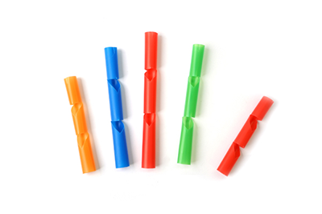
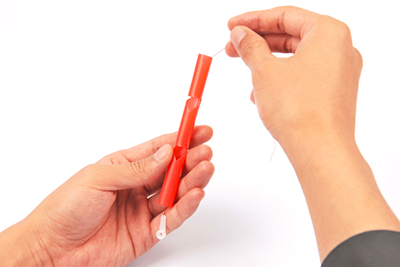
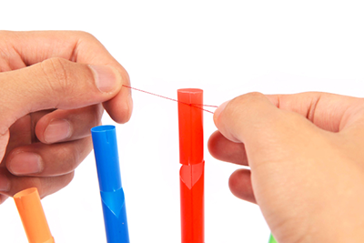
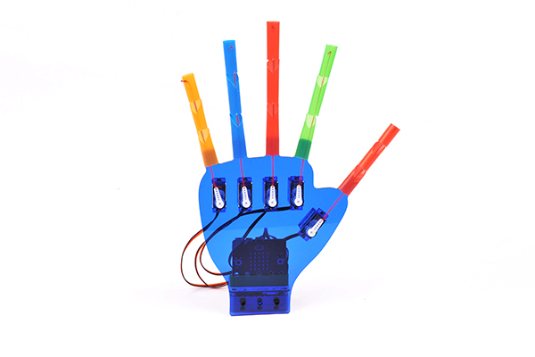

# Lesson 3: Finish the Hand

!!! learn "In this lesson we will learn"
    - how to fit the servo arms so 0 degrees is a straight finger
    - how to thread the straw fingers
    - how to test and adjust the finished hand

Now that every servo motor is at 0 degrees, we fit the arms and threads so that 0 degrees matches a straight finger.

## Fit the arms and threads

1. Push a white arm onto each servo motor, pointing the same way as its finger. Fix each one with its small screw.
    - Why: fitting the arm at 0 degrees means the program's 0 degrees is a straight finger.
    - Result: all 5 arms point the same way as the fingers.
2. Cut 5 pieces of thread, each a little longer than a finger plus the distance to its servo motor.
3. Tie one end of a thread to the first hole on a servo arm.
4. Thread it through a straw, then fix the bottom of the straw to its finger position on the palm with a connector.

    <figure markdown="span">
      { width="380" }
      <figcaption>The straw fingers. The notches let each finger bend. Image: <a href="https://wiki.elecfreaks.com/en/microbit/interesting-case/straw-manipulator/How-to-use-the-microbit-to-control-the-straw-manipulator/">ELECFREAKS</a>.</figcaption>
    </figure>

    <figure markdown="span">
      { width="380" }
      <figcaption>Threading a straw. Image: <a href="https://wiki.elecfreaks.com/en/microbit/interesting-case/straw-manipulator/How-to-use-the-microbit-to-control-the-straw-manipulator/">ELECFREAKS</a>.</figcaption>
    </figure>

5. Gently pull the thread until it's just straight (not tight), then tie a knot at the top and fix the knot in the slot at the top of the straw.
    - Why: if the thread is too tight, the servo motor can't reach 0 degrees and strains. If it's too loose, the finger won't curl all the way.
    - Result: the finger is straight and the thread has no slack.

    <figure markdown="span">
      { width="380" }
      <figcaption>Tie the knot at the top of the straw. Image: <a href="https://wiki.elecfreaks.com/en/microbit/interesting-case/straw-manipulator/How-to-use-the-microbit-to-control-the-straw-manipulator/">ELECFREAKS</a>.</figcaption>
    </figure>

6. Repeat steps 3 to 5 for the other 4 fingers.

<figure markdown="span">
  { width="400" }
  <figcaption>The finished hand, with all 5 fingers fitted. Image: <a href="https://wiki.elecfreaks.com/en/microbit/interesting-case/straw-manipulator/How-to-use-the-microbit-to-control-the-straw-manipulator/">ELECFREAKS</a>.</figcaption>
</figure>

## Test the finished hand

Switch the board on, with the Lesson 2 test program still on the micro:bit.

| Test | Expected result |
| --- | --- |
| switch on | all fingers are straight |
| press A | the thumb curls about halfway |
| press B | the thumb straightens |

!!! tip "If a finger won't straighten"
    Its thread is too tight. Switch the board off, loosen the knot slightly and test again. If a finger won't curl far enough, its thread is too loose: tie it again with less slack.

## Exercises

### Exercise 1

Can you test every finger by changing the port in the Lesson 2 test program? Record any finger that doesn't straighten or curl properly, and what you changed to fix it.

### Exercise 2

Why do we zero the servo motors before fitting the arms, instead of after? Explain what would happen if we fitted an arm while its servo motor was at 90 degrees.
