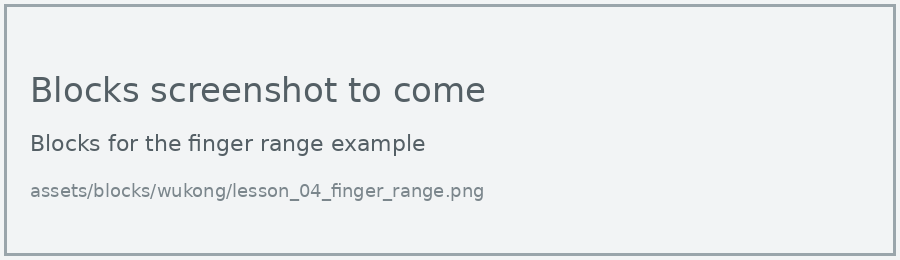
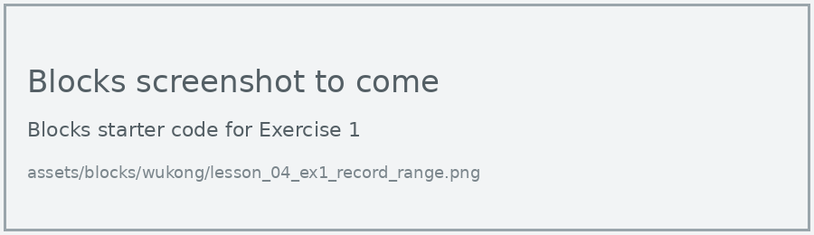
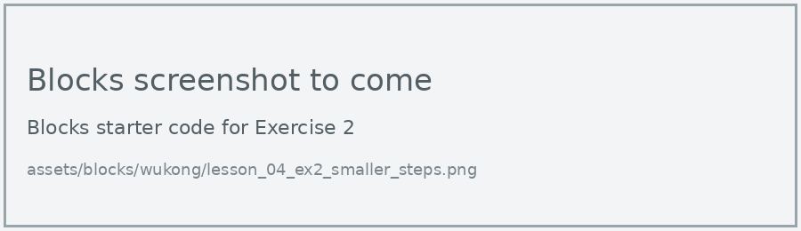
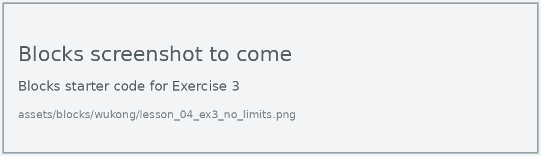

# Lesson 4: Finger Range

!!! learn "In this lesson we will learn"
    - how to store a number in a variable and change it
    - why a variable used in an event handler is a global variable
    - how to find the angle at which each finger is fully curled

A servo motor can turn to 180 degrees, but our finger might be fully curled well before that, depending on how tight its thread is. If we keep turning past that point, the servo motor strains. So let's find each finger's real range.

## A variable for the angle

We store the angle in a **variable** called `angle`. Button A adds 10 to it and button B takes 10 away, and each time the finger moves to the new angle.

=== "Blocks"

    { .blocks }

    Blocks used: **on button pressed** (Input), **set angle to**, **change angle by** and **angle** (Variables), **if then** and **0 < 0** (Logic), **Set servo angle to** (wuKong), **show number** (Basic).

=== "Python"

    ```python linenums="1"
    --8<-- "examples/other/wukong/lesson_04_finger_range.py"
    ```

!!! primm "PRIMM"
    1. **Predict** what will happen to the thumb and the display each time you press A, then B.
    2. **Run** the program.
    3. Time to **investigate** the code. What does each line do?

??? note "Code explanation"
    - **line 1** → defines a function called `on_button_pressed_a`, which will run when button A is pressed.
    - **line 2** → tells Python to use the `angle` variable from the main program, not a new one.
    - **line 3** → checks whether the angle is still less than 180…
    - **line 4** → …and if it is, adds 10 to it.
    - **line 5** → turns the thumb servo motor to the new angle.
    - **line 6** → shows the angle on the display.
    - **line 7** → connects `on_button_pressed_a` to button A.
    - **line 9** → defines a function called `on_button_pressed_b`, which will run when button B is pressed.
    - **line 10** → tells Python to use the `angle` variable from the main program.
    - **line 11** → checks whether the angle is more than 0…
    - **line 12** → …and if it is, takes 10 away from it.
    - **line 13** → turns the thumb servo motor to the new angle.
    - **line 14** → shows the angle on the display.
    - **line 15** → connects `on_button_pressed_b` to button B.
    - **line 17** → creates the `angle` variable and sets it to 0.
    - **line 18** → turns the thumb servo motor to 0 degrees.

!!! tip "What does global do?"
    `angle` is created in the main program, so it's a **global variable**. Inside a function, Python needs the line `global angle` before it can change it. In Blocks, MakeCode adds this for us.

## Exercises

!!! primm "PRIMM"
    Time to **modify** the code and see what happens.

Each exercise has starter code in Blocks and Python. Build the blocks in MakeCode, or copy the Python into MakeCode's Python view, then change it.

### Exercise 1

What angle makes each finger fully curled? It should:

1. press A until the thumb is fully curled, stopping as soon as it stops moving or the servo motor buzzes
2. record the angle in a table with the columns Finger, Port and Fully curled angle
3. change the port and repeat for each finger

We use these angles instead of 180 in all the later lessons.

Starter code:

=== "Blocks"

    { .blocks }

=== "Python"

    ```python linenums="1"
    --8<-- "examples/other/wukong/lesson_04_ex1_record_range.py"
    ```

### Exercise 2

Can you change the program so each button press moves the finger by 5 degrees instead of 10?

Starter code:

=== "Blocks"

    { .blocks }

=== "Python"

    ```python linenums="1"
    --8<-- "examples/other/wukong/lesson_04_ex2_smaller_steps.py"
    ```

### Exercise 3

What happens if we take the `if` lines out and keep pressing B? Why do you think the program needs them?

Starter code:

=== "Blocks"

    { .blocks }

=== "Python"

    ```python linenums="1"
    --8<-- "examples/other/wukong/lesson_04_ex3_no_limits.py"
    ```
