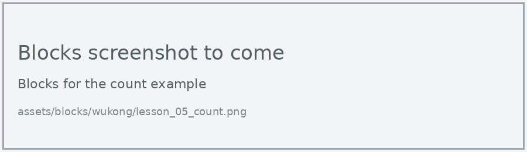

# Lesson 5: Count to Five

!!! learn "In this lesson we will learn"
    - how to move fingers one at a time, in order
    - how to use pauses to control the timing of a sequence
    - how to put the hand back to its starting position

Now that we know each finger's range, let's make the hand count. The hand curls one finger at a time, and the display shows the count.

## Count with the fingers

The examples use 150 degrees as fully curled. Change it to the angles from our table in Lesson 4.

=== "Blocks"

    { .blocks }

    Blocks used: **on button pressed** (Input), **show number**, **pause (ms)** and **clear screen** (Basic), **Set servo angle to** (wuKong).

=== "Python"

    ```python linenums="1"
    --8<-- "examples/other/wukong/lesson_05/count/main.py"
    ```

!!! primm "PRIMM"
    1. **Predict** what the hand and the display will do when you press A, then B.
    2. **Run** the program.
    3. Time to **investigate** the code. What does each line do?

??? note "Code explanation"
    - **line 1** → defines a function called `on_button_pressed_a`, which will run when button A is pressed.
    - **line 2** → shows 1 on the display.
    - **line 3** → curls the thumb.
    - **line 4** → waits for 1 second.
    - **line 5** → shows 2 on the display.
    - **line 6** → curls the index finger.
    - **line 7** → waits for 1 second.
    - **line 8** → shows 3 on the display.
    - **line 9** → curls the middle finger.
    - **line 10** → waits for 1 second.
    - **line 11** → connects `on_button_pressed_a` to button A.
    - **line 13** → defines a function called `on_button_pressed_b`, which will run when button B is pressed.
    - **line 14** → straightens the thumb.
    - **line 15** → straightens the index finger.
    - **line 16** → straightens the middle finger.
    - **line 17** → clears the display.
    - **line 18** → connects `on_button_pressed_b` to button B.

## Exercises

!!! primm "PRIMM"
    Time to **modify** the code and see what happens.

Each exercise has starter code. Copy it into MakeCode's Python view, or build the same program in Blocks, then change it.

### Exercise 1

Can you finish the count so the hand counts all the way to 5, and button B straightens all 5 fingers?

Starter code:

```python linenums="1"
--8<-- "examples/other/wukong/lesson_05/ex1_count_to_five/main.py"
```

### Exercise 2

Can you make the hand count the other way? It should start as a fist and straighten one finger per second, counting 1 to 5 on the display.

Starter code:

```python linenums="1"
--8<-- "examples/other/wukong/lesson_05/ex2_count_open/main.py"
```

### Exercise 3

Can you turn on the WuKong board's breathing light (**Set light mode to BREATH**) while the hand counts, and turn it off (**OFF**) at the end?

Starter code:

```python linenums="1"
--8<-- "examples/other/wukong/lesson_05/ex3_breathing_light/main.py"
```
