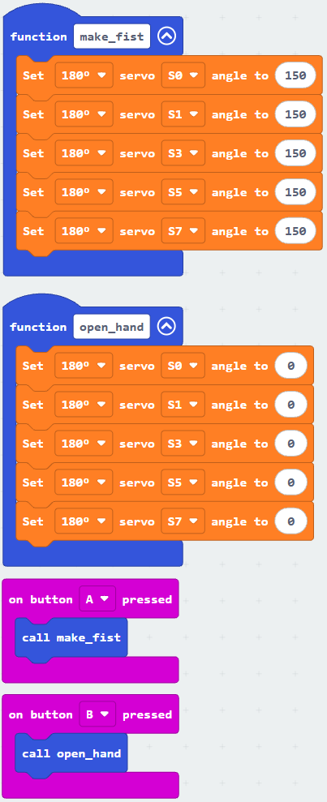
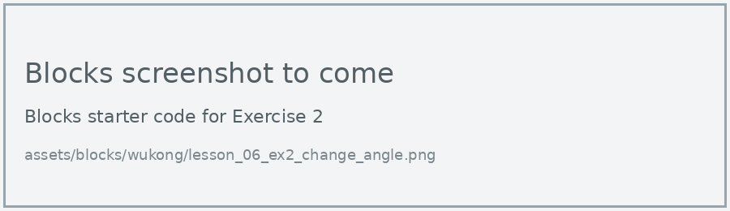

# Lesson 6: Hand Gestures

!!! learn "In this lesson we will learn"
    - how to define our own functions
    - how to call a function to run its code
    - why functions make programs shorter and easier to change

!!! terms "Terminology"
    - **define** – to create a function with `def`, giving it a name and a code block that Python remembers but doesn't run yet.
    - **call** – to run a function by using its name, after which the program comes back to where it was.

Making a fist takes 5 blocks, one for each finger. If we want a fist in three different places in our program, that's 15 blocks, and changing the angle means changing all 15. A function lets us write the 5 blocks once and use them anywhere.

## Define and call functions

We **define** two functions: `make_fist` and `open_hand`. Then each button **calls** one of them.

=== "Blocks"

    { .blocks }

    Blocks used: **function** and **call** (Functions), **on button pressed** (Input), **Set servo angle to** (wuKong).

=== "Python"

    ```python linenums="1"
    --8<-- "examples/other/wukong/lesson_06_gestures.py"
    ```

!!! primm "PRIMM"
    1. **Predict** what the hand will do when you press A, then B.
    2. **Run** the program.
    3. Time to **investigate** the code. What does each line do?

??? note "Code explanation"
    === "Blocks"

        - **function make_fist** → defines a function called `make_fist`.
            - **Set 180° servo S0 angle to 150** to **Set 180° servo S7 angle to 150** (5 blocks) → curl all 5 fingers.
        - **function open_hand** → defines a function called `open_hand`.
            - **Set 180° servo S0 angle to 0** to **Set 180° servo S7 angle to 0** (5 blocks) → straighten all 5 fingers.
        - **on button A pressed** → runs the blocks inside when we press button A.
            - **call make_fist** → calls `make_fist`, which curls all the fingers.
        - **on button B pressed** → runs the blocks inside when we press button B.
            - **call open_hand** → calls `open_hand`, which straightens all the fingers.

    === "Python"

        - **line 1** → defines a function called `make_fist`.
        - **lines 2–6** → curl all 5 fingers.
        - **line 8** → defines a function called `open_hand`.
        - **lines 9–13** → straighten all 5 fingers.
        - **line 15** → defines a function called `on_button_pressed_a`, which will run when button A is pressed.
        - **line 16** → calls `make_fist`, which curls all the fingers.
        - **line 17** → connects `on_button_pressed_a` to button A.
        - **line 19** → defines a function called `on_button_pressed_b`, which will run when button B is pressed.
        - **line 20** → calls `open_hand`, which straightens all the fingers.
        - **line 21** → connects `on_button_pressed_b` to button B.

!!! tip "Defining doesn't run the code"
    Lines 1 to 13 don't move the hand when the program starts. Python only remembers the functions. The fingers move when a button calls one of them.

## Exercises

!!! primm "PRIMM"
    Time to **modify** the code and see what happens.

Each exercise has starter code in Blocks and Python. Build the blocks in MakeCode, or copy the Python into MakeCode's Python view, then change it.

### Exercise 1

Can you create functions called `point`, `thumbs_up` and `peace_sign`, and call them with A and B together, touching the logo, and shaking the micro:bit?

Starter code:

=== "Blocks"

    { .blocks }

=== "Python"

    ```python linenums="1"
    --8<-- "examples/other/wukong/lesson_06_ex1_more_gestures.py"
    ```

### Exercise 2

Can you change the fist angle from 150 to your own angles from Lesson 4? How many lines did you have to change? How many would you have changed without functions?

Starter code:

=== "Blocks"

    { .blocks }

=== "Python"

    ```python linenums="1"
    --8<-- "examples/other/wukong/lesson_06_ex2_change_angle.py"
    ```

### Exercise 3

Why is using functions better than copying the same 5 blocks each time? Write two reasons.
