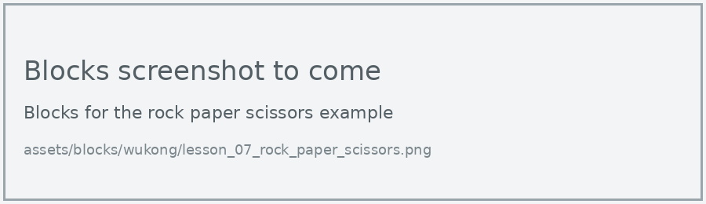

# Lesson 7: Rock, Paper, Scissors

!!! learn "In this lesson we will learn"
    - how to pick a random number
    - how to use **if**, **elif** and **else** to choose between three options
    - how to combine functions and decisions in a game

!!! terms "Terminology"
    - **random number** – a number picked by chance, such as a whole number from 1 to 3.
    - **elif** – short for else if, a part of an `if` statement that checks another condition when the conditions before it were `False`.

Let's put our gestures to work in a game. When we shake the micro:bit, the hand picks rock, paper or scissors at random, and we play against it.

## Pick a gesture at random

The hand picks a **random number** from 1 to 3, then uses an if statement to choose a gesture. With three options, we need a third path, so we add **elif** between the if and the else.

=== "Blocks"

    { .blocks }

    Blocks used: **function** and **call** (Functions), **on shake** (Input), **set choice to** (Variables), **pick random** (Math), **if then else if then else** and **0 = 0** (Logic), **Set servo angle to** (wuKong).

=== "Python"

    ```python linenums="1"
    --8<-- "examples/other/wukong/lesson_07/rock_paper_scissors/main.py"
    ```

!!! primm "PRIMM"
    1. **Predict** what the hand will do each time you shake the micro:bit.
    2. **Run** the program. Shake it at least 10 times.
    3. Time to **investigate** the code. What does each line do?

??? note "Code explanation"
    - **line 1** → defines a function called `rock`.
    - **lines 2–6** → curl all 5 fingers into a fist.
    - **line 8** → defines a function called `paper`.
    - **lines 9–13** → straighten all 5 fingers.
    - **line 15** → defines a function called `scissors`.
    - **line 16** → curls the thumb.
    - **lines 17–18** → straighten the index and middle fingers.
    - **lines 19–20** → curl the ring and little fingers.
    - **line 22** → defines a function called `on_gesture_shake`, which will run when the micro:bit is shaken.
    - **line 23** → picks a random whole number from 1 to 3 and stores it in `choice`.
    - **line 24** → checks whether `choice` is 1…
    - **line 25** → …and if it is, makes rock.
    - **line 26** → otherwise, checks whether `choice` is 2…
    - **line 27** → …and if it is, makes paper.
    - **line 28** → otherwise…
    - **line 29** → …makes scissors.
    - **line 30** → connects `on_gesture_shake` to shaking the micro:bit.

!!! tip "Why doesn't else need a condition?"
    If `choice` isn't 1 and isn't 2, it must be 3. So the else doesn't need to check anything: it catches every case left over.

## Exercises

!!! primm "PRIMM"
    Time to **modify** the code and see what happens.

Each exercise has starter code. Copy it into MakeCode's Python view, or build the same program in Blocks, then change it.

### Exercise 1

Can you show an icon on the display for each choice as well, so we can check the hand's answer?

Starter code:

```python linenums="1"
--8<-- "examples/other/wukong/lesson_07/ex1_icons/main.py"
```

### Exercise 2

Is the hand really random? Shake it 30 times and tally how many times it picks each gesture. Are the three totals close?

Starter code:

```python linenums="1"
--8<-- "examples/other/wukong/lesson_07/ex2_tally/main.py"
```

### Exercise 3

Can you keep score? Press A when the hand wins and B when you win, using two variables, and show both scores when the logo is touched.

Starter code:

```python linenums="1"
--8<-- "examples/other/wukong/lesson_07/ex3_score/main.py"
```
