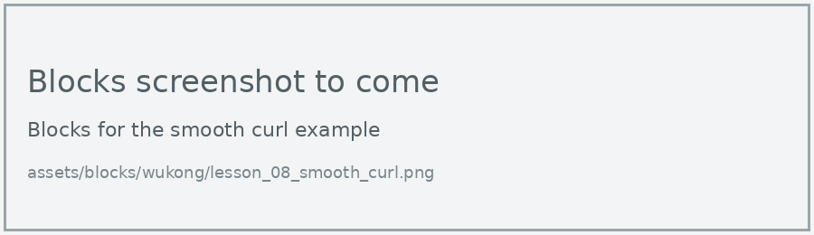
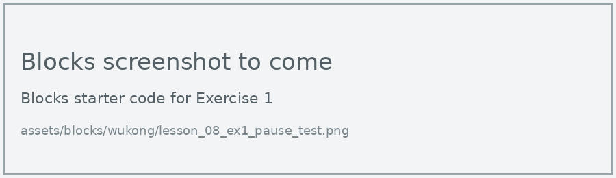
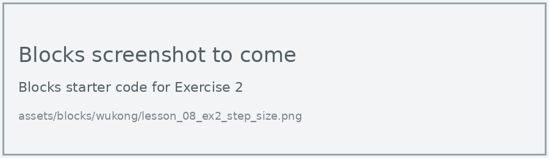
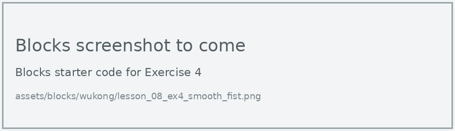

# Lesson 8: Smooth Movement

!!! learn "In this lesson we will learn"
    - how a while loop repeats code until its condition becomes `False`
    - how to make a finger curl slowly instead of snapping into place
    - how the step size and pause control the speed of a movement

!!! terms "Terminology"
    - **while loop** – a loop that keeps repeating its code while its condition is `True`.

When we set a servo motor's angle, it moves there as fast as it can. Real hands don't snap shut. To curl a finger slowly, we move it a few degrees at a time, with a short pause between each move.

## While loop

A **while loop** checks its condition before each repeat. Here it keeps going while the angle is 150 or less, adding 5 each time, so it stops once the finger has reached 150 degrees.

=== "Blocks"

    { .blocks }

    Blocks used: **on button pressed** (Input), **set angle to**, **change angle by** and **angle** (Variables), **while** (Loops), **0 ≤ 0** (Logic), **Set servo angle to** (wuKong), **pause (ms)** (Basic).

=== "Python"

    ```python linenums="1"
    --8<-- "examples/other/wukong/lesson_08/smooth_curl/main.py"
    ```

!!! primm "PRIMM"
    1. **Predict** how the index finger will move when you press A, and when you press B.
    2. **Run** the program.
    3. Time to **investigate** the code. What does each line do?

??? note "Code explanation"
    - **line 1** → defines a function called `on_button_pressed_a`, which will run when button A is pressed.
    - **line 2** → creates the `angle` variable and sets it to 0.
    - **line 3** → starts a loop that repeats while the angle is 150 or less.
    - **line 4** → turns the index finger's servo motor to the current angle.
    - **line 5** → adds 5 to the angle.
    - **line 6** → waits 20 milliseconds before the next small move.
    - **line 7** → connects `on_button_pressed_a` to button A.
    - **line 9** → defines a function called `on_button_pressed_b`, which will run when button B is pressed.
    - **line 10** → straightens the index finger straight away.
    - **line 11** → connects `on_button_pressed_b` to button B.

!!! tip "Repeat loop or while loop?"
    A repeat loop runs a set number of times. A while loop runs until its condition becomes `False`, so we use it when we know where to stop, rather than how many times to repeat.

!!! warning "Make sure the loop can end"
    If we forget the line that adds 5, the angle never changes, the condition is always `True`, and the loop never stops.

## Exercises

!!! primm "PRIMM"
    Time to **modify** the code and see what happens.

Each exercise has starter code in Blocks and Python. Build the blocks in MakeCode, or copy the Python into MakeCode's Python view, then change it.

### Exercise 1

How does the pause change the speed? Change the pause to 5, 50 and 100 ms, time how long the finger takes to curl each time with a stopwatch, and record the results in a table.

Starter code:

=== "Blocks"

    { .blocks }

=== "Python"

    ```python linenums="1"
    --8<-- "examples/other/wukong/lesson_08/ex1_pause_test/main.py"
    ```

### Exercise 2

What's the relationship between the pause, the step size and the total time? Work out how many steps the loop takes to reach 150, then predict the total time before testing.

Starter code:

=== "Blocks"

    { .blocks }

=== "Python"

    ```python linenums="1"
    --8<-- "examples/other/wukong/lesson_08/ex2_step_size/main.py"
    ```

### Exercise 3

Can you change button B so it straightens the finger slowly too? Hint: start at 150 and take 5 away each time.

Starter code:

=== "Blocks"

    { .blocks }

=== "Python"

    ```python linenums="1"
    --8<-- "examples/other/wukong/lesson_08/ex3_slow_open/main.py"
    ```

### Exercise 4

Can you make all 5 fingers curl slowly together, to make a smooth fist?

Starter code:

=== "Blocks"

    { .blocks }

=== "Python"

    ```python linenums="1"
    --8<-- "examples/other/wukong/lesson_08/ex4_smooth_fist/main.py"
    ```
