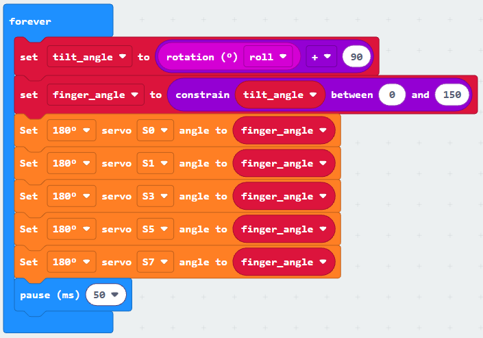
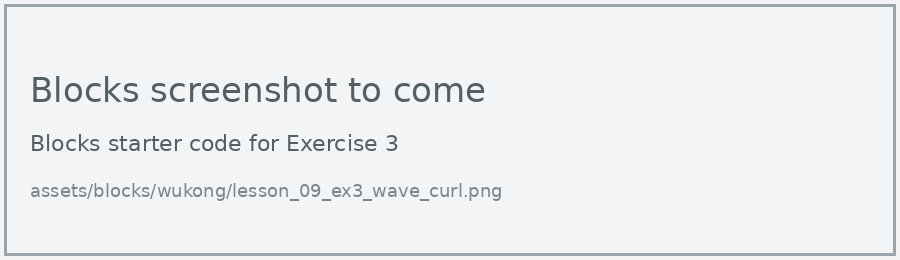

# Lesson 9: Tilt Control

!!! learn "In this lesson we will learn"
    - how the micro:bit measures tilt in degrees
    - how to change a range of numbers by adding to it
    - how to control the fingers by tilting the micro:bit

!!! terms "Terminology"
    - **accelerometer** – a sensor that measures movement and tilt in three directions and can recognise gestures such as shaking.

The micro:bit's **accelerometer** measures how it's tilted, and the **rotation (°)** block turns that into degrees. When we tilt the board left and right, its roll (how far it dips to one side, like a plane dipping one wing) goes from about -90 to 90 degrees. Our fingers need an angle from 0 to 150. If we add 90 to the roll, -90 becomes 0 and 90 becomes 180, which is close to the range we need.

!!! tip "Can't find the rotation block?"
    It isn't in the main **Input** list. In the list of block categories, select **…more** under **Input**, and the **rotation (°)** block is there. After we drag it in, we check its drop-down says **roll**.

## Turn the tilt into an angle

=== "Blocks"

    { .blocks }

    Blocks used: **forever** and **pause (ms)** (Basic), **set angle to** and **angle** (Variables), **0 + 0** and **constrain** (Math), **rotation (°) roll** (Input > more), **Set servo angle to** (wuKong).

=== "Python"

    ```python linenums="1"
    --8<-- "examples/other/wukong/lesson_09_tilt_control.py"
    ```

!!! primm "PRIMM"
    1. **Predict** what the hand will do as you slowly tilt the board from left to right.
    2. **Run** the program.
    3. Time to **investigate** the code. What does each line do?

??? note "Code explanation"
    === "Blocks"

        - **forever** → runs the blocks inside again and again.
            - **set angle to (rotation (°) roll + 90)** → reads how far the board is tilted left or right (its roll, from -90 to 90 degrees) and adds 90, giving an angle from 0 to 180.
            - **set angle to constrain angle between low 0 and high 150** → keeps the angle between 0 and 150, so the fingers stay in their safe range.
            - **Set 180° servo S0 angle to angle** to **Set 180° servo S7 angle to angle** (5 blocks) → set all 5 fingers to the angle.
            - **pause (ms) 50** → waits 50 milliseconds before reading the tilt again.

    === "Python"

        - **line 1** → defines the function that the forever loop repeats.
        - **line 2** → reads how far the board is tilted left or right (its roll, from -90 to 90 degrees) and adds 90, giving an angle from 0 to 180.
        - **line 3** → keeps the angle between 0 and 150, so the fingers stay in their safe range.
        - **lines 4–8** → set all 5 fingers to the angle.
        - **line 9** → waits 50 milliseconds before reading the tilt again.
        - **line 10** → tells the micro:bit to run `on_forever` again and again.

!!! tip "Why constrain?"
    Adding 90 gives angles up to 180, and if we turn the board upside down the roll can go past 90 degrees too. Angles past 150 could strain the servo motors. **Constrain** keeps the angle inside the range we choose.

## Exercises

!!! primm "PRIMM"
    Time to **modify** the code and see what happens.

Each exercise has starter code in Blocks and Python. Build the blocks in MakeCode, or copy the Python into MakeCode's Python view, then change it.

### Exercise 1

Does the hand open and close smoothly as you tilt? Why might it jitter? Try changing the pause and see whether it helps.

Starter code:

=== "Blocks"

    { .blocks }

=== "Python"

    ```python linenums="1"
    --8<-- "examples/other/wukong/lesson_09_ex1_jitter.py"
    ```

### Exercise 2

Can you control the hand by tilting forwards and backwards instead? Hint: change the rotation block's drop-down to **pitch**.

Starter code:

=== "Blocks"

    { .blocks }

=== "Python"

    ```python linenums="1"
    --8<-- "examples/other/wukong/lesson_09_ex2_tilt_y.py"
    ```

### Exercise 3

Can you give each finger a different range, so the fingers curl one after another as you tilt? For example, the thumb curls over the first part of the tilt and the little finger over the last part.

Starter code:

=== "Blocks"

    { .blocks }

=== "Python"

    ```python linenums="1"
    --8<-- "examples/other/wukong/lesson_09_ex3_wave_curl.py"
    ```
