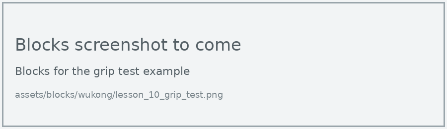
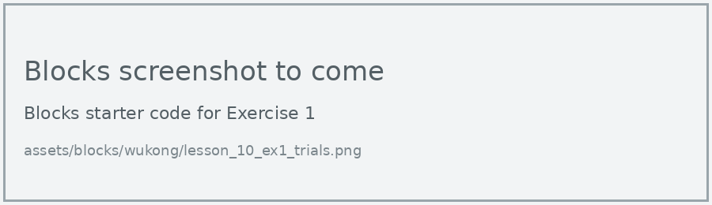
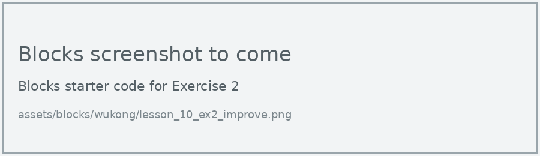

# Lesson 10: Grip Challenge

!!! learn "In this lesson we will learn"
    - how to test a design with repeated trials
    - how to record results in a testing table
    - how to improve a design and use results to show whether it's better

!!! terms "Terminology"
    - **prototype** – an early version of a product, built so we can test an idea and improve it.

Our hand can make gestures, but can it hold something? Our hand is a **prototype**: a first version we can test and improve. In this challenge, we test how well it grips, make one design change, then test again to see if the change helped.

## The grip test program

=== "Blocks"

    { .blocks }

    Blocks used: **function** and **call** (Functions), **on button pressed** (Input), **Set servo angle to** (wuKong), **pause (ms)** (Basic).

=== "Python"

    ```python linenums="1"
    --8<-- "examples/other/wukong/lesson_10_grip_test.py"
    ```

!!! primm "PRIMM"
    1. **Predict** whether the hand will hold a scrunched paper ball for the whole 5 seconds.
    2. **Run** the program with the ball resting in the palm.
    3. Time to **investigate** the code. What does each line do?

??? note "Code explanation"
    - **line 1** → defines a function called `make_fist`.
    - **lines 2–6** → curl all 5 fingers.
    - **line 8** → defines a function called `open_hand`.
    - **lines 9–13** → straighten all 5 fingers.
    - **line 15** → defines a function called `on_button_pressed_a`, which will run when button A is pressed.
    - **line 16** → calls `make_fist` to close the hand around the object.
    - **line 17** → holds the grip for 5 seconds.
    - **line 18** → calls `open_hand` to let go.
    - **line 19** → connects `on_button_pressed_a` to button A.

## Testing table

Each trial is one press of button A. A trial passes if the hand is still holding the object after 5 seconds.

| Trial | Design | Expected result | Actual result | Pass or fail |
| --- | --- | --- | --- | --- |
| 1 | original | holds for 5 seconds | | |
| 2 | original | holds for 5 seconds | | |
| … | … | … | | |

Run 5 trials with the original design, so one lucky grip doesn't fool us.

## Exercises

!!! primm "PRIMM"
    Time to **modify** the code and see what happens.

Each exercise has starter code in Blocks and Python. Build the blocks in MakeCode, or copy the Python into MakeCode's Python view, then change it.

### Exercise 1

Can you choose a light object, such as a paper cup or a scrunched paper ball, and run 5 trials with the original hand? Record the results in a testing table.

Starter code:

=== "Blocks"

    { .blocks }

=== "Python"

    ```python linenums="1"
    --8<-- "examples/other/wukong/lesson_10_ex1_trials.py"
    ```

### Exercise 2

Can you make one design change to improve the grip, then run 5 more trials? For example, add rubber bands to the fingertips, change the finger angles in `make_fist`, or curl the fingers in a different order.

Starter code:

=== "Blocks"

    { .blocks }

=== "Python"

    ```python linenums="1"
    --8<-- "examples/other/wukong/lesson_10_ex2_improve.py"
    ```

### Exercise 3

Did your change improve the grip? Explain using your results from both sets of trials. Why is it important to change only one thing at a time?
