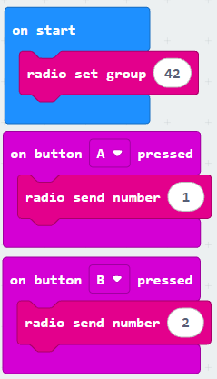
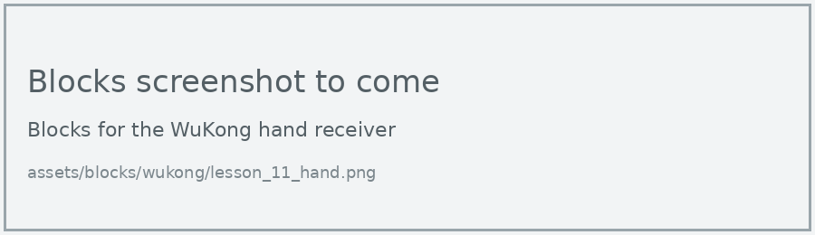
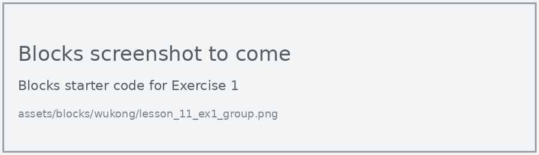
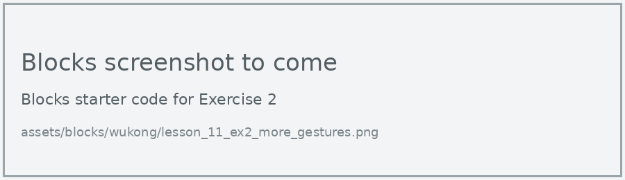

# Lesson 11: Radio Remote

!!! learn "In this lesson we will learn"
    - how to control the hand from a second micro:bit by radio
    - how the hand decides which gesture to make from each number
    - how to send a tilt reading so the hand copies the remote

Just like the XGO in its Radio Remote lesson, we use the micro:bit's **Radio** blocks. The remote sends a number, and the hand chooses a gesture.

## What we need

- the WuKong hand, with its micro:bit
- a second micro:bit to use as the remote, with a battery pack

!!! warning "Each pair needs its own radio group"
    Every pair needs a different radio group number, used in both programs. Otherwise one remote will control several hands.

## The remote

=== "Blocks"

    { .blocks }

    Blocks used: **on button pressed** (Input), **radio send number** and **radio set group** (Radio).

=== "Python"

    ```python linenums="1"
    --8<-- "examples/other/wukong/lesson_11/remote/main.py"
    ```

??? note "Code explanation"
    - **line 1** → defines a function called `on_button_pressed_a`, which will run when button A is pressed.
    - **line 2** → sends the number 1 by radio.
    - **line 3** → connects `on_button_pressed_a` to button A.
    - **line 5** → defines a function called `on_button_pressed_b`, which will run when button B is pressed.
    - **line 6** → sends the number 2 by radio.
    - **line 7** → connects `on_button_pressed_b` to button B.
    - **line 9** → sets the remote's radio group to 42.

## The hand

=== "Blocks"

    { .blocks }

    Blocks used: **function** and **call** (Functions), **on radio received receivedNumber** and **radio set group** (Radio), **if then else** and **0 = 0** (Logic), **Set servo angle to** (wuKong).

=== "Python"

    ```python linenums="1"
    --8<-- "examples/other/wukong/lesson_11/hand/main.py"
    ```

Download each program to its own micro:bit, then switch the WuKong board on.

!!! primm "PRIMM"
    1. **Predict** what the hand will do when you press A on the remote, then B.
    2. **Run** both programs.
    3. Time to **investigate** the code. What does each line do?

??? note "Code explanation"
    - **line 1** → defines a function called `make_fist`.
    - **lines 2–6** → curl all 5 fingers.
    - **line 8** → defines a function called `open_hand`.
    - **lines 9–13** → straighten all 5 fingers.
    - **line 15** → defines a function called `on_received_number`, which gets the number that arrived in `receivedNumber`.
    - **line 16** → checks whether the number is 1…
    - **line 17** → …and if it is, makes a fist.
    - **line 18** → otherwise…
    - **line 19** → …opens the hand.
    - **line 20** → connects `on_received_number` to the event of a number arriving by radio.
    - **line 22** → sets the hand's radio group to 42, the same as the remote.

## Exercises

!!! primm "PRIMM"
    Time to **modify** the code and see what happens.

Each exercise has starter code in Blocks and Python. Build the blocks in MakeCode, or copy the Python into MakeCode's Python view, then change it.

### Exercise 1

Can you change 42 to your pair's radio group in both programs, and test that your remote only controls your hand?

Starter code:

=== "Blocks"

    { .blocks }

=== "Python"

    ```python linenums="1"
    --8<-- "examples/other/wukong/lesson_11/ex1_group/main.py"
    ```

### Exercise 2

Can you add more gestures from Lesson 6? Send 3 for A and B together and 4 for shake, and add an **else if** on the hand for each one.

Starter code:

=== "Blocks"

    { .blocks }

=== "Python"

    ```python linenums="1"
    --8<-- "examples/other/wukong/lesson_11/ex2_more_gestures/main.py"
    ```

### Exercise 3

Can you make the hand copy how far the remote is tilted? It should:

- send the remote's **acceleration (mg) x** as a number, about 10 times a second, in a forever loop
- map the number to an angle on the hand, as in Lesson 9
- set all 5 fingers to that angle

Starter code:

=== "Blocks"

    { .blocks }

=== "Python"

    ```python linenums="1"
    --8<-- "examples/other/wukong/lesson_11/ex3_copy_tilt/main.py"
    ```
