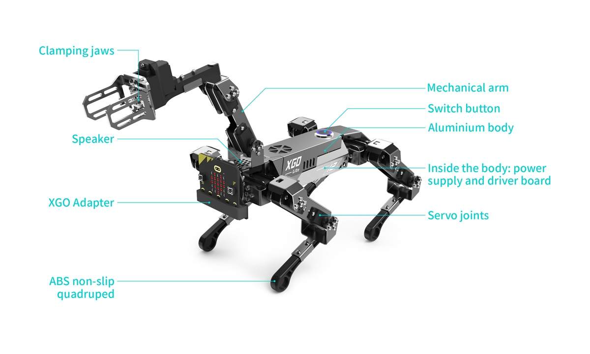
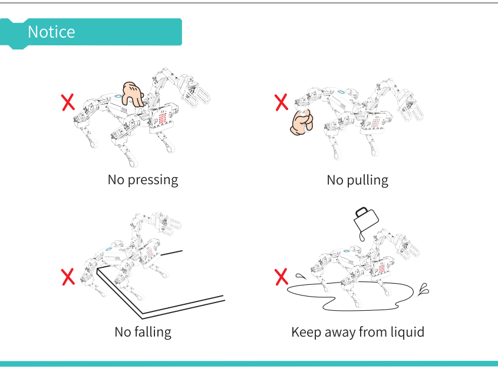

# Lesson 1: Meet the XGO

!!! learn "In this lesson we will learn"
    - how to switch the XGO on and off, and charge it
    - how to use the XGO safely
    - how to set up a MakeCode project for the XGO
    - what the blocks in the xgo category do

!!! terms "Terminology"
    - **control board** – the circuit board inside the dog that drives its servo motors, following the commands the micro:bit sends it.

The XGO has 15 servo motors: three in each leg, plus three in the robotic arm. The micro:bit doesn't move them directly. Instead, it sends commands to the dog's own **control board**, which moves the servo motors.

<figure markdown="span">
  { width="560" }
  <figcaption>The main parts of the XGO Robot Dog V2. Image: ELECFREAKS.</figcaption>
</figure>

## What we need

- an XGO Robot Dog V2, charged (a full charge takes about 2 hours)
- a micro:bit V2 in the slot on the dog's head
- a micro USB data cable
- a computer with Chrome or Edge
- clear floor or table space

!!! warning "Safety rules"
    - Don't block or hold the dog's legs while it moves. This damages the servo motors.
    - The arm can only carry objects up to 20 g. A paper ball or pom-pom is fine; a phone is not.
    - Don't use the dog while it's charging.
    - Before each use, check that the leg, arm and gripper screws are tight. Tell our teacher if any are loose.
    - Keep fingers clear of the joints and gripper while the dog is switched on.

<figure markdown="span">
  { width="480" }
  <figcaption>Don't block or press on the dog, don't pull its legs, don't let it fall, and keep it away from liquids. Image: ELECFREAKS.</figcaption>
</figure>

## Switch on

1. Place the dog on the floor or table, lying down.
    - Why: the dog measures its balance while it starts up. If we hold it, or it starts in an awkward pose, it moves strangely.
2. Press the power switch on the dog's back once.
    - Result: the ring light around the switch flashes quickly, then stays on.
3. Don't touch the dog until it has finished starting up.
    - Result: the dog stands up slowly, and the arm opens and then folds back in.

<figure markdown="span">
  { width="480" }
  <figcaption>Switching on. Image: ELECFREAKS.</figcaption>
</figure>

## Switch off

1. Press the power switch again.
    - Result: the ring light flashes slowly, the dog lies down, the arm folds in, then the light goes out.

<figure markdown="span">
  { width="480" }
  <figcaption>Switching off. Image: ELECFREAKS.</figcaption>
</figure>

## Charging

If the ring light flashes and the dog lies down by itself, the battery is low. Switch it off and plug the charger into the port on the dog's belly. The charger's light is red while charging and green when the battery is full.

<figure markdown="span">
  { width="480" }
  <figcaption>The charging port is on the dog's belly. Image: ELECFREAKS.</figcaption>
</figure>

## The micro:bit slot

The micro:bit plugs into a slot on the dog's head. Always switch the dog off before taking out or putting in the micro:bit, and check which way it faces so it goes back the same way.

To download a program, switch the dog off, then plug the USB cable into the micro:bit in its slot. If we can't reach the USB port, take the micro:bit out first.

## Set up a MakeCode project

Follow [Using MakeCode](../using-makecode.md) to create a new project and add the XGO extension (search for `xgo`). A new **xgo** category appears in the list of block categories. It has these groups:

| Group | What it does |
| --- | --- |
| Basic | connecting to the dog, built-in actions, battery level and balance mode |
| Set Servo | body height, speed, switching servo motors on and off, and recording poses |
| Sports | walking, turning, tilting and shifting the body, and moving single legs |
| Robot Arm(V2) | arm position and gripper |

## Exercises

### Exercise 1

Can you switch the dog on, wait for it to finish starting up, then switch it off? Describe what the dog and its ring light do at each step.

### Exercise 2

Can you find the power switch, the charging port and the micro:bit slot on your dog? Show a partner where each one is.
