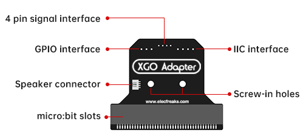
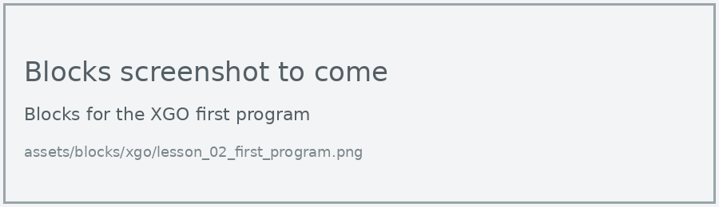
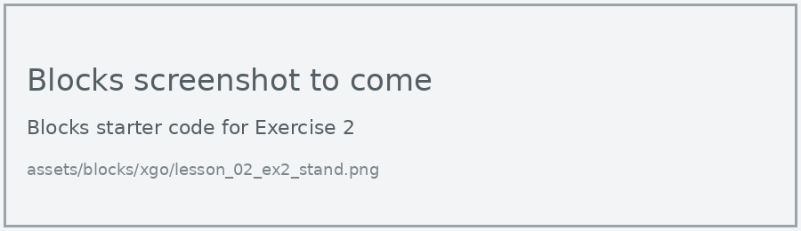

# Lesson 2: First Program

!!! learn "In this lesson we will learn"
    - how the micro:bit talks to the XGO through two pins
    - how to start every XGO program with **set XGO**
    - how to use button events to make the dog sit and show its battery level

!!! terms "Terminology"
    - **pin** – a metal connection point on the micro:bit, such as pins 0, 1 and 2, that can be used for inputs and outputs.
    - **serial communication** – sending data one piece after another along a wire, which is how the micro:bit sends commands to the XGO's control board.

Our first program checks that the micro:bit can talk to the dog.

## Set XGO

The micro:bit sends commands to the dog's control board using **serial communication**. The commands travel through two **pins**: P14 sends (TX, short for transmit) and P13 receives (RX). **Set XGO TX P14 RX P13** tells the micro:bit which pins to use, so it has to be the first block in **on start**.

<figure markdown="span">
  { width="420" }
  <figcaption>The micro:bit plugs into the XGO Adapter board. The 4-pin signal interface connects the board to the dog's control board. Image: <a href="https://wiki.elecfreaks.com/en/microbit/robot/xgo-robot-kit-v2/hardware-introduction/">ELECFREAKS</a>.</figcaption>
</figure>

=== "Blocks"

    { .blocks }

    Blocks used: **set XGO TX RX** (xgo > Basic), **show icon** (Basic).

=== "Python"

    ```python linenums="1"
    --8<-- "examples/other/xgo/lesson_02/first_program/main.py"
    ```

!!! primm "PRIMM"
    1. **Predict** what you think the dog and the display will do when the dog switches on.
    2. **Run** the program.
    3. Time to **investigate** the code. What does each line do?

??? note "Code explanation"
    - **line 1** → tells the micro:bit to send commands to the dog on pin P14 and receive replies on pin P13.
    - **line 2** → shows a happy face on the display.

!!! warning "P14 and P13, not P1 and P2"
    Older XGO examples online use pins P1 and P2. Those are for the first XGO kit. The V2 dog uses P14 and P13. With the wrong pins, the dog ignores every command.

## Button events

Unlike the PU Robot, the XGO's micro:bit buttons are easy to reach, so we can use them to start actions. Pressing a button is an event, and **on button A pressed** is its event handler.

=== "Blocks"

    { .blocks }

    Blocks used: **on button pressed** (Input), **Execution action** and **get XGO's current power** (xgo > Basic), **show number** and **show icon** (Basic), **set XGO TX RX** (xgo > Basic).

=== "Python"

    ```python linenums="1"
    --8<-- "examples/other/xgo/lesson_02/sit_and_battery/main.py"
    ```

Download the program, lay the dog down and switch it on. Wait until the ring light stays on and the dog has stood up before pressing any buttons.

!!! primm "PRIMM"
    1. **Predict** what the dog will do when you press A, and what you'll see when you press B.
    2. **Run** the program.
    3. Time to **investigate** the code. What does each line do?

??? note "Code explanation"
    - **line 1** → defines a function called `on_button_pressed_a`, which will run when button A is pressed.
    - **line 2** → makes the dog sit down.
    - **line 3** → connects `on_button_pressed_a` to button A.
    - **line 5** → defines a function called `on_button_pressed_b`, which will run when button B is pressed.
    - **line 6** → reads the dog's battery level and shows it on the display.
    - **line 7** → connects `on_button_pressed_b` to button B.
    - **line 9** → tells the micro:bit which pins to use to talk to the dog.
    - **line 10** → shows a happy face.

!!! tip "Why is on start at the bottom?"
    MakeCode puts the event handlers at the top of the Python program and the **on start** code at the bottom. The on start code still runs first, when the micro:bit switches on. The event handlers wait until their button is pressed.

## Exercises

!!! primm "PRIMM"
    Time to **modify** the code and see what happens.

Each exercise has starter code in Blocks and Python. Build the blocks in MakeCode, or copy the Python into MakeCode's Python view, then change it.

### Exercise 1

What happens if we take out the **set XGO** block and press A? Why do you think this happens?

Starter code:

=== "Blocks"

    { .blocks }

=== "Python"

    ```python linenums="1"
    --8<-- "examples/other/xgo/lesson_02/ex1_no_set_xgo/main.py"
    ```

### Exercise 2

Can you add a program for pressing A and B together that makes the dog stand back up? Use the **Stand** action.

Starter code:

=== "Blocks"

    { .blocks }

=== "Python"

    ```python linenums="1"
    --8<-- "examples/other/xgo/lesson_02/ex2_stand/main.py"
    ```

### Exercise 3

Can you make the display show a sad face when the battery level is below 20, and a happy face otherwise, each time B is pressed?

Starter code:

=== "Blocks"

    { .blocks }

=== "Python"

    ```python linenums="1"
    --8<-- "examples/other/xgo/lesson_02/ex3_battery_face/main.py"
    ```
