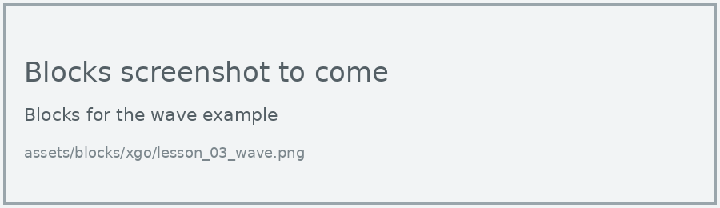
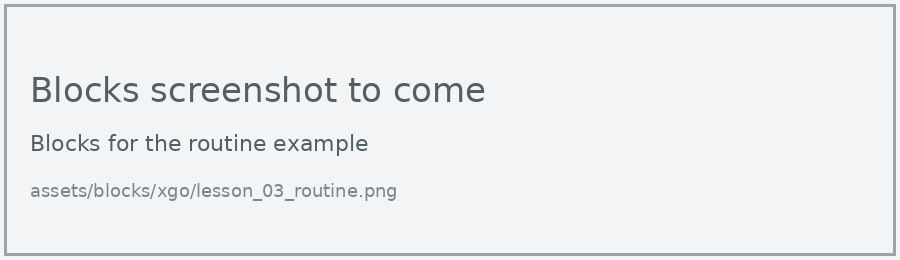
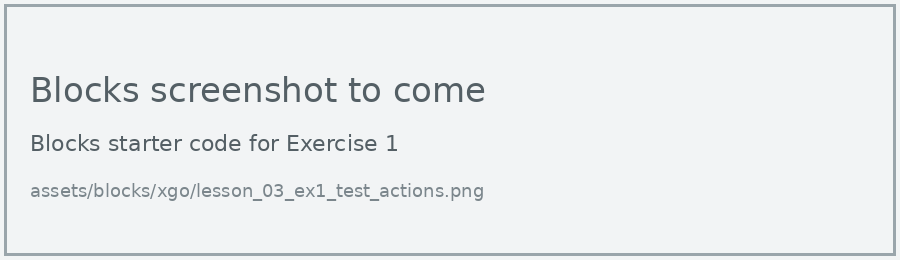
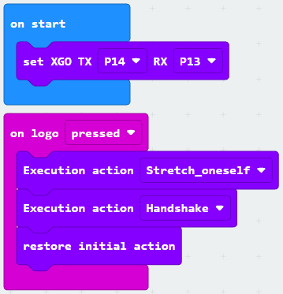

# Lesson 3: Built-in Actions

!!! learn "In this lesson we will learn"
    - how to run the XGO's built-in actions
    - why XGO blocks wait for each movement to finish
    - how to put actions together into a routine

The XGO has 19 built-in actions, such as Sit_down, Wave, Handshake and Stretch_oneself. Each one is a whole movement that ELECFREAKS has already programmed.

## Execution action

=== "Blocks"

    { .blocks }

    Blocks used: **on button pressed** (Input), **Execution action** and **set XGO TX RX** (xgo > Basic).

=== "Python"

    ```python linenums="1"
    --8<-- "examples/other/xgo/lesson_03_wave.py"
    ```

!!! primm "PRIMM"
    1. **Predict** what the dog will do when you press A.
    2. **Run** the program.
    3. Time to **investigate** the code. What does each line do?

??? note "Code explanation"
    - **line 1** → defines a function called `on_button_pressed_a`, which will run when button A is pressed.
    - **line 2** → makes the dog do its wave action.
    - **line 3** → connects `on_button_pressed_a` to button A.
    - **line 5** → tells the micro:bit which pins to use to talk to the dog.

In Python, each action is an option of `xgo.action_enum`, written in capitals, such as `WAVE`, `SIT_DOWN` and `HANDSHAKE`.

## A routine

Most XGO blocks wait until the dog finishes moving (up to about 10 seconds) before the next block runs. So when we put actions one after another, the dog does them one at a time, in order. Here we use the micro:bit V2's touch logo as the trigger.

=== "Blocks"

    { .blocks }

    Blocks used: **on logo pressed** (Input), **Execution action**, **restore initial action** and **set XGO TX RX** (xgo > Basic).

=== "Python"

    ```python linenums="1"
    --8<-- "examples/other/xgo/lesson_03_routine.py"
    ```

!!! primm "PRIMM"
    1. **Predict** what the dog will do when you touch the micro:bit logo, and in what order.
    2. **Run** the program.
    3. Time to **investigate** the code. What does each line do?

??? note "Code explanation"
    - **line 1** → defines a function called `on_logo_pressed`, which will run when the logo is touched.
    - **line 2** → makes the dog stretch, and waits until it's finished.
    - **line 3** → makes the dog hold out a paw to shake hands.
    - **line 4** → puts the dog back in its starting position.
    - **line 5** → connects `on_logo_pressed` to touching the logo.
    - **line 7** → tells the micro:bit which pins to use to talk to the dog.

!!! tip "Restore initial action"
    **Restore initial action** puts every joint back where it was when the dog started up. Ending a routine with it means the next action always starts from the same position.

## Exercises

!!! primm "PRIMM"
    Time to **modify** the code and see what happens.

Each exercise has starter code in Blocks and Python. Build the blocks in MakeCode, or copy the Python into MakeCode's Python view, then change it.

### Exercise 1

Can you test at least 8 actions, one at a time? Record each one in a table with the columns Action, What the dog did and Time taken (seconds).

Starter code:

=== "Blocks"

    { .blocks }

=== "Python"

    ```python linenums="1"
    --8<-- "examples/other/xgo/lesson_03_ex1_test_actions.py"
    ```

### Exercise 2

Can you make a 3-action routine that tells a short story, such as a dog asking for food, eating and then lying down? Start it with the touch logo.

Starter code:

=== "Blocks"

    { .blocks }

=== "Python"

    ```python linenums="1"
    --8<-- "examples/other/xgo/lesson_03_ex2_story.py"
    ```

### Exercise 3

Can you show a different icon on the display during each action of your routine?

Starter code:

=== "Blocks"

    { .blocks }

=== "Python"

    ```python linenums="1"
    --8<-- "examples/other/xgo/lesson_03_ex3_icons.py"
    ```
