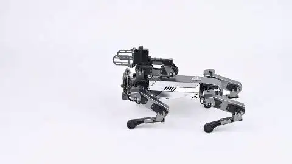
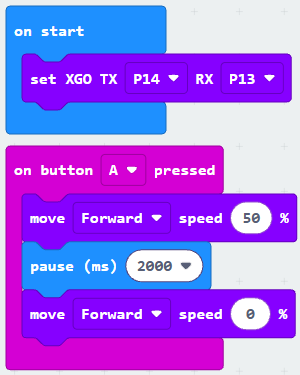
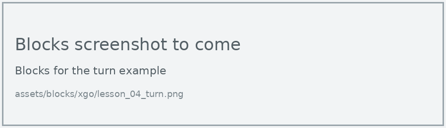
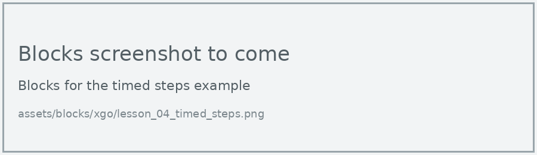
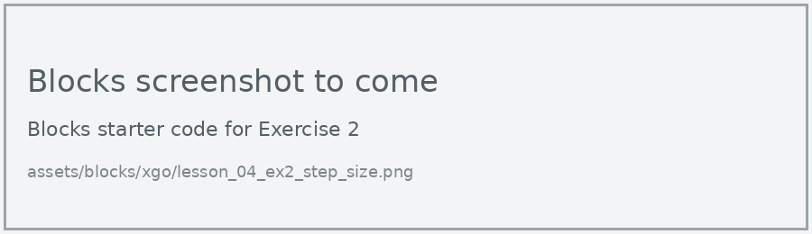

# Lesson 4: Walking and Turning

!!! learn "In this lesson we will learn"
    - how to make the dog walk at a set speed
    - how to make the dog turn on the spot
    - why walking keeps going until we stop it
    - how to walk for a set time

The XGO walks in four directions (forward, backward, left and right) and turns on the spot. Unlike the built-in actions, walking doesn't finish by itself.

## Walk

The **move** block sets a direction and a speed from 0 to 100%. The dog keeps walking until it gets another command, so we stop it by setting the speed to 0.

<figure markdown="span">
  { width="480" }
  <figcaption>The XGO walking. Image: ELECFREAKS.</figcaption>
</figure>

=== "Blocks"

    { .blocks }

    Blocks used: **on button pressed** (Input), **move speed** (xgo > Sports), **pause (ms)** (Basic), **set XGO TX RX** (xgo > Basic).

=== "Python"

    ```python linenums="1"
    --8<-- "examples/other/xgo/lesson_04_walk_forward.py"
    ```

!!! primm "PRIMM"
    1. **Predict** how far the dog will walk when you press A.
    2. **Run** the program.
    3. Time to **investigate** the code. What does each line do?

??? note "Code explanation"
    === "Blocks"

        - **on start** → runs the blocks inside once, when the program starts.
            - **set XGO TX P14 RX P13** → tells the micro:bit which pins to use to talk to the dog.
        - **on button A pressed** → runs the blocks inside when we press button A.
            - **move Forward speed 50 %** → starts the dog walking forward at 50% speed.
            - **pause (ms) 3000** → waits 3 seconds while the dog keeps walking.
            - **move Forward speed 0 %** → sets the speed to 0, which stops the dog.

    === "Python"

        - **line 1** → defines a function called `on_button_pressed_a`, which will run when button A is pressed.
        - **line 2** → starts the dog walking forward at 50% speed.
        - **line 3** → waits 3 seconds while the dog keeps walking.
        - **line 4** → sets the speed to 0, which stops the dog.
        - **line 5** → connects `on_button_pressed_a` to button A.
        - **line 7** → tells the micro:bit which pins to use to talk to the dog.

!!! warning "Be ready to switch off"
    If we forget to set the speed back to 0, the dog keeps walking. Be ready to catch it or press the power switch, especially near the edge of a table.

## Turn

The **rotate** block works the same way, but turns the dog on the spot.

=== "Blocks"

    { .blocks }

    Blocks used: **on button pressed** (Input), **rotate speed** (xgo > Sports), **pause (ms)** (Basic), **set XGO TX RX** (xgo > Basic).

=== "Python"

    ```python linenums="1"
    --8<-- "examples/other/xgo/lesson_04_turn.py"
    ```

!!! primm "PRIMM"
    1. **Predict** how far the dog will turn when you press B.
    2. **Run** the program.
    3. Time to **investigate** the code. What does each line do?

??? note "Code explanation"
    === "Blocks"

        - **on start** → runs the blocks inside once, when the program starts.
            - **set XGO TX P14 RX P13** → tells the micro:bit which pins to use to talk to the dog.
        - **on button B pressed** → runs the blocks inside when we press button B.
            - **rotate Left, speed is 50 %** → starts the dog turning left at 50% speed.
            - **pause (ms) 2000** → waits 2 seconds while the dog keeps turning.
            - **rotate Left, speed is 0 %** → sets the turning speed to 0, which stops the dog.

    === "Python"

        - **line 1** → defines a function called `on_button_pressed_b`, which will run when button B is pressed.
        - **line 2** → starts the dog turning left at 50% speed.
        - **line 3** → waits 2 seconds while the dog keeps turning.
        - **line 4** → sets the turning speed to 0, which stops the dog.
        - **line 5** → connects `on_button_pressed_b` to button B.
        - **line 7** → tells the micro:bit which pins to use to talk to the dog.

## Walk for a set time

The **translational motion** block with a time walks for that many seconds and then stops by itself. Its step size, in millimetres, sets how big each step is.

=== "Blocks"

    { .blocks }

    Blocks used: **on button pressed** (Input), **set XGO to perform a translational motion with a step size of mm for seconds** (xgo > Sports), **set XGO TX RX** (xgo > Basic).

=== "Python"

    ```python linenums="1"
    --8<-- "examples/other/xgo/lesson_04_timed_steps.py"
    ```

!!! primm "PRIMM"
    1. **Predict** how this walk will be different from the first example.
    2. **Run** the program.
    3. Time to **investigate** the code. What does each line do?

??? note "Code explanation"
    === "Blocks"

        - **on start** → runs the blocks inside once, when the program starts.
            - **set XGO TX P14 RX P13** → tells the micro:bit which pins to use to talk to the dog.
        - **on button A pressed** → runs the blocks inside when we press button A.
            - **set XGO to perform a forward(0mm~25mm) translational motion with a step size of 15 mm for 3 seconds** → walks the dog forward with 15 mm steps for 3 seconds, then stops.

    === "Python"

        - **line 1** → defines a function called `on_button_pressed_a`, which will run when button A is pressed.
        - **line 2** → walks the dog forward with 15 mm steps for 3 seconds, then stops.
        - **line 3** → connects `on_button_pressed_a` to button A.
        - **line 5** → tells the micro:bit which pins to use to talk to the dog.

## Exercises

!!! primm "PRIMM"
    Time to **modify** the code and see what happens.

Each exercise has starter code in Blocks and Python. Build the blocks in MakeCode, or copy the Python into MakeCode's Python view, then change it.

### Exercise 1

What happens if we take out the last move line (speed 0)? Predict first, then test it, ready to switch the dog off.

Starter code:

=== "Blocks"

    { .blocks }

=== "Python"

    ```python linenums="1"
    --8<-- "examples/other/xgo/lesson_04_ex1_no_stop.py"
    ```

### Exercise 2

How does step size change how far the dog walks? It should:

1. walk forward for 3 seconds with step sizes of 5, 15 and 25 mm
2. measure the distance from a tape start line each time
3. run each step size 3 times and record the results in a table

Starter code:

=== "Blocks"

    { .blocks }

=== "Python"

    ```python linenums="1"
    --8<-- "examples/other/xgo/lesson_04_ex2_step_size.py"
    ```

### Exercise 3

Can you program the dog to walk in a square and finish where it started?

Starter code:

=== "Blocks"

    { .blocks }

=== "Python"

    ```python linenums="1"
    --8<-- "examples/other/xgo/lesson_04_ex3_square.py"
    ```
