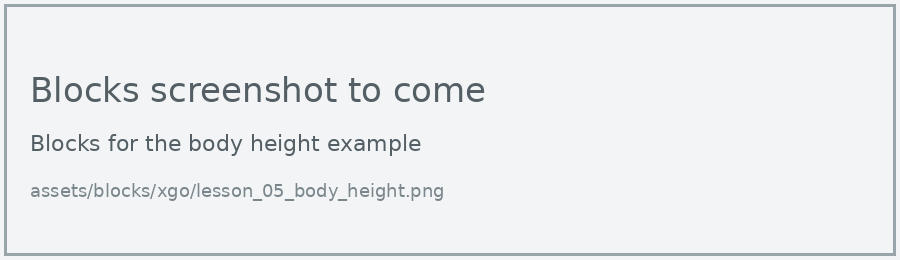
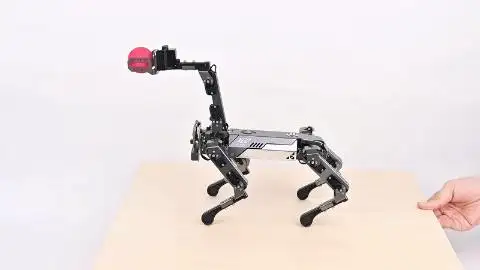
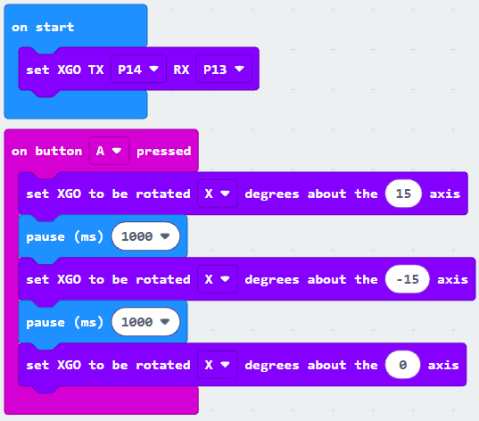
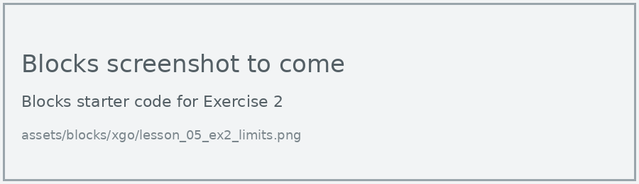
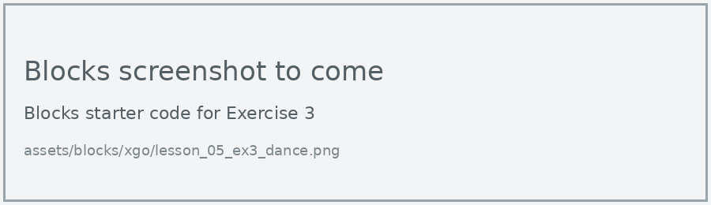

# Lesson 5: Body Posture

!!! learn "In this lesson we will learn"
    - how to raise and lower the dog's body
    - how to tilt the body around the X, Y and Z axes
    - how to put posture moves together into a dance

!!! terms "Terminology"
    - **axis** – an imaginary line, called x, y or z, along which movement is measured.
    - **yaw** – turning around the z-axis, like a car turning left or right.

The XGO can move its body without moving its feet. It can crouch down, stand tall, lean and twist. These moves are great for dances and for making the dog look alive.

<figure markdown="span">
  { width="480" }
  <figcaption>The XGO moving its body without moving its feet. Image: <a href="https://wiki.elecfreaks.com/en/microbit/robot/xgo-robot-kit-v2/xgo-lite-v2-products-instruction/">ELECFREAKS</a>.</figcaption>
</figure>

## Body height

The **body height** block sets how tall the dog stands, from 0% (crouched) to 100% (as tall as it can go).

=== "Blocks"

    { .blocks }

    Blocks used: **on button pressed** (Input), **body height** (xgo > Set Servo), **pause (ms)** (Basic), **set XGO TX RX** (xgo > Basic).

=== "Python"

    ```python linenums="1"
    --8<-- "examples/other/xgo/lesson_05/body_height/main.py"
    ```

!!! primm "PRIMM"
    1. **Predict** what the dog will do when you press A.
    2. **Run** the program.
    3. Time to **investigate** the code. What does each line do?

??? note "Code explanation"
    - **line 1** → defines a function called `on_button_pressed_a`, which will run when button A is pressed.
    - **line 2** → lowers the body to 20% height.
    - **line 3** → waits for 1 second.
    - **line 4** → raises the body to its full height.
    - **line 5** → waits for 1 second.
    - **line 6** → moves the body back to half height.
    - **line 7** → connects `on_button_pressed_a` to button A.
    - **line 9** → tells the micro:bit which pins to use to talk to the dog.

## Tilt the body

The body can tilt around three **axes**. Think of three sticks pushed through the dog's body: one from nose to tail (X), one from side to side (Y) and one from top to bottom (Z). Turning around each stick tilts the dog a different way. Turning around the Z axis is called **yaw**.

The **rotate … degrees about the … axis** block tilts the body from -20 to 20 degrees.

<figure markdown="span">
  { width="480" }
  <figcaption>The XGO can also keep its body level by itself when the ground tilts. Image: <a href="https://wiki.elecfreaks.com/en/microbit/robot/xgo-robot-kit-v2/xgo-lite-v2-products-instruction/">ELECFREAKS</a>.</figcaption>
</figure>

=== "Blocks"

    { .blocks }

    Blocks used: **on button pressed** (Input), **set XGO to be rotated degrees about the axis** (xgo > Sports), **pause (ms)** (Basic), **set XGO TX RX** (xgo > Basic).

=== "Python"

    ```python linenums="1"
    --8<-- "examples/other/xgo/lesson_05/rotate_body/main.py"
    ```

!!! primm "PRIMM"
    1. **Predict** which way the dog will lean when you press A.
    2. **Run** the program.
    3. Time to **investigate** the code. What does each line do?

??? note "Code explanation"
    - **line 1** → defines a function called `on_button_pressed_a`, which will run when button A is pressed.
    - **line 2** → tilts the body 15 degrees around the X axis.
    - **line 3** → waits for 1 second.
    - **line 4** → tilts the body 15 degrees the other way.
    - **line 5** → waits for 1 second.
    - **line 6** → tilts the body back to level.
    - **line 7** → connects `on_button_pressed_a` to button A.
    - **line 9** → tells the micro:bit which pins to use to talk to the dog.

!!! tip "Rotating keeps going"
    Like walking, a tilt stays in place until the dog gets another command. That's why we finish with an angle of 0, which puts the body back to level.

## Exercises

!!! primm "PRIMM"
    Time to **modify** the code and see what happens.

Each exercise has starter code in Blocks and Python. Build the blocks in MakeCode, or copy the Python into MakeCode's Python view, then change it.

### Exercise 1

Can you test rotation around the X, Y and Z axes? Sketch the dog from above and from the side, and label which way each axis tilts it.

Starter code:

=== "Blocks"

    { .blocks }

=== "Python"

    ```python linenums="1"
    --8<-- "examples/other/xgo/lesson_05/ex1_axes/main.py"
    ```

### Exercise 2

What happens if we type an angle bigger than 20 into the rotate block? Test 20, then 30, and describe what happens. Why do you think the block has a limit?

Starter code:

=== "Blocks"

    { .blocks }

=== "Python"

    ```python linenums="1"
    --8<-- "examples/other/xgo/lesson_05/ex2_limits/main.py"
    ```

### Exercise 3

Can you create a short dance of at least 6 posture moves that ends back at the starting position?

Starter code:

=== "Blocks"

    { .blocks }

=== "Python"

    ```python linenums="1"
    --8<-- "examples/other/xgo/lesson_05/ex3_dance/main.py"
    ```
