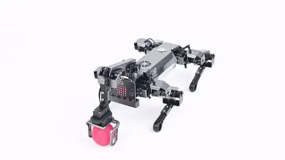
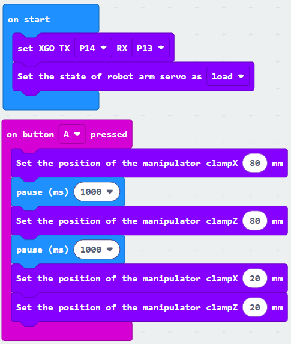
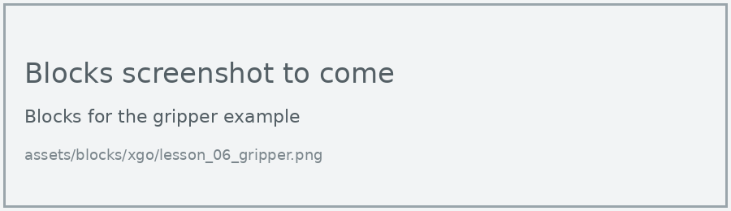

# Lesson 6: Robotic Arm

!!! learn "In this lesson we will learn"
    - how to switch the arm's servo motors on
    - how to move the arm forwards, backwards, up and down
    - how to open and close the gripper

!!! terms "Terminology"
    - **gripper** – the part at the end of a robot arm that opens and closes to hold things.
    - **load** – to switch on a servo motor's power so it moves where it's told and holds its position.

The robotic arm on the XGO's back has three servo motors. Two move the arm (clampX forwards and backwards, clampZ up and down), and one opens and closes the **gripper**.

<figure markdown="span">
  { width="480" }
  <figcaption>The arm reaching and gripping a pom-pom. Image: <a href="https://wiki.elecfreaks.com/en/microbit/robot/xgo-robot-kit-v2/xgo-lite-v2-products-instruction/">ELECFREAKS</a>.</figcaption>
</figure>

!!! warning "20 g or less"
    The arm can only lift objects up to 20 g, such as a scrunched-up paper ball or a pom-pom. Heavier objects damage its servo motors.

## Move the arm

Before the arm can move, we **load** its servo motors. Then we set clampX and clampZ, each from 0 to 100 mm.

=== "Blocks"

    { .blocks }

    Blocks used: **on button pressed** (Input), **Set the position of the manipulator clampX**, **clampZ** and **Set the state of robot arm servo as load** (xgo > Robot Arm(V2)), **pause (ms)** (Basic), **set XGO TX RX** (xgo > Basic).

=== "Python"

    ```python linenums="1"
    --8<-- "examples/other/xgo/lesson_06/arm_position/main.py"
    ```

!!! primm "PRIMM"
    1. **Predict** which way the arm will move for clampX, and which way for clampZ.
    2. **Run** the program.
    3. Time to **investigate** the code. What does each line do?

??? note "Code explanation"
    - **line 1** → defines a function called `on_button_pressed_a`, which will run when button A is pressed.
    - **line 2** → moves the arm's clampX position to 80 mm.
    - **line 3** → waits for 1 second.
    - **line 4** → moves the arm's clampZ position to 80 mm.
    - **line 5** → waits for 1 second.
    - **line 6** → moves clampX back to 20 mm.
    - **line 7** → moves clampZ back to 20 mm.
    - **line 8** → connects `on_button_pressed_a` to button A.
    - **line 10** → tells the micro:bit which pins to use to talk to the dog.
    - **line 11** → loads the arm's servo motors so they can move.

!!! warning "Check the Python names in MakeCode"
    The Python names of the arm blocks (such as `manipulator_clamp_x`) haven't been checked in MakeCode yet. Build the program in Blocks, then switch to Python to see the exact names.

## Open and close the gripper

The **clamp** block sets the gripper from 0 to 255.

=== "Blocks"

    { .blocks }

    Blocks used: **on button pressed** (Input), **Set the position of the manipulator clamp** and **Set the state of robot arm servo as load** (xgo > Robot Arm(V2)), **set XGO TX RX** (xgo > Basic).

=== "Python"

    ```python linenums="1"
    --8<-- "examples/other/xgo/lesson_06/gripper/main.py"
    ```

!!! primm "PRIMM"
    1. **Predict** which button will open the gripper and which will close it.
    2. **Run** the program.
    3. Time to **investigate** the code. What does each line do?

??? note "Code explanation"
    - **line 1** → defines a function called `on_button_pressed_a`, which will run when button A is pressed.
    - **line 2** → sets the gripper to position 50.
    - **line 3** → connects `on_button_pressed_a` to button A.
    - **line 5** → defines a function called `on_button_pressed_b`, which will run when button B is pressed.
    - **line 6** → sets the gripper to position 200.
    - **line 7** → connects `on_button_pressed_b` to button B.
    - **line 9** → tells the micro:bit which pins to use to talk to the dog.
    - **line 10** → loads the arm's servo motors so they can move.

## Exercises

!!! primm "PRIMM"
    Time to **modify** the code and see what happens.

Each exercise has starter code. Copy it into MakeCode's Python view, or build the same program in Blocks, then change it.

### Exercise 1

What clamp values make the gripper fully open and fully closed? Test values from 0 to 255 and record what you find.

Starter code:

```python linenums="1"
--8<-- "examples/other/xgo/lesson_06/ex1_clamp_range/main.py"
```

### Exercise 2

Can you program the dog to pick up a scrunched paper ball placed in front of it, lift it and drop it?

Starter code:

```python linenums="1"
--8<-- "examples/other/xgo/lesson_06/ex2_pick_up/main.py"
```

### Exercise 3

What does **clmap stable is stable** do? Set it to stable, then change the body height while the gripper holds the ball. Repeat with unstable and compare what happens to the gripper's position.

Starter code:

```python linenums="1"
--8<-- "examples/other/xgo/lesson_06/ex3_stable/main.py"
```
