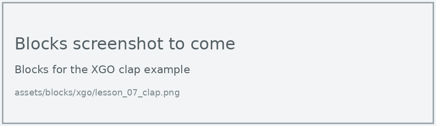
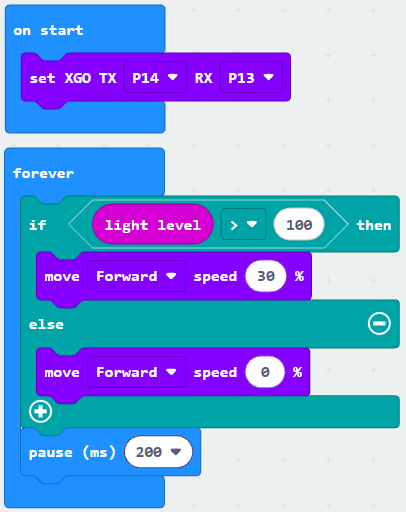
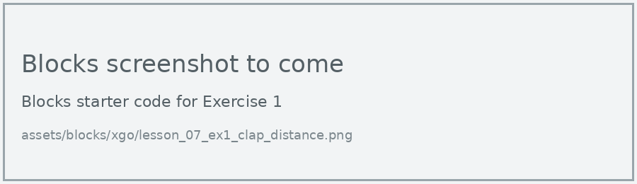

# Lesson 7: Sensor-controlled Dog

!!! learn "In this lesson we will learn"
    - how to make the dog react to a clap
    - how to use the micro:bit's light sensor
    - how a threshold turns a sensor reading into a decision

!!! terms "Terminology"
    - **light sensor** – a sensor that measures how much light is shining on it; on the micro:bit, the display LEDs do this job.

So far, we've controlled the dog with buttons. The micro:bit also has sensors, so the dog can react to what's happening around it.

## React to a clap

=== "Blocks"

    { .blocks }

    Blocks used: **on loud sound** (Input), **Execution action** and **set XGO TX RX** (xgo > Basic).

=== "Python"

    ```python linenums="1"
    --8<-- "examples/other/xgo/lesson_07_clap.py"
    ```

!!! primm "PRIMM"
    1. **Predict** what the dog will do when you clap.
    2. **Run** the program.
    3. Time to **investigate** the code. What does each line do?

??? note "Code explanation"
    - **line 1** → defines a function called `on_sound_loud`, which will run when there's a loud sound.
    - **line 2** → makes the dog sit down.
    - **line 3** → makes the dog stand up again.
    - **line 4** → connects `on_sound_loud` to the loud sound event.
    - **line 6** → tells the micro:bit which pins to use to talk to the dog.

## Light level

The micro:bit's display LEDs can also work as a **light sensor**. The **light level** block gives a number from 0 (dark) to 255 (bright). We use a **threshold** of 100: above it counts as bright, and at or below it counts as dark.

=== "Blocks"

    { .blocks }

    Blocks used: **forever** and **pause (ms)** (Basic), **if then else** and **0 > 0** (Logic), **light level** (Input), **move speed** (xgo > Sports), **set XGO TX RX** (xgo > Basic).

=== "Python"

    ```python linenums="1"
    --8<-- "examples/other/xgo/lesson_07_light_level.py"
    ```

!!! primm "PRIMM"
    1. **Predict** what the dog will do in a bright room, and when you cover the display with your hand.
    2. **Run** the program.
    3. Time to **investigate** the code. What does each line do?

??? note "Code explanation"
    - **line 1** → defines the function that the forever loop repeats.
    - **line 2** → checks whether the light level is above 100…
    - **line 3** → …and if it is, walks the dog forward at 30% speed.
    - **line 4** → otherwise…
    - **line 5** → …stops the dog.
    - **line 6** → waits 200 milliseconds before checking again.
    - **line 7** → tells the micro:bit to run `on_forever` again and again.
    - **line 9** → tells the micro:bit which pins to use to talk to the dog.

!!! tip "Choosing a threshold"
    Every room is different. Show the light level on the display first, in the light and in the dark, then choose a threshold halfway between the two readings.

## Exercises

!!! primm "PRIMM"
    Time to **modify** the code and see what happens.

Each exercise has starter code in Blocks and Python. Build the blocks in MakeCode, or copy the Python into MakeCode's Python view, then change it.

### Exercise 1

How loud does a clap need to be? Try clapping from 1, 2 and 3 metres away, and record whether the dog reacts each time.

Starter code:

=== "Blocks"

    { .blocks }

=== "Python"

    ```python linenums="1"
    --8<-- "examples/other/xgo/lesson_07_ex1_clap_distance.py"
    ```

### Exercise 2

Can you make the dog lie down (Go_prone) when it's dark, and stand up when it's bright?

Starter code:

=== "Blocks"

    { .blocks }

=== "Python"

    ```python linenums="1"
    --8<-- "examples/other/xgo/lesson_07_ex2_bedtime.py"
    ```
