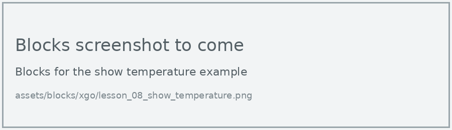
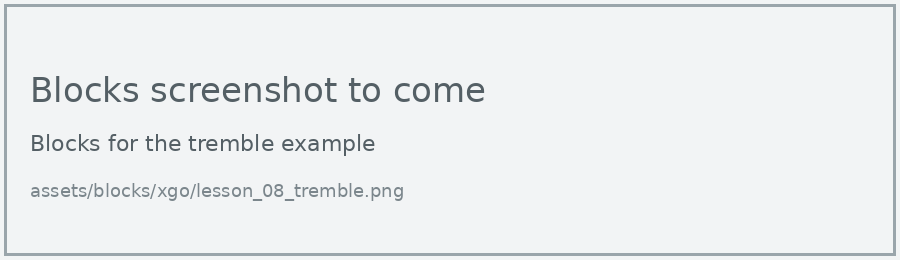
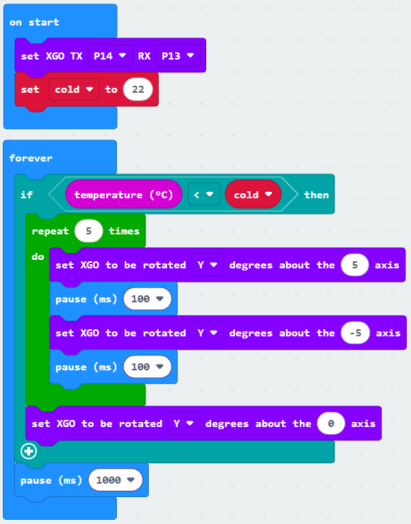

# Lesson 8: Trembling Dog

!!! learn "In this lesson we will learn"
    - how to read the micro:bit's temperature sensor
    - how to choose a threshold for our own room
    - how to make the dog tremble when it feels cold

!!! terms "Terminology"
    - **temperature sensor** – a sensor that measures how hot or cold it is, in degrees Celsius.
    - **processor** – the main chip that runs programs on the micro:bit; its temperature sensor is built inside it.

Real dogs shiver when they're cold. Let's make the XGO do the same, using the micro:bit's **temperature sensor**.

## Read the temperature

The temperature sensor is built into the micro:bit's **processor**, so it measures the temperature of the chip. That's usually a little warmer than the room.

=== "Blocks"

    { .blocks }

    Blocks used: **forever**, **show number** and **pause (ms)** (Basic), **temperature (°C)** (Input), **set XGO TX RX** (xgo > Basic).

=== "Python"

    ```python linenums="1"
    --8<-- "examples/other/xgo/lesson_08_show_temperature.py"
    ```

!!! primm "PRIMM"
    1. **Predict** what number the display will show in our classroom.
    2. **Run** the program. Then hold your palm over the micro:bit for a minute and watch the number.
    3. Time to **investigate** the code. What does each line do?

??? note "Code explanation"
    === "Blocks"

        - **on start** → runs the blocks inside once, when the program starts.
            - **set XGO TX P14 RX P13** → tells the micro:bit which pins to use to talk to the dog.
        - **forever** → runs the blocks inside again and again.
            - **show number temperature (°C)** → reads the temperature in degrees Celsius and shows it on the display.
            - **pause (ms) 1000** → waits 1 second before reading it again.

    === "Python"

        - **line 1** → defines the function that the forever loop repeats.
        - **line 2** → reads the temperature in degrees Celsius and shows it on the display.
        - **line 3** → waits 1 second before reading it again.
        - **line 4** → tells the micro:bit to run `on_forever` again and again.
        - **line 6** → tells the micro:bit which pins to use to talk to the dog.

## Tremble when cold

The dog trembles by tilting its body quickly from side to side. We store the cold threshold in a variable, `cold`, so it's easy to change for our room.

!!! warning "Remember the mixed-up rotate block"
    The drop-down after "rotated" chooses the axis, and the number before "axis" is the angle in degrees (see [Lesson 5](lesson_05.md#tilt-the-body)).

=== "Blocks"

    { .blocks }

    Blocks used: **forever** and **pause (ms)** (Basic), **if then** and **0 < 0** (Logic), **temperature (°C)** (Input), **repeat** (Loops), **set XGO to be rotated degrees about the axis** (xgo > Sports), **set XGO TX RX** (xgo > Basic), **set cold to** and **cold** (Variables).

=== "Python"

    ```python linenums="1"
    --8<-- "examples/other/xgo/lesson_08_tremble.py"
    ```

Set `cold` to 1 degree above the reading from the first example. Then cool the micro:bit down, for example by moving the dog near an air-conditioner vent or an ice pack (never touching it).

!!! primm "PRIMM"
    1. **Predict** what the dog will do when the temperature drops below `cold`.
    2. **Run** the program.
    3. Time to **investigate** the code. What does each line do?

??? note "Code explanation"
    === "Blocks"

        - **on start** → runs the blocks inside once, when the program starts.
            - **set XGO TX P14 RX P13** → tells the micro:bit which pins to use to talk to the dog.
            - **set cold to 22** → creates the `cold` variable and sets the threshold to 22 °C.
        - **forever** → runs the blocks inside again and again.
            - **if temperature (°C) < cold then** → checks whether the temperature is below `cold`…
                - **repeat 5 times** → …and if it is, starts a loop that runs 5 times.
                    - **set XGO to be rotated Y degrees about the 5 axis** → tilts the body 5 degrees one way around the Y axis.
                    - **pause (ms) 100** → waits 100 milliseconds.
                    - **set XGO to be rotated Y degrees about the -5 axis** → tilts the body 5 degrees the other way.
                    - **pause (ms) 100** → waits 100 milliseconds.
                - **set XGO to be rotated Y degrees about the 0 axis** → puts the body back to level when the trembling finishes.
            - **pause (ms) 1000** → waits 1 second before checking the temperature again.

    === "Python"

        - **line 1** → defines the function that the forever loop repeats.
        - **line 2** → checks whether the temperature is below `cold`…
        - **line 3** → …and if it is, starts a loop that runs 5 times.
        - **line 4** → tilts the body 5 degrees one way around the Y axis.
        - **line 5** → waits 100 milliseconds.
        - **line 6** → tilts the body 5 degrees the other way.
        - **line 7** → waits 100 milliseconds.
        - **line 8** → puts the body back to level when the trembling finishes.
        - **line 9** → waits 1 second before checking the temperature again.
        - **line 10** → tells the micro:bit to run `on_forever` again and again.
        - **line 12** → tells the micro:bit which pins to use to talk to the dog.
        - **line 13** → creates the `cold` variable and sets the threshold to 22 °C.

!!! warning "Keep the electronics dry"
    Never put the dog in a fridge or touch the micro:bit with ice. Water from condensation can damage the electronics.

## Exercises

!!! primm "PRIMM"
    Time to **modify** the code and see what happens.

Each exercise has starter code in Blocks and Python. Build the blocks in MakeCode, or copy the Python into MakeCode's Python view, then change it.

### Exercise 1

How warm does your hand make the micro:bit? Record the temperature before, and after 1 and 2 minutes of holding your palm over it. Then choose a value for `cold` that suits your room.

Starter code:

=== "Blocks"

    { .blocks }

=== "Python"

    ```python linenums="1"
    --8<-- "examples/other/xgo/lesson_08_ex1_threshold.py"
    ```

### Exercise 2

Can you make the dog lie down (Go_prone) if it's still cold after trembling, and stand up again when it warms up?

Starter code:

=== "Blocks"

    { .blocks }

=== "Python"

    ```python linenums="1"
    --8<-- "examples/other/xgo/lesson_08_ex2_lie_down.py"
    ```

### Exercise 3

Can you add a second threshold, `hot`, so the dog pants (shows an icon of your choice and lowers its body) when it's too warm?

Starter code:

=== "Blocks"

    { .blocks }

=== "Python"

    ```python linenums="1"
    --8<-- "examples/other/xgo/lesson_08_ex3_too_hot.py"
    ```
