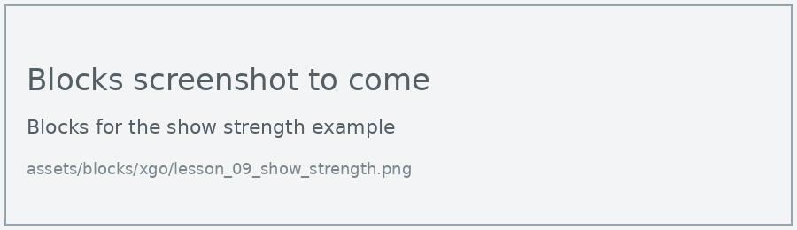
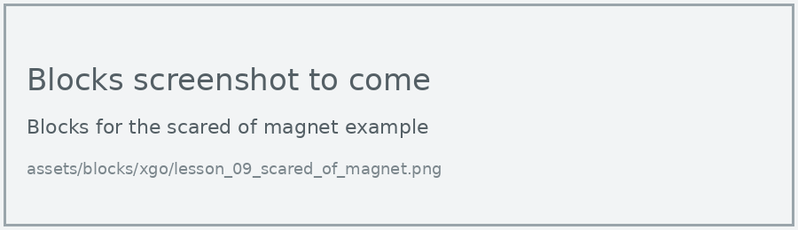

# Lesson 9: Magnet-controlled Dog

!!! learn "In this lesson we will learn"
    - how the micro:bit measures magnetic fields
    - why we measure a baseline before choosing a threshold
    - how to make the dog back away from a magnet

!!! terms "Terminology"
    - **magnetometer** – a sensor that measures magnetic fields, used by the micro:bit as a compass.
    - **magnetic field** – the invisible area of magnetic force around a magnet or the Earth.
    - **microtesla** – a unit for measuring how strong a magnetic field is; the Earth's magnetic field is about 50 microteslas.

The micro:bit has a **magnetometer**, which measures the **magnetic field** around it. When we bring a magnet close, the reading jumps. Let's use that to control the dog without touching it.

## What we need

- the XGO, with its micro:bit
- a small magnet, such as a fridge magnet

## Measure the magnetic field

The **magnetic force** block gives the strength of the magnetic field in **microteslas** (µT).

=== "Blocks"

    { .blocks }

    Blocks used: **forever**, **show number** and **pause (ms)** (Basic), **magnetic force (µT) strength** (Input > more), **set XGO TX RX** (xgo > Basic).

=== "Python"

    ```python linenums="1"
    --8<-- "examples/other/xgo/lesson_09/show_strength/main.py"
    ```

!!! primm "PRIMM"
    1. **Predict** what will happen to the number as you bring the magnet closer to the micro:bit.
    2. **Run** the program. If the display asks you to tilt the micro:bit to fill the screen, do that first.
    3. Time to **investigate** the code. What does each line do?

??? note "Code explanation"
    - **line 1** → defines the function that the forever loop repeats.
    - **line 2** → reads the strength of the magnetic field in microteslas and shows it on the display.
    - **line 3** → waits half a second before reading it again.
    - **line 4** → tells the micro:bit to run `on_forever` again and again.
    - **line 6** → tells the micro:bit which pins to use to talk to the dog.

!!! tip "Tilt to fill the screen"
    The first time a program uses the magnetometer, the micro:bit may ask us to tilt it until every LED lights up. This is calibration: it lets the micro:bit measure the Earth's magnetic field so its readings are accurate. With the micro:bit in the dog, tilt the whole dog gently, or calibrate the micro:bit before putting it in the slot.

## Scared of magnets

When the reading goes above a threshold, the dog walks backward, away from the magnet. As it moves away, the reading drops, and the dog stops.

=== "Blocks"

    { .blocks }

    Blocks used: **forever** and **pause (ms)** (Basic), **if then else** and **0 > 0** (Logic), **magnetic force (µT) strength** (Input > more), **move speed** (xgo > Sports), **set XGO TX RX** (xgo > Basic).

=== "Python"

    ```python linenums="1"
    --8<-- "examples/other/xgo/lesson_09/scared_of_magnet/main.py"
    ```

!!! primm "PRIMM"
    1. **Predict** what the dog will do when you hold the magnet near its head, then take it away.
    2. **Run** the program.
    3. Time to **investigate** the code. What does each line do?

??? note "Code explanation"
    - **line 1** → defines the function that the forever loop repeats.
    - **line 2** → checks whether the magnetic field is stronger than 200 microteslas…
    - **line 3** → …and if it is, walks the dog backward at 30% speed.
    - **line 4** → otherwise…
    - **line 5** → …stops the dog.
    - **line 6** → waits 200 milliseconds before checking again.
    - **line 7** → tells the micro:bit to run `on_forever` again and again.
    - **line 9** → tells the micro:bit which pins to use to talk to the dog.

!!! warning "Motors are magnets too"
    The dog's servo motors contain magnets, so the reading changes when the dog moves. Measure the reading with the dog standing still and walking, then choose a threshold well above both.

## Exercises

!!! primm "PRIMM"
    Time to **modify** the code and see what happens.

Each exercise has starter code. Copy it into MakeCode's Python view, or build the same program in Blocks, then change it.

### Exercise 1

What's the reading with no magnet near, and how much does it change while the dog walks? Record both, then choose a better threshold. This starting reading is called a baseline.

Starter code:

```python linenums="1"
--8<-- "examples/other/xgo/lesson_09/ex1_baseline/main.py"
```

### Exercise 2

Can you make the dog sit down when the magnet is held above its head, and stand up when it's taken away?

Starter code:

```python linenums="1"
--8<-- "examples/other/xgo/lesson_09/ex2_follow/main.py"
```

### Exercise 3

The magnetic force block can also measure in the x and y directions. Can you make the dog turn away from a magnet held on its left or its right? Hint: try **magnetic force (µT) x** and see whether it goes up or down on each side.

Starter code:

```python linenums="1"
--8<-- "examples/other/xgo/lesson_09/ex3_sides/main.py"
```
