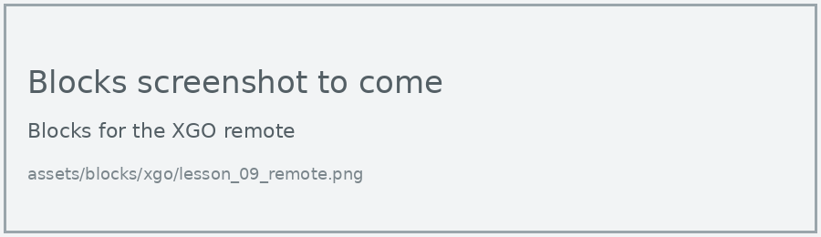
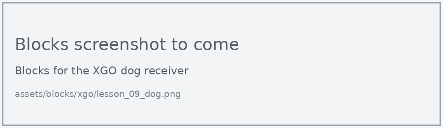

# Lesson 9: Radio Remote

!!! learn "In this lesson we will learn"
    - how to send numbers by radio from one micro:bit to another
    - how to program a second micro:bit as a remote control for the dog
    - how the dog decides what to do with each number

In the PU Robot lessons, the extension had its own remote control blocks. The XGO doesn't, so we use the micro:bit's own **Radio** blocks. The remote sends a number, and the dog decides what to do with it.

## What we need

- the XGO, with its micro:bit
- a second micro:bit V2 to use as the remote, with a battery pack

!!! warning "Each pair needs its own radio group"
    Every pair needs a different radio group number, used in both programs. Otherwise one remote will control several dogs.

## The remote

=== "Blocks"

    { .blocks }

    Blocks used: **on button pressed** (Input), **radio send number** and **radio set group** (Radio).

=== "Python"

    ```python linenums="1"
    --8<-- "examples/other/xgo/lesson_09/remote/main.py"
    ```

??? note "Code explanation"
    - **line 1** → defines a function called `on_button_pressed_a`, which will run when button A is pressed.
    - **line 2** → sends the number 1 by radio.
    - **line 3** → connects `on_button_pressed_a` to button A.
    - **line 5** → defines a function called `on_button_pressed_b`, which will run when button B is pressed.
    - **line 6** → sends the number 0 by radio.
    - **line 7** → connects `on_button_pressed_b` to button B.
    - **line 9** → sets the remote's radio group to 42.

## The dog

=== "Blocks"

    { .blocks }

    Blocks used: **on radio received receivedNumber** and **radio set group** (Radio), **if then else** and **0 = 0** (Logic), **move speed** (xgo > Sports), **set XGO TX RX** (xgo > Basic).

=== "Python"

    ```python linenums="1"
    --8<-- "examples/other/xgo/lesson_09/dog/main.py"
    ```

Download each program to its own micro:bit, then switch the dog on.

!!! primm "PRIMM"
    1. **Predict** what the dog will do when you press A on the remote, then B.
    2. **Run** both programs.
    3. Time to **investigate** the code. What does each line do?

??? note "Code explanation"
    - **line 1** → defines a function called `on_received_number`, which gets the number that arrived in `receivedNumber`.
    - **line 2** → checks whether the number is 1…
    - **line 3** → …and if it is, walks the dog forward at 50% speed.
    - **line 4** → otherwise…
    - **line 5** → …stops the dog.
    - **line 6** → connects `on_received_number` to the event of a number arriving by radio.
    - **line 8** → tells the micro:bit which pins to use to talk to the dog.
    - **line 9** → sets the dog's radio group to 42, the same as the remote.

## Exercises

!!! primm "PRIMM"
    Time to **modify** the code and see what happens.

Each exercise has starter code. Copy it into MakeCode's Python view, or build the same program in Blocks, then change it.

### Exercise 1

Can you change 42 to your pair's radio group in both programs, and test that your remote only controls your dog?

Starter code:

```python linenums="1"
--8<-- "examples/other/xgo/lesson_09/ex1_group/main.py"
```

### Exercise 2

Can you add turning left and right? Send 2 when A and B are pressed together, and 3 when the logo is touched. Hint: on the dog, add **else if** for each new number.

Starter code:

```python linenums="1"
--8<-- "examples/other/xgo/lesson_09/ex2_turning/main.py"
```

### Exercise 3

Can you steer the dog by tilting the remote? Hint: send the remote's **acceleration (mg) x** as a number, and turn the dog left or right when it's past a threshold.

Starter code:

```python linenums="1"
--8<-- "examples/other/xgo/lesson_09/ex3_tilt/main.py"
```

### Exercise 4

Can you add a gesture on the remote, such as shaking it, that makes the dog do a built-in action?

Starter code:

```python linenums="1"
--8<-- "examples/other/xgo/lesson_09/ex4_action/main.py"
```
