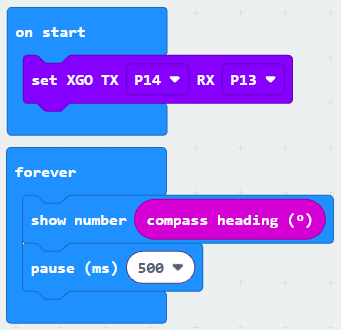
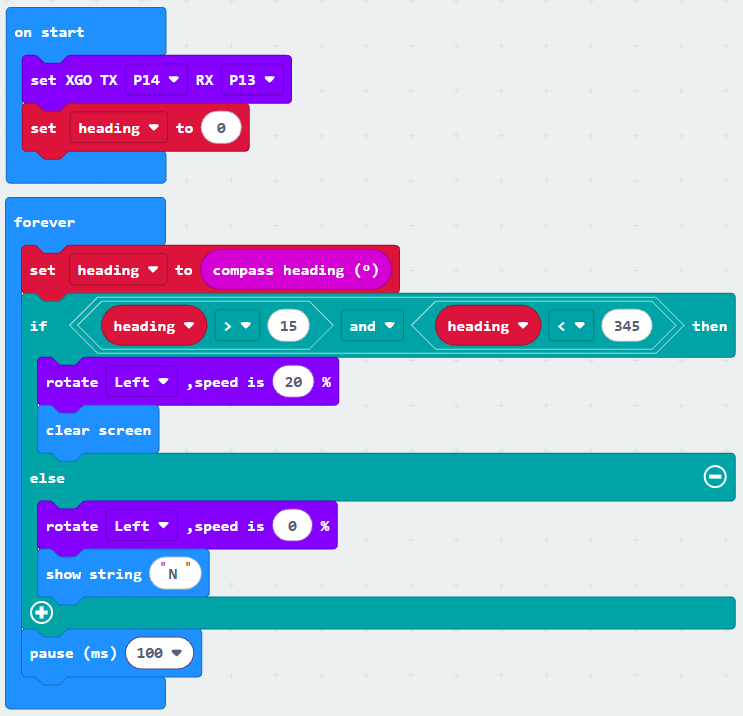
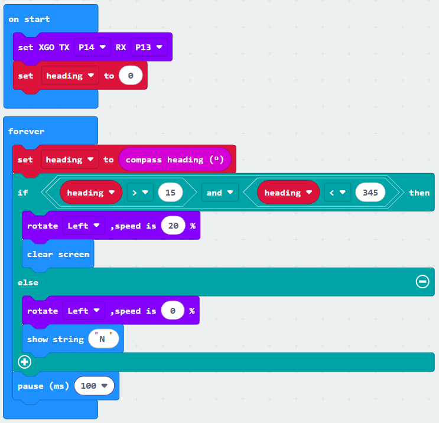
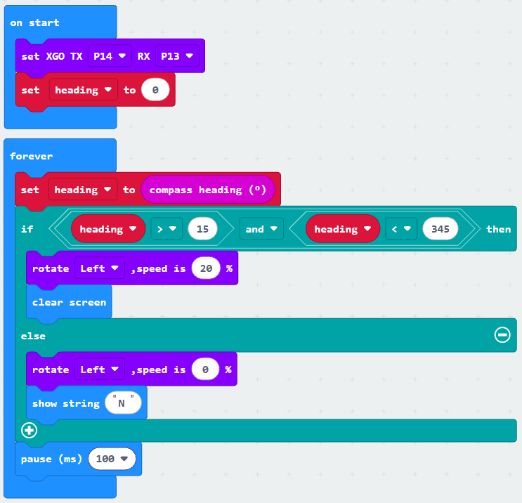

# Lesson 10: Compass and Treasure Hunt

!!! learn "In this lesson we will learn"
    - how the micro:bit works out which way it's facing
    - how to use **and** to check that a value is inside a range
    - how to make the dog turn until it faces north
    - how to follow compass directions to find treasure

!!! terms "Terminology"
    - **heading** – the direction the top of the micro:bit is pointing, measured in degrees from 0 to 359.
    - **and operator** – a Boolean operator that gives back `True` only if every value is `True`.

In Lesson 9, the magnetometer measured the field around a magnet. It can also measure the Earth's own magnetic field, which turns the micro:bit into a compass. Let's use it to give the dog a sense of direction.

## Read the heading

The **compass heading** block gives the dog's **heading**: 0 is north, 90 is east, 180 is south and 270 is west.

=== "Blocks"

    { .blocks }

    Blocks used: **forever**, **show number** and **pause (ms)** (Basic), **compass heading (°)** (Input), **set XGO TX RX** (xgo > Basic).

=== "Python"

    ```python linenums="1"
    --8<-- "examples/other/xgo/lesson_10_show_heading.py"
    ```

!!! primm "PRIMM"
    1. **Predict** what number the display will show when the dog faces the classroom door.
    2. **Run** the program. Calibrate first if the display asks you to tilt the micro:bit. Then turn the dog slowly in a full circle.
    3. Time to **investigate** the code. What does each line do?

??? note "Code explanation"
    === "Blocks"

        - **on start** → runs the blocks inside once, when the program starts.
            - **set XGO TX P14 RX P13** → tells the micro:bit which pins to use to talk to the dog.
        - **forever** → runs the blocks inside again and again.
            - **show number compass heading (°)** → reads the compass heading in degrees and shows it on the display.
            - **pause (ms) 500** → waits half a second before reading it again.

    === "Python"

        - **line 1** → defines the function that the forever loop repeats.
        - **line 2** → reads the compass heading in degrees and shows it on the display.
        - **line 3** → waits half a second before reading it again.
        - **line 4** → tells the micro:bit to run `on_forever` again and again.
        - **line 6** → tells the micro:bit which pins to use to talk to the dog.

## Face north

North is a heading of 0, but the heading jumps from 359 straight to 0, so north is close to both ends. We count anything up to 15 degrees either side of north as facing north. So the dog needs to keep turning while the heading is more than 15 **and** less than 345.

=== "Blocks"

    { .blocks }

    Blocks used: **forever**, **clear screen**, **show string** and **pause (ms)** (Basic), **set heading to** and **heading** (Variables), **compass heading (°)** (Input), **if then else**, **and** and **0 > 0** (Logic), **rotate speed** (xgo > Sports), **set XGO TX RX** (xgo > Basic).

=== "Python"

    ```python linenums="1"
    --8<-- "examples/other/xgo/lesson_10_face_north.py"
    ```

!!! primm "PRIMM"
    1. **Predict** what the dog will do when it starts facing south.
    2. **Run** the program.
    3. Time to **investigate** the code. What does each line do?

??? note "Code explanation"
    === "Blocks"

        - **on start** → runs the blocks inside once, when the program starts.
            - **set XGO TX P14 RX P13** → tells the micro:bit which pins to use to talk to the dog.
            - **set heading to 0** → creates the `heading` variable and sets it to 0.
        - **forever** → runs the blocks inside again and again.
            - **set heading to compass heading (°)** → reads the compass heading once and stores it in `heading`.
            - **if heading > 15 and heading < 345 then** → checks whether the heading is more than 15 and less than 345, which means the dog isn't facing north…
                - **rotate Left, speed is 20 %** → …and if so, keeps turning left at 20% speed…
                - **clear screen** → …and clears the display.
            - **else** → otherwise, the dog is facing north…
                - **rotate Left, speed is 0 %** → …so it stops turning…
                - **show string "N"** → …and shows N on the display.
            - **pause (ms) 100** → waits 100 milliseconds before checking again.

    === "Python"

        - **line 1** → defines the function that the forever loop repeats.
        - **line 2** → tells Python to use the `heading` variable from the main program.
        - **line 3** → reads the compass heading once and stores it in `heading`.
        - **line 4** → checks whether the heading is more than 15 and less than 345, which means the dog isn't facing north…
        - **line 5** → …and if so, keeps turning left at 20% speed…
        - **line 6** → …and clears the display.
        - **line 7** → otherwise, the dog is facing north…
        - **line 8** → …so it stops turning…
        - **line 9** → …and shows N on the display.
        - **line 10** → waits 100 milliseconds before checking again.
        - **line 11** → tells the micro:bit to run `on_forever` again and again.
        - **line 13** → tells the micro:bit which pins to use to talk to the dog.
        - **line 14** → creates the `heading` variable and sets it to 0.

!!! warning "Metal confuses the compass"
    Steel table legs, laptops and the dog's own servo motors all affect the magnetometer. If the dog stops facing the wrong way, move it away from metal, calibrate again, and test on the floor.

## Exercises

!!! primm "PRIMM"
    Time to **modify** the code and see what happens.

Each exercise has starter code in Blocks and Python. Build the blocks in MakeCode, or copy the Python into MakeCode's Python view, then change it.

### Exercise 1

Can you change the program so the dog turns to face east (90 degrees) instead? Hint: east is in the middle of the range, so we don't need to worry about the jump from 359 to 0.

Starter code:

=== "Blocks"

    { .blocks }

=== "Python"

    ```python linenums="1"
    --8<-- "examples/other/xgo/lesson_10_ex1_face_east.py"
    ```

### Exercise 2

The dog always turns left, even when turning right would be quicker. Can you make it turn right when the heading is less than 180, and left when it's more?

Starter code:

=== "Blocks"

    { .blocks }

=== "Python"

    ```python linenums="1"
    --8<-- "examples/other/xgo/lesson_10_ex2_shortest_turn.py"
    ```

### Exercise 3

Can you program a treasure hunt? Hide a "treasure" in the room, then write directions from a start mark, such as: face north and walk for 3 seconds, face east and walk for 2 seconds. It should:

- turn to face each direction using the compass
- walk for a set time in that direction
- show a heart when it reaches the treasure

Swap directions with another group and see whether their dog finds your treasure.

Starter code:

=== "Blocks"

    { .blocks }

=== "Python"

    ```python linenums="1"
    --8<-- "examples/other/xgo/lesson_10_ex3_treasure_hunt.py"
    ```
