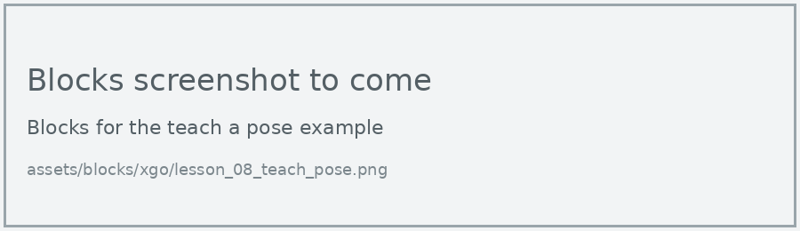
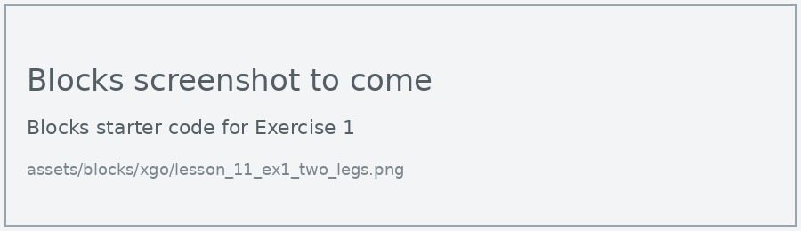
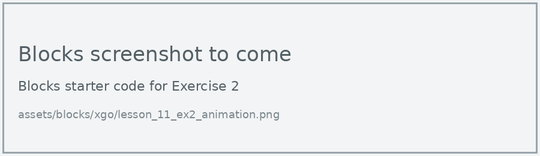

# Lesson 11: Teach a Pose

!!! learn "In this lesson we will learn"
    - how to switch a leg's servo motors off so we can move it by hand
    - how to record the dog's position as a pose
    - how to replay a recorded pose

!!! terms "Terminology"
    - **unload** – to switch off a servo motor's power so it goes floppy and can be moved by hand.
    - **pose** – the position of all the robot's joints at one moment, which can be saved and returned to later.

Instead of working out joint angles in code, we can teach the dog a position by moving its leg with our hands, then record it. The XGO can store up to five **poses**.

## Record and replay a pose

=== "Blocks"

    { .blocks }

    Blocks used: **on button pressed** and **on logo pressed** (Input), **set XGO leg servo**, **Record the current status of the XGO as** and **Setting the XGO to state** (xgo > Set Servo), **restore initial action** and **set XGO TX RX** (xgo > Basic).

=== "Python"

    ```python linenums="1"
    --8<-- "examples/other/xgo/lesson_11/teach_pose/main.py"
    ```

Run the program in this order:

1. Press A. The left front leg goes floppy, so support the dog with our other hand.
2. Gently move that leg into a new position, such as raised in the air.
3. Press B to record the pose. The leg holds its position again, then the dog goes back to standing.
4. Touch the logo to replay the pose.

!!! primm "PRIMM"
    1. **Predict** what the dog will do when you touch the logo.
    2. **Run** the program, following the steps above.
    3. Time to **investigate** the code. What does each line do?

??? note "Code explanation"
    - **line 1** → defines a function called `on_button_pressed_a`, which will run when button A is pressed.
    - **line 2** → unloads the left front leg's servo motors, so we can move the leg by hand.
    - **line 3** → connects `on_button_pressed_a` to button A.
    - **line 5** → defines a function called `on_button_pressed_b`, which will run when button B is pressed.
    - **line 6** → records the position of every joint as pose 1.
    - **line 7** → loads the left front leg's servo motors again.
    - **line 8** → puts the dog back in its starting position.
    - **line 9** → connects `on_button_pressed_b` to button B.
    - **line 11** → defines a function called `on_logo_pressed`, which will run when the logo is touched.
    - **line 12** → moves every joint to the positions saved in pose 1.
    - **line 13** → connects `on_logo_pressed` to touching the logo.
    - **line 15** → tells the micro:bit which pins to use to talk to the dog.

!!! warning "Move the leg gently"
    An unloaded leg moves freely, but it's still connected to gears inside the servo motor. Move it slowly and don't force it past where it wants to stop.

!!! tip "Check the Python names in MakeCode"
    The Python names of the pose blocks (`get_posestate` and `set_posestate`) haven't been checked in MakeCode yet. If MakeCode shows a different name, use MakeCode's.

## Exercises

!!! primm "PRIMM"
    Time to **modify** the code and see what happens.

Each exercise has starter code in Blocks and Python. Build the blocks in MakeCode, or copy the Python into MakeCode's Python view, then change it.

### Exercise 1

Can you teach the dog a pose that uses two legs? Unload both front legs, move them, then record the pose.

Starter code:

=== "Blocks"

    { .blocks }

=== "Python"

    ```python linenums="1"
    --8<-- "examples/other/xgo/lesson_11/ex1_two_legs/main.py"
    ```

### Exercise 2

Can you record 3 different poses and play them one after another as an animation? Use pose 1, pose 2 and pose 3, with a pause between each.

Starter code:

=== "Blocks"

    { .blocks }

=== "Python"

    ```python linenums="1"
    --8<-- "examples/other/xgo/lesson_11/ex2_animation/main.py"
    ```

### Exercise 3

What happens to a recorded pose when the dog is switched off and on again? Test it and explain what this tells us about where the pose is stored.

Starter code:

=== "Blocks"

    { .blocks }

=== "Python"

    ```python linenums="1"
    --8<-- "examples/other/xgo/lesson_11/ex3_memory/main.py"
    ```
