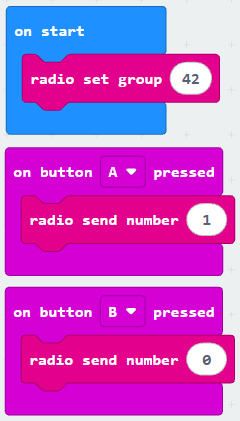
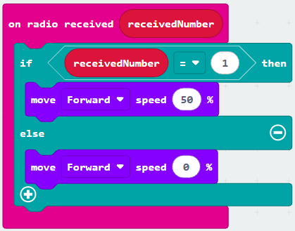
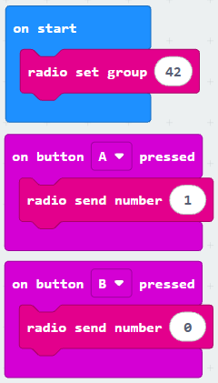
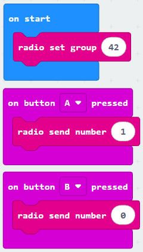

# Lesson 12: Radio Remote

!!! learn "In this lesson we will learn"
    - how to send numbers by radio from one micro:bit to another
    - how to program a second micro:bit as a remote control for the dog
    - how the dog decides what to do with each number

In the PU Robot lessons, the extension had its own remote control blocks. The XGO doesn't, so we use the micro:bit's own **Radio** blocks. The remote sends a number, and the dog decides what to do with it.

## What we need

- the XGO, with its micro:bit
- a second micro:bit V2 to use as the remote, with a battery pack

!!! warning "Each pair needs its own radio group"
    A radio remote needs two micro:bits: the one in the dog and a second micro:bit as the remote. They only hear each other when both programs use the same **radio group**.

    Every micro:bit in the room that is on the same radio group hears every message sent on it, whatever robot it belongs to. With more than one robot running in the class, two pairs on the same group means one remote controls both dogs. Before we download, we check with the other pairs and choose a group number from 0 to 255 that nobody else is using. Then we change 42 to that number in both programs.

## The remote

=== "Blocks"

    { .blocks }

    Blocks used: **on button pressed** (Input), **radio send number** and **radio set group** (Radio).

=== "Python"

    ```python linenums="1"
    --8<-- "examples/other/xgo/lesson_12_remote.py"
    ```

??? note "Code explanation"
    === "Blocks"

        - **on start** → runs the blocks inside once, when the program starts.
            - **radio set group 42** → sets the remote's radio group to 42.
        - **on button A pressed** → runs the blocks inside when we press button A.
            - **radio send number 1** → sends the number 1 by radio.
        - **on button B pressed** → runs the blocks inside when we press button B.
            - **radio send number 0** → sends the number 0 by radio.

    === "Python"

        - **line 1** → defines a function called `on_button_pressed_a`, which will run when button A is pressed.
        - **line 2** → sends the number 1 by radio.
        - **line 3** → connects `on_button_pressed_a` to button A.
        - **line 5** → defines a function called `on_button_pressed_b`, which will run when button B is pressed.
        - **line 6** → sends the number 0 by radio.
        - **line 7** → connects `on_button_pressed_b` to button B.
        - **line 9** → sets the remote's radio group to 42.

## The dog

=== "Blocks"

    { .blocks }

    Blocks used: **on radio received receivedNumber** and **radio set group** (Radio), **if then else** and **0 = 0** (Logic), **move speed** (xgo > Sports), **set XGO TX RX** (xgo > Basic).

=== "Python"

    ```python linenums="1"
    --8<-- "examples/other/xgo/lesson_12_dog.py"
    ```

Download each program to its own micro:bit, then switch the dog on.

!!! primm "PRIMM"
    1. **Predict** what the dog will do when you press A on the remote, then B.
    2. **Run** both programs.
    3. Time to **investigate** the code. What does each line do?

??? note "Code explanation"
    === "Blocks"

        - **on start** → runs the blocks inside once, when the program starts.
            - **set XGO TX P14 RX P13** → tells the micro:bit which pins to use to talk to the dog.
            - **radio set group 42** → sets the dog's radio group to 42, the same as the remote.
        - **on radio received receivedNumber** → runs the blocks inside when a number arrives by radio, and stores it in `receivedNumber`.
            - **if receivedNumber = 1 then** → checks whether the number is 1…
                - **move Forward speed 50 %** → …and if it is, walks the dog forward at 50% speed.
            - **else** → otherwise…
                - **move Forward speed 0 %** → …stops the dog.

    === "Python"

        - **line 1** → defines a function called `on_received_number`, which gets the number that arrived in `receivedNumber`.
        - **line 2** → checks whether the number is 1…
        - **line 3** → …and if it is, walks the dog forward at 50% speed.
        - **line 4** → otherwise…
        - **line 5** → …stops the dog.
        - **line 6** → connects `on_received_number` to the event of a number arriving by radio.
        - **line 8** → tells the micro:bit which pins to use to talk to the dog.
        - **line 9** → sets the dog's radio group to 42, the same as the remote.

## Exercises

!!! primm "PRIMM"
    Time to **modify** the code and see what happens.

Each exercise has starter code in Blocks and Python. Build the blocks in MakeCode, or copy the Python into MakeCode's Python view, then change it.

### Exercise 1

Can you change 42 to your pair's radio group in both programs, and test that your remote only controls your dog?

Starter code:

=== "Blocks"

    { .blocks }

=== "Python"

    ```python linenums="1"
    --8<-- "examples/other/xgo/lesson_12_ex1_group.py"
    ```

### Exercise 2

Can you add turning left and right? Send 2 when A and B are pressed together, and 3 when the logo is touched. Hint: on the dog, add **else if** for each new number.

Starter code:

=== "Blocks"

    { .blocks }

=== "Python"

    ```python linenums="1"
    --8<-- "examples/other/xgo/lesson_12_ex2_turning.py"
    ```

### Exercise 3

Can you steer the dog by tilting the remote? Hint: send the remote's **acceleration (mg) x** as a number, and turn the dog left or right when it's past a threshold.

Starter code:

=== "Blocks"

    { .blocks }

=== "Python"

    ```python linenums="1"
    --8<-- "examples/other/xgo/lesson_12_ex3_tilt.py"
    ```

### Exercise 4

Can you add a gesture on the remote, such as shaking it, that makes the dog do a built-in action?

Starter code:

=== "Blocks"

    { .blocks }

=== "Python"

    ```python linenums="1"
    --8<-- "examples/other/xgo/lesson_12_ex4_action.py"
    ```
