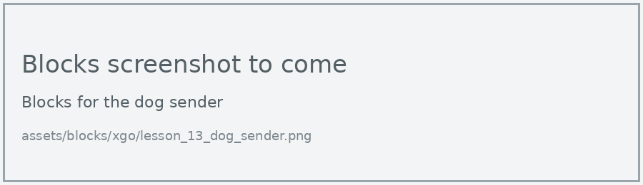
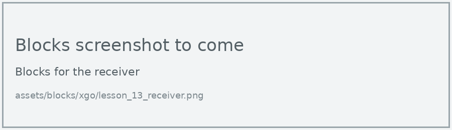
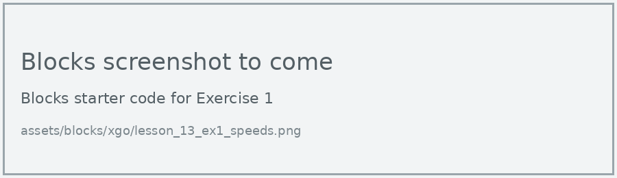
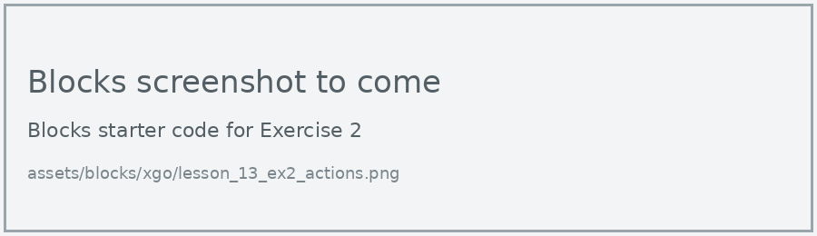
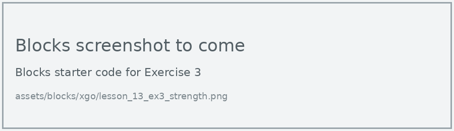

# Lesson 13: Sense the Feelings

!!! learn "In this lesson we will learn"
    - how to send sensor readings from the dog to a computer by radio
    - how to graph live data in MakeCode and download it as a CSV file
    - how to use a spreadsheet to compare the dog's movements

!!! terms "Terminology"
    - **data logging** – recording sensor readings over time so we can study them later.
    - **CSV** – short for comma-separated values, a file that stores a table of data as text with commas between the values, which a spreadsheet can open.

!!! tip "An extension lesson"
    This lesson brings together radio, sensors and data, and suits Years 9 and 10 or anyone who has finished the other XGO lessons.

How does the dog "feel" when it walks, turns or does an action? We can't ask it, but its micro:bit's accelerometer feels every bump and tilt. In this lesson the dog sends its accelerometer readings by radio to a second micro:bit plugged into the computer, and we graph them. This is called **data logging**.

## What we need

- the XGO, with its micro:bit
- a second micro:bit V2, connected to the computer by USB
- a computer with Chrome or Edge, and a spreadsheet app such as Excel

## The dog

The dog sends its x, y and z acceleration ten times a second. Buttons A and B start and stop it walking.

=== "Blocks"

    { .blocks }

    Blocks used: **on button pressed** (Input), **move speed** (xgo > Sports), **forever** and **pause (ms)** (Basic), **radio send value** and **radio set group** (Radio), **acceleration (mg)** (Input), **set XGO TX RX** (xgo > Basic).

=== "Python"

    ```python linenums="1"
    --8<-- "examples/other/xgo/lesson_13/dog_sender/main.py"
    ```

??? note "Code explanation"
    - **line 1** → defines a function called `on_button_pressed_a`, which will run when button A is pressed.
    - **line 2** → starts the dog walking forward at 50% speed.
    - **line 3** → connects `on_button_pressed_a` to button A.
    - **line 5** → defines a function called `on_button_pressed_b`, which will run when button B is pressed.
    - **line 6** → stops the dog.
    - **line 7** → connects `on_button_pressed_b` to button B.
    - **line 9** → defines the function that the forever loop repeats.
    - **line 10** → sends the x acceleration by radio, labelled "x".
    - **line 11** → sends the y acceleration, labelled "y".
    - **line 12** → sends the z acceleration, labelled "z".
    - **line 13** → waits 100 milliseconds, so it sends about 10 readings a second.
    - **line 14** → tells the micro:bit to run `on_forever` again and again.
    - **line 16** → tells the micro:bit which pins to use to talk to the dog.
    - **line 17** → sets the radio group to 42.

## The receiver

The receiver passes each reading it hears on to the computer through the USB cable, using serial communication.

=== "Blocks"

    { .blocks }

    Blocks used: **on radio received name value** and **radio set group** (Radio), **serial write value** (Advanced > Serial).

=== "Python"

    ```python linenums="1"
    --8<-- "examples/other/xgo/lesson_13/receiver/main.py"
    ```

Download each program to its own micro:bit. Keep the receiver plugged in, and connect it to MakeCode with WebUSB (see [Using MakeCode](../using-makecode.md#option-a-connect-with-webusb)).

!!! primm "PRIMM"
    1. **Predict** which of x, y and z will change the most when the dog walks forward.
    2. **Run** both programs. Under the simulator, select **Show data Device** to see the live graph, then press A on the dog, wait 10 seconds and press B.
    3. Time to **investigate** the code. What does each line do?

??? note "Code explanation"
    - **line 1** → defines a function called `on_received_value`, which gets the label in `name` and the reading in `value`.
    - **line 2** → sends the label and the reading to the computer through the USB cable.
    - **line 3** → connects `on_received_value` to the event of a labelled value arriving by radio.
    - **line 5** → sets the radio group to 42, the same as the dog.

## Download and graph the data

1. In the data view, select the download button.
    - Why: this saves every reading as a **CSV** file we can open in a spreadsheet.
    - Result: a `.csv` file is saved to the Downloads folder.
2. Open the CSV file in Excel or another spreadsheet app.
    - Result: there's a time column and a column for each of x, y and z.
3. Select the time column and one acceleration column, then insert a scatter chart.
    - Result: a graph shows how that acceleration changed while the dog walked.

!!! tip "Each pair needs its own radio group"
    If two dogs send on the same radio group, the receiver graphs both dogs' readings mixed together. Change 42 in both programs to our pair's group.

## Exercises

!!! primm "PRIMM"
    Time to **modify** the code and see what happens.

Each exercise has starter code in Blocks and Python. Build the blocks in MakeCode, or copy the Python into MakeCode's Python view, then change it.

### Exercise 1

How does walking speed change the readings? Log the dog walking at 20%, 50% and 80% speed, graph each one, and describe the differences.

Starter code:

=== "Blocks"

    { .blocks }

=== "Python"

    ```python linenums="1"
    --8<-- "examples/other/xgo/lesson_13/ex1_speeds/main.py"
    ```

### Exercise 2

Can you log the dog doing three built-in actions (such as Wave, Squat and Twirl_Roll) and work out which action shakes the micro:bit the most?

Starter code:

=== "Blocks"

    { .blocks }

=== "Python"

    ```python linenums="1"
    --8<-- "examples/other/xgo/lesson_13/ex2_actions/main.py"
    ```

### Exercise 3

Can you send one combined reading instead of three, using **acceleration (mg) strength**, and use it to rank how "excited" the dog is during each movement?

Starter code:

=== "Blocks"

    { .blocks }

=== "Python"

    ```python linenums="1"
    --8<-- "examples/other/xgo/lesson_13/ex3_strength/main.py"
    ```
